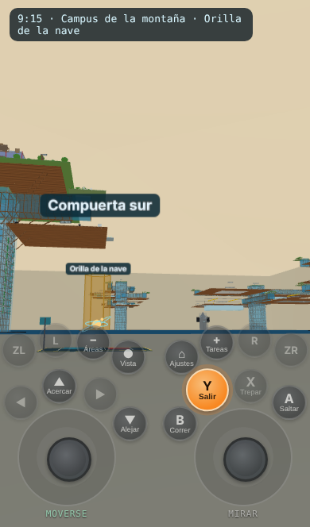
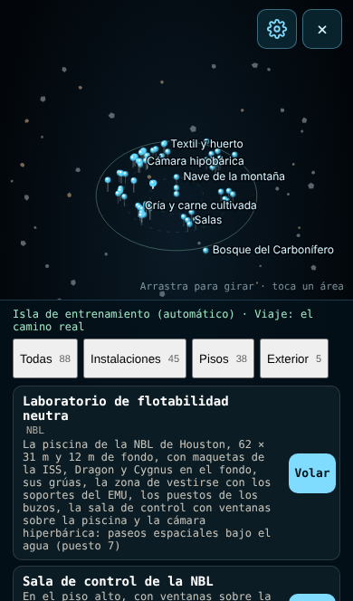
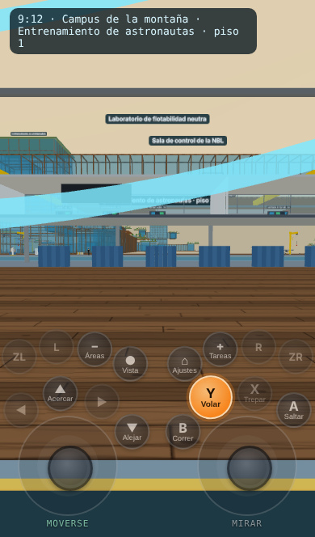
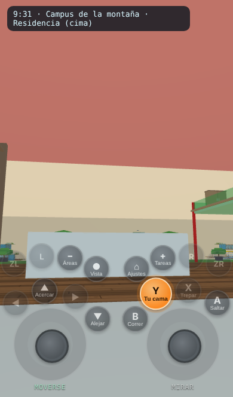
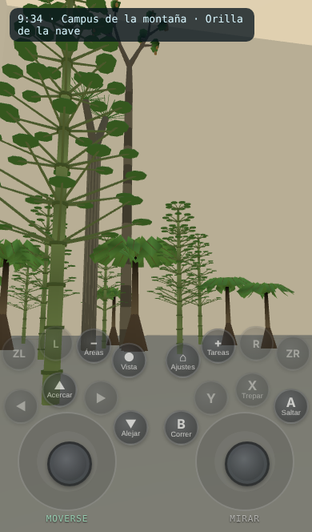
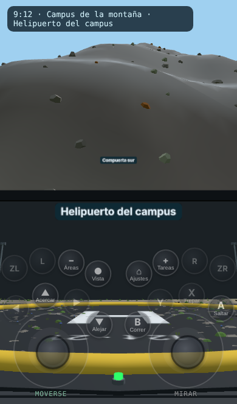

# La montaña del santuario 3 por dentro: la nave excavada (Berón, 2026-11-25; rehecha el 2026-11-28)

> «Los edificios de sanctuary3 no veo que se parezcan a los de coldsanctuary1… tomar los de sanctuary1 y migrarlos tal
> cual dentro de la montaña, y luego… agregar los pisos especiales de sanctuary3… los de entrenamiento para ser
> astronauta… el interior baja más del nivel del mar, como si se hubiera excavado… más ancho para que exista mayor
> espacio entre edificios y con la abeja… el interior de la montaña podría ser un cambio de escena? En lugar de cuevas se
> colocarían compuertas, y todos los insectos gigantes estarían dentro… volver a dejar sobre la montaña su flora y
> fauna real… las alfombras de las entradas… llevan a cualquier edificio directamente.» (Berón, 2026-11-28)

Todo es **ficción** (la nave, los edificios-árbol de Cold Sanctuary); las salas de entrenamiento y los servicios son
**reales** (cada uno con su fuente en `data/layout.ts` y `data/campus.ts`). Código: `data/montana.ts` (la nave, sus
edificios, compuertas, orilla, alfombras, Starship), `data/bioma-island.ts` (las compuertas en la cara sur),
`sanctuary-one/data/layout.ts` `buildTowers` (los edificios del santuario 1, el mismo código), `data/campus.ts`
(`CAMPUS_IN_S1`), `adapters/three/s3-mountain.ts` (muros, techo, fondo, Starship) y `adapters/three/s1-models.ts` (los
edificios, dibujados por el santuario 1). Pruebas: `data/montana.test.ts`, `data/caidas.test.ts`, `data/layout.test.ts`,
`application/hall-geo.test.ts`.

## Otra escena

La nave está en una parte del plano solo suya (`NAVE`, centro en (9000, 9000), a más de 2 km de toda isla): fuera se ven
las islas y la montaña **maciza**; dentro, solo la nave. `aerial-sanctuary.ts` tiene dos raíces (`fuera`, `dentro`) y
**solo dibuja la de donde está ella** (la otra, oculta, no se pinta): al pasar una compuerta, teletransportarse o cargar
una partida, sale la pantalla de carga un momento (la de siempre, `ui/loading-screen.ts`) y cambian el fondo, la niebla y
la luz. Ella, las alfombras, los entrenadores y los escenarios de los puestos siguen en la escena, cada uno donde está.
No se copió el patrón de escenas separadas de la nave espacial (`main.ts` `present`): habría que reparentar a ella y todo
lo que la acompaña en cada paso; ocultar la otra raíz cuesta lo mismo al dibujar.

## La nave

- **1280 m de lado** (`INNER_HALF` 640: más que los 520 m de la pirámide; Berón: «más ancho»), muros hasta 200 m y techo
  piramidal hasta 330 m sobre el mar (`ceilingAt`).
- **Excavada 40 m bajo el mar** (`bottomY` −40): el lago (`lago-montana`) es tan hondo como el mar del santuario 1 bajo
  sus edificios, y se dibuja como ese mar.
- **Luz**: pareja de todos lados (hemisférica ×2, sol casi apagado), niebla del color de los muros: sin sombras.
- **Centro libre** (`CENTRE_FREE_M` 45 m, E16): ahí está la pupa de la abeja ([pupa-abeja.md](pupa-abeja.md)).
- **Orilla** (`SHORE`): una franja de roca al nivel del lago a lo largo de los muros (de 520 m del centro al muro), fuera
  del anillo de edificios: el suelo de los insectos gigantes y del bosque del Carbonífero; en ella atracan las compuertas.
- **Caídas**: dentro, sin límite (`dropLimit`): de un piso se cae al de abajo o al agua (`caidas.test.ts`); fuera, 10 m.

## Los edificios del santuario 1, tal cual

Los cinco edificios-árbol del santuario 1 (Servicios, Entrenamiento, Ciencias con su cima, Producción y el Árbol de los
Campos) con **sus pisos, muebles, troncos de agua, anillos, bases y estaciones**, a sus mismas distancias del centro:
`buildTowers` (el mismo código que construye el santuario 1, sin casquetes, mar ni globo) y `buildS1Scene` los dibuja.
`montana.test.ts` comprueba que son los mismos (pisos, alturas, cima). Sus reglas: [edificios-y-pisos.md](edificios-y-pisos.md).

**Pisos de entrenamiento** (los «pisos especiales» del santuario 3): dos edificios-árbol más con las reglas del santuario
1 (`TRAINING_TOWERS`), al oeste, en el hueco del anillo. Cada piso crece a la medida de su sala (`TowerSpec.square`) y la
sala real se construye encima (`buildRoom`; el suelo del piso se abre donde está: la piscina de la NBL baja por él).

| Edificio | Pisos (de abajo arriba) |
|---|---|
| Entrenamiento de astronautas | NBL · SVMF (maquetas) · centrífuga · supervivencia |
| Simuladores y control | gimnasio + trajes · simuladores Dragon + LM · robótica + control · centro médico · criadero |

**Criadero de insectos gigantes** (la sala «crianza», Berón: «el criadero será para domesticar a estos insectos
gigantes»): insectario, colmenas y cámaras de cría; aquí se crían y amansan los insectos de la nave (ficción sobre salas
reales de cría de insectos).

**Servicios del campus en los pisos del santuario 1 que los hacen** (`CAMPUS_IN_S1`): dormir en un aposento libre de la
cima de Ciencias (en la litera: `MachineDef.seat`), comer en el comedor del piso 1 de Servicios (sentada a la mesa),
clínica en el hospital de aislamiento, aulas y biblioteca en la cima de Ciencias, laboratorio en sus laboratorios,
huerto en el piso de textil y huerto de Producción, taller en su mecánica, asambleas en la sala de comisión de
Servicios. Sus retos son los de siempre (`CAMPUS_RETOS`).

**Caminos por un piso amueblado** (`domain/floor-way.ts`): rodean los muebles por una rejilla de 0,5 m con medio cuerpo de
margen y guardan solo las esquinas; así «Ir» llega de la estación a cada sala o mueble sin atravesar nada.

## Compuertas (regla E14)

Tres compuertas de acero en la cara sur (sur, con el helipuerto del campus en su explanada; suroeste; sureste), en lugar
de las cuevas: la montaña ya no tiene túneles. **Tamaño**: el mayor animal del santuario + 2 m a cada lado y por encima,
nunca menos que la puerta de un tronco del santuario 1 (`GATE_PASSAGE`, de `LARGEST_S3_ANIMAL`). Fuera, ante la hoja, el
botón naranja dice **«Entrar»**; dentro, cada compuerta abre a su muelle en el muro sur de la nave, con **«Salir»**. En el
grafo, los dos lados son un paso con `gate` (coste 20): «Ir» desde fuera entra solo por la compuerta.

## Alfombras: dos tipos

El mismo código del santuario 1 (`carpetRoute`, `ui/carpet-stations.ts`, `adapters/three/carpet-stations.ts`).

- **De un piso**: el botón «Volar» abre la ventana de alfombras con las estaciones **de su edificio** (pisos, pie, copa).
- **Entre edificios** (las de los muelles de las compuertas, los pies, las copas y el Starship, `reach: "santuario"`):
  «Volar» abre **Áreas de la nave, con sus filtros** (categorías, edificio y piso) y vuela **directo** a la estación de lo
  elegido, y de ahí andando; nunca saltos encadenados a la vista (`frameRoute` vuela de una vez una serie de estaciones).
- **Coste** (medido el 2026-11-28, `node` sin freno, escala 1,5, las 846 rutas de las 18 estaciones entre edificios a
  todas): mediana 0,04 ms, p95 1,3 ms, peor 4,9 ms. Con el freno ×4 del iPhone 13 (`tools/experiencia`), ≤ 20 ms **una
  vez por viaje**: se calcula al pedirlo, sin tablas precalculadas. Todas las rutas se prueban sin tocar nada ni el techo
  (`flightTouches`).

## Fauna dentro y fuera

- **Dentro** (en la orilla y sobre el lago): los insectos gigantes de Gilgit-Baltistán ×400 (`airBiome`, geometría
  `hallGeo`: cada zona de la isla es el tramo de orilla en su dirección), el bosque del Carbonífero con sus gigantes
  ([carbonifero.md](carbonifero.md)), las larvas del lago ([larvas-lago.md](larvas-lago.md)) y la pupa.
- **Fuera**: la flora y la **fauna real** de la montaña, a tamaño real (`data/bioma-real.ts`, la de Khunjerab de antes de
  los insectos: íbices, markhores, bharales, leopardo de las nieves, buitres, quebrantahuesos, marmotas, pikas…, cada una
  con su fuente), [bioma-s3.md](bioma-s3.md).

## Starship inundado

La Starship de la nodriza (`nodriza-starship.md`) de pie en el fondo del lago: se entra por la pasarela y la esclusa de
la cubierta 3 nadando, y se visita cada cubierta; su pasarela tiene estación entre edificios.

 
 
 
