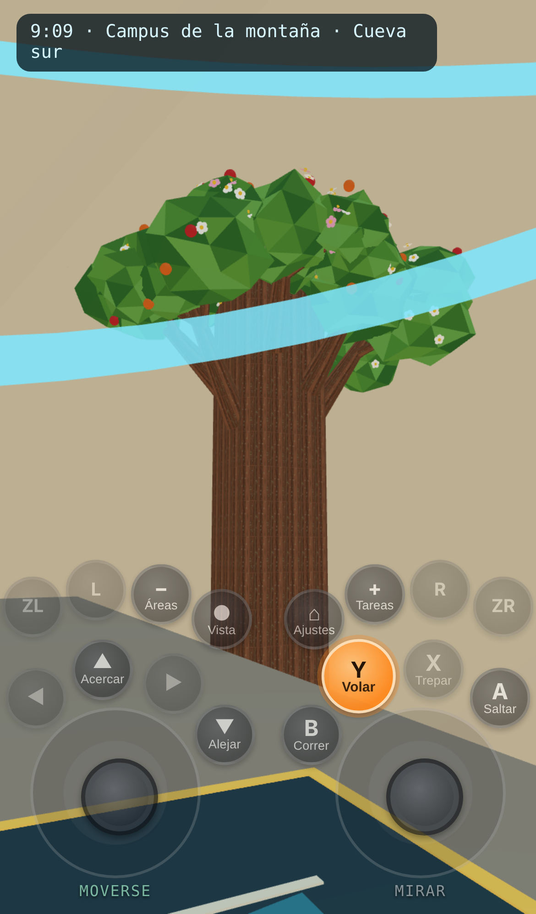
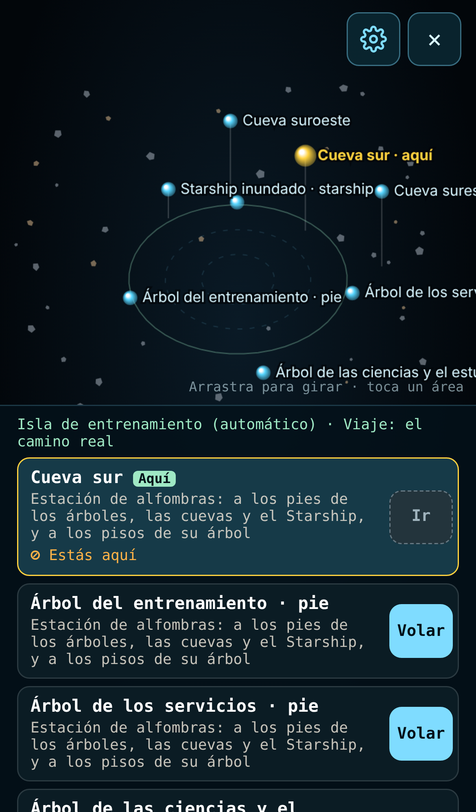

# La montaña hueca del santuario 3 (Berón, 2026-11-25)

> «La montaña es una pirámide artificial hueca cubierta de tierra y piedra, con cuevas; dentro, árboles gigantes llegan
> al techo como columnas; sus pisos siguen las reglas de los edificios del santuario 1; estaciones de alfombras; un
> Starship lleno de agua donde se nada; la base es un lago de 4 m; luz brillante sin sombras y se ve el fondo.»

Todo es **ficción** (como los edificios-árbol de Cold Sanctuary); las salas del campus dentro de los árboles son
**reales** (cada una con su fuente en `data/campus.ts`). Código: `data/bioma-island.ts` (pirámide y cuevas),
`domain/mountain.ts` (terreno con la cubierta y los túneles), `data/montana.ts` (lago, árboles, pisos, alfombras,
Starship), `data/campus.ts` y `data/campus-fixtures.ts` (servicios), `adapters/three/s3-mountain.ts` (dibujo).
Pruebas: `data/montana.test.ts`, `data/caidas.test.ts`, `data/layout.test.ts`, `data/fixtures.test.ts`.

## Pirámide (capa delgada, Berón 2026-11-26)

- Base de 520 m de lado y 335 m de alto, con su centro en (1610, 370) (`CORE_DEF`); la cubierta de tierra y piedra tiene
  solo 3 m sobre la cara natural y la cáscara 2 m (`SHELL_M`): deja intactos los farallones.
- Hueco casi igual a la pirámide: 516 m de lado en el suelo (`INNER_HALF` 258, y 100) y ápice a 431 m (`INNER_H` 331);
  `ceilingAt(x, z)` da la altura del techo en cada punto. `HOLLOW_INSIDE` (data/montana.ts) exporta las medidas del
  interior (centro, suelo, lago, medio lado, ápice, techo y radio libre) para la fauna y la pupa.
- **Centro libre** (`CENTRE_FREE_M` = 45 m alrededor de `HOLLOW` x, z, del lago al techo): ningún piso, tronco, copa ni
  estación; ahí va la pupa central (la pone otra rama).
- **Lago de 4 m** en todo el suelo (`lago-montana`, y 100–104): agua clara, fondo de arena visible.
- **Luz**: dentro, la luz es pareja de todos lados (hemisférica ×2, sol casi apagado) y la niebla toma el color claro de
  las paredes: sin sombras, se ve el fondo del lago.

## Cuevas (regla E14)

Tres túneles cortos por la cara sur (37–43 m: atraviesan solo la capa), **por encima del agua**, cada uno termina en su
estación de alfombras sobre el lago: sur (y 236, con el helipuerto del campus en su explanada de 22 m), suroeste (y 232)
y sureste (y 236). Senderos del monte suben a las bocas; escalones de 0,4 m bajan de la boca a la explanada.

**Tamaño**: como las puertas de los troncos del santuario 1 (`sanctuary-one/data/paso.ts`): el mayor animal del santuario
+ 2 m a cada lado y por encima, nunca menos que esa puerta. El mayor se calcula de los datos de la fauna
(`LARGEST_S3_ANIMAL` = tamaño real × `AIR_BIOME.drawScale`; hoy el saltamontes, 36 × 6 m) y da `CAVE_PASSAGE` 40 × 8 m
(medio ancho 20 m, bóveda 13,3 m). Si llega un insecto mayor (una Meganeura), las cuevas crecen solas; si no cabe en la
pirámide, `montana.test.ts` falla.

## Árboles gigantes (regla E15)

Cuatro troncos de madera maciza del lago al techo: lo sostienen. **Parecen árboles** (`adapters/three/s3-giant-trees.ts`):
corteza con textura, tronco acanalado que se ensancha abajo, raíces de contrafuerte, ramas laterales donde no estorban
a los pisos ni a los carriles, y una **copa** de ramas, masas de hojas, frutos y flores. La copa (`crownOf`, `CROWN`)
empieza 12 m sobre la sala más alta de todos los árboles y 20 m sobre las cuevas (hoy y 256) y acaba bajo el techo: es
sólida para los vuelos (los carriles la esquivan). Sus pisos siguen las reglas indexadas en
[edificios-y-pisos.md](edificios-y-pisos.md); **no tienen paredes ni tejado** (E13): desde el borde se cae al piso de
abajo o al lago. Las grúas de la NBL apoyan en pilotes en las esquinas de la sala.

| Árbol | Pisos (de abajo arriba) | Cima |
|---|---|---|
| Entrenamiento | supervivencia · gimnasio + trajes · simuladores Dragon + LM · robótica + control · SVMF | NBL |
| Servicios | residencia · restaurante · clínica · centro médico · asambleas | — |
| Ciencias y estudio | aulas · biblioteca · laboratorio · crianza | — |
| Producción y campos | huerto · taller | centrífuga |

21 salas en total. Cada pie y cada piso tiene su estación de alfombras.

 

**Caídas**: fuera de la montaña, del borde de una isla no se baja más de 10 m (`ISLAND_DROP_M`); dentro del hueco no hay
límite (`dropLimit`, `FreeWalk.maxDrop`): se cae al piso de abajo o al agua (`data/caidas.test.ts`).

## Alfombras (código compartido con el santuario 1)

Las del santuario 1, el mismo código: datos y rutas en `sanctuary-one/data/alfombras.ts` (`carpetRoute`), ventana y
botón en `ui/carpet-stations.ts`, dibujo (plataforma, dos alfombras flotando y el planetario) en
`adapters/three/carpet-stations.ts`. De pie en una estación, el botón naranja (Y) dice «Volar» y abre la misma ventana de
mapa que Áreas con solo sus destinos; cada estación guarda su «viaje o teletransporte» (`ui/carpet-travel.ts`). Un piso
vuela a los demás pisos y al pie de su árbol; los pies, las cuevas y el Starship vuelan entre sí. Un enlace solo existe
si su vuelo no toca nada (`flightTouches`, probado para todos). «Ir» encadena saltos de alfombra cuando hace falta
(cueva → pie → piso) y vuela cada uno a la vista.

## Starship inundado

La Starship de la nodriza (`nodriza-starship.md`) a escala del campus, de pie en el lago: sus cubiertas, escotillas y
camarotes son agua. Se entra por la pasarela y la esclusa de la cubierta 3 nadando, y se visita cada cubierta.

## Auditoría del campus (servicios)

| Servicio | Salas | Qué se hace |
|---|---|---|
| Residencia | residencia | **Dormir** en tu cama (8 h del reloj) · reto «Preparar el descanso» |
| Restaurante | restaurante | **Comer** sentada a la mesa · reto «Cata» |
| Hospital | clínica, centro médico | reto «Cuarentena» + la cámara hipobárica |
| Crianza | crianza | retos «Moscas» y «Colmena» |
| Entrenamiento | NBL, centrífuga, SVMF, gimnasio, supervivencia, simuladores, robótica, trajes, control | los puestos de la iniciación |
| Estudio | aulas, biblioteca | retos «Clase» y «Procedimiento» |
| Ciencias | laboratorio | reto «Guantera» |
| Campos | huerto | reto «Veggie» |
| Producción | taller | reto «Impresora 3D» |
| Asambleas | asambleas | reto «Reunión» |
