# La nano_net: núcleos hechos de asteroides

Canon de Berón (2026-11-12). Este documento continúa [bucle-de-juego.md](bucle-de-juego.md) y [vida-a-bordo.md](vida-a-bordo.md).

- La **nano_net** es una red de nodos que se construye en el espacio para que viajar sea mejor: da **energía**, **seguridad** y **velocidad**.
- Los nodos salen de **asteroides subyugados**. Un asteroide persuadido puede convertirse en **núcleo** o «célula madre» de la red.
- Al núcleo se le programa **por etapas**. Primero aprende a generar nodos, luego a moverlos por el espacio y después a conectarlos para cubrir un área. Al final enlaza su red con otra cercana.
- Las misiones de Nevaeh **ya no son retos del panel de la nave**. Cada misión es un vuelo al núcleo: hay que aterrizar en él y configurar o reparar su programa con un reto de código.

## Cómo se juega

```
Persuadir al asteroide → Convertirlo en núcleo → Etapas: generar → mover → cubrir → enlazar
                                                        ↑                        ↓
                         Reparar en el núcleo  ←  Avería (desgaste, impacto, sacudida) → carta de Nevaeh
```

1. **Persuadir.** Es el duelo mental de siempre. Si el asteroide queda **persuadido**, obedece y además se puede convertir en núcleo.
2. **Convertir.** Con la nave anclada en el asteroide aparece el botón **Convertir en núcleo**. Es una cadena de retos:
   - ordenar el arranque del programa semilla;
   - predecir μ = G·M con la **masa real** de Bennu (6,674·10⁻¹¹ × 7,329·10¹⁰ ≈ 4,89 m³/s²);
   - declarar `pulsosPorHora = 20`, la variable de la carta del borrador.
3. **Etapas.** Cada etapa es una cadena de 3 o 4 retos que se hace aterrizado en el núcleo. El botón dice **Programar: …**:

| Etapa | Qué aprende el núcleo | Retos |
| --- | --- | --- |
| Generar nodos | Moldea 3 nodos con su regolito (energía, escudo e impulso), a 40 m de la superficie | Ordenar el bucle `para`; predecir `roles[i % 3]`; declarar `capasDeOnda = 10` |
| Mover nodos | Los sube a un anillo polar a 600 m de altura | Ordenar la maniobra; completar la **velocidad orbital real** v = √(μ/r) = √(4,89/845) ≈ 0,076 m/s; declarar `girosPorHora = 60` |
| Cubrir un área | Genera los nodos que faltan (techo(2π·845/700) = 8) y enlaza cada uno con el siguiente | Predecir cuántos nodos; ordenar el bucle del anillo; completar el operador `%`; declarar `codigoGlobal = '3396815'` |
| Enlazar redes | Une su red con el relevo del santuario, a 50 km | Predecir un `si distancia < alcance`; ordenar el saludo; declarar `codigoOnda = '8819618'` |

4. **Averías.** Los nodos se gastan poco a poco y a veces reciben un impacto. El programa del núcleo puede corromperse solo o por una sacudida fuerte. Cada avería nueva hace que Nevaeh escriba una carta por la radio: la misión es **reparar esa avería**. Reparar también es una cadena de retos, aterrizado en el núcleo:
   - **Nodo averiado:** predecir qué nodo apagó la guarda `si nodo.salud < 0,5`, ordenar la reparación con el dron y completar `N3Encendido = verdadero` (el booleano del borrador, no el texto `'verdadero'`).
   - **Programa corrupto:** encontrar la línea corrupta del programa del núcleo (por ejemplo `generar(-3 nodos…)` o `% → /`), ordenar el reinicio y declarar `codigoPulso = '441319'`.

   Si el programa está roto, el núcleo no puede aprender más etapas hasta repararlo.

Si se falla demasiadas veces, la etapa o la reparación queda sin hacer y se puede repetir, igual que las tareas a bordo.

## Qué da la red a la nave

Cada nodo cubre una esfera de 600 m a su alrededor. Un nodo solo da algo si **funciona** y está **conectado al núcleo**:

- directamente, por un haz desde la superficie del núcleo (hasta 700 m);
- o a través de los enlaces del anillo.

Si el programa del núcleo está roto, no da nada ningún nodo.

| Efecto | Nodo | Por nodo | Tope | En la nave |
| --- | --- | --- | --- | --- |
| Velocidad | Impulso | +0,25 al multiplicador del tiempo acelerado | ×3 | El tiempo ×10 pasa a ×15 dentro de la red; enlazada con otra red, +0,5 más |
| Energía | Energía | 2 kW | — | Los drones de mantenimiento reparan el casco: 1 % por kW·h |
| Seguridad | Escudo | 15 % | 60 % | La sacudida de un asteroide furioso llega más débil al hábitat (con Bennu solo aún no puede pasar: un asteroide persuadido ya no se enfurece) |

Antes de cerrar el anillo cada nodo da la mitad, y solo cerca de él. Con el anillo cerrado, la red **reparte**: desde cualquier punto cubierto se recibe lo de todos los nodos conectados.

El anillo es **polar**, de modo que pasa sobre los polos del núcleo. Ahí el giro es más lento y es donde se aterriza, así que la nave anclada en el polo queda dentro de la red.

**Todos estos números son ajuste de juego** (`NANO_TUNING` en `modules/nano-net/domain/core.ts`): la nano_net es ficción. Los datos reales entran por el asteroide (radio, masa y μ de Bennu, con su fuente en `celestial/data/bennu.ts`) y por la física de los retos (órbita circular).

## La historia: las cartas de Nevaeh

Las cartas del borrador (`number.js`, `text.js`, `boolean.js`) pedían configurar la nano_net desde un panel. Ahora cada carta anuncia una etapa del núcleo o una avería. Las variables del borrador siguen vivas dentro de los retos.

| Carta | Llega | Misión (se cumple en el núcleo) |
| --- | --- | --- |
| La nano_net necesita un núcleo (de `number.js`) | Al empezar | Convertir a Bennu en núcleo |
| Que el núcleo aprenda a generar nodos (de `text.js`) | 0,25 días después de la misión anterior | Generar nodos |
| Mover los nodos a su órbita (nueva) | Igual | Mover nodos |
| Cerrar el anillo y cubrir un área (de `boolean.js`) | Igual | Cubrir un área |
| Enlazar tu red con la nuestra (nueva) | Igual | Enlazar con el relevo del santuario |
| Avería en la nano_net: … (generada) | Con cada avería nueva | Reparar esa avería |

- Si el jugador completa una etapa antes de que llegue su carta, la carta llega con la misión ya hecha.
- Las posdatas mantienen el arco del borrador: seres queridos preocupados, un fallo de comunicaciones y «alguien estaba detrás». La carta de avería deja abierta la duda de si es desgaste o sabotaje.

## Arquitectura

```
modules/nano-net/
  domain/core.ts          NanoCore (etapas, nodos, enlaces, cobertura, averías, efectos) y NANO_TUNING
  domain/network.ts       NanoNet: todos los núcleos y las redes ajenas; efectos en un punto
  data/networks.ts        el relevo del santuario (posición de juego)
  application/challenges.ts  retos generados del estado y de los datos reales del asteroide
  application/operations.ts  NanoNetOps: qué se puede hacer aterrizado, sesiones de retos, eventos
adapters/three/nano-net-view.ts  nodos como puntos luminosos, haces, enlaces y la banda cubierta
ui/nano-net-panel.ts            botón «nano_net» en la barra de estado del puente de la nodriza (tarjeta de estado) y botón de acción en la cabina del módulo, anclado en el núcleo (accesos.md)
```

- El dominio y la aplicación no dependen de Three.js ni del DOM (`npm run lint:arch`).
- Los retos usan el motor de tareas (`ChoreRun`) y la misma pantalla `DuelView`, en modo hoja inferior, como las tareas de a bordo.
- `story` no depende de `nano-net`. `main.ts` traduce los eventos de la red (núcleo plantado, etapa aprendida, avería, reparada) en `Mailbox.achieve()` y `Mailbox.post()`.

## Capturas

| | Escritorio | Móvil |
| --- | --- | --- |
| Reto para convertir a Bennu | 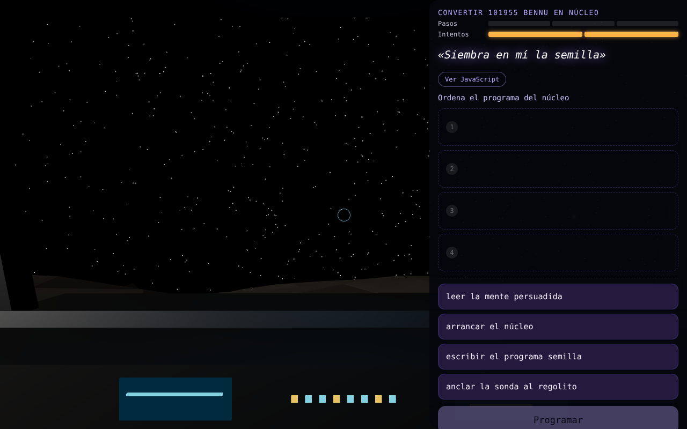 | 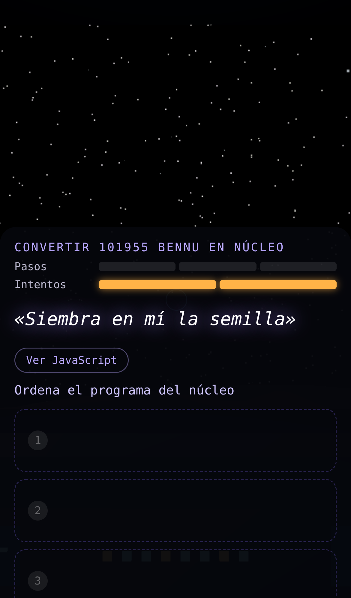 |
| Etapa «mover nodos»: el nodo recién nacido y su haz | 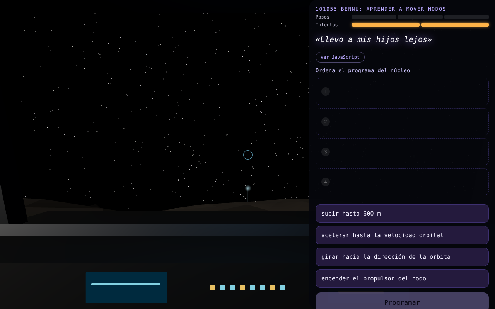 | 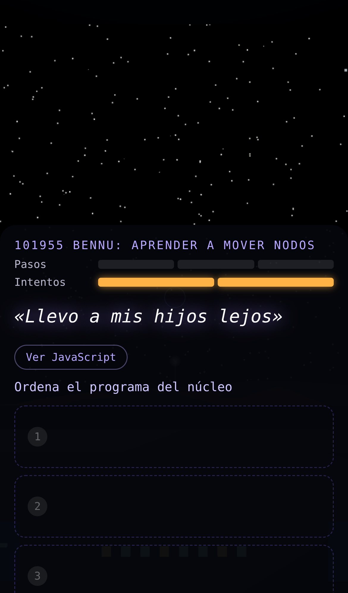 |
| Anillo cerrado y estado de la red | 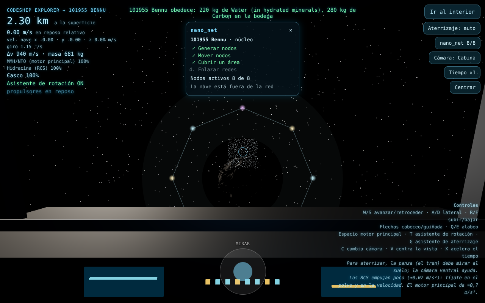 | 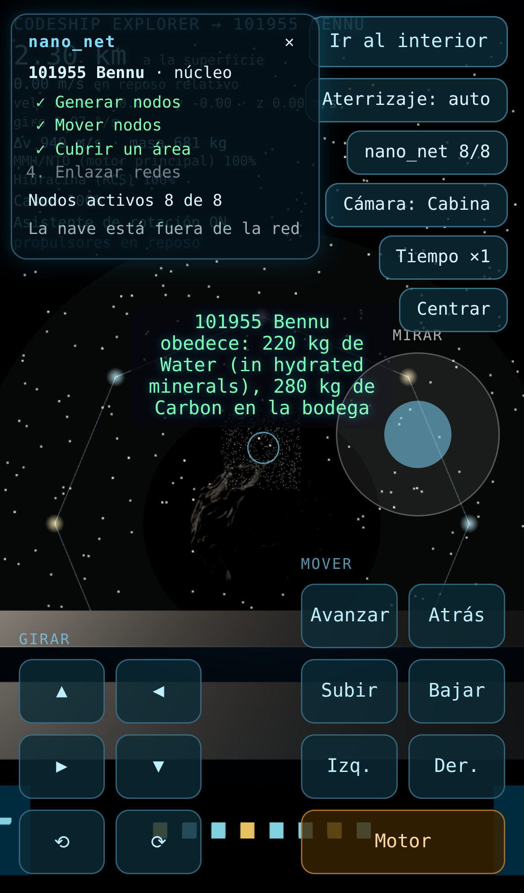 |
| Avería: nodos desconectados y uno en rojo | 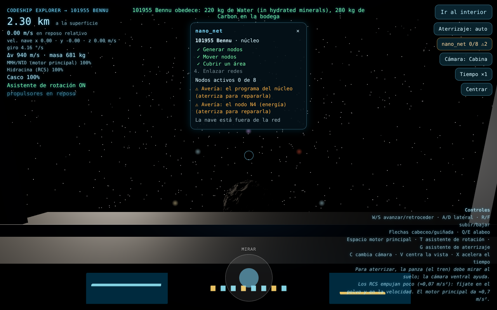 | 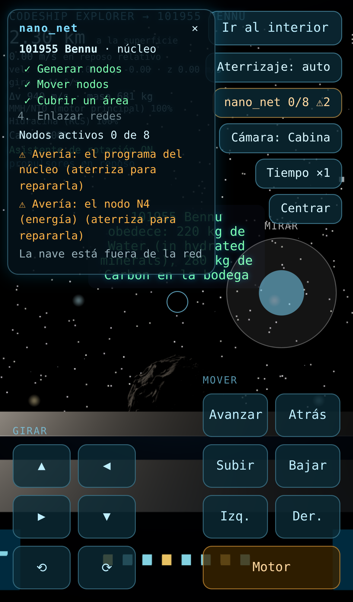 |
| Reparar el programa del núcleo | 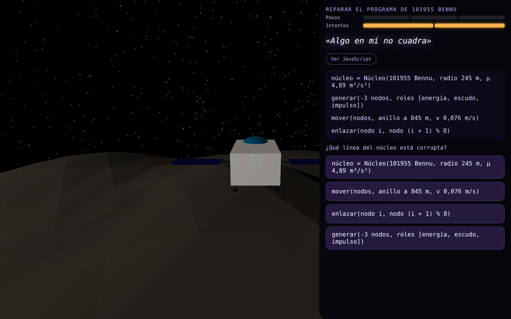 | 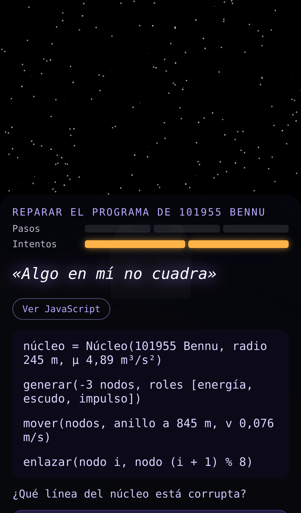 |
| Carta de avería de Nevaeh | 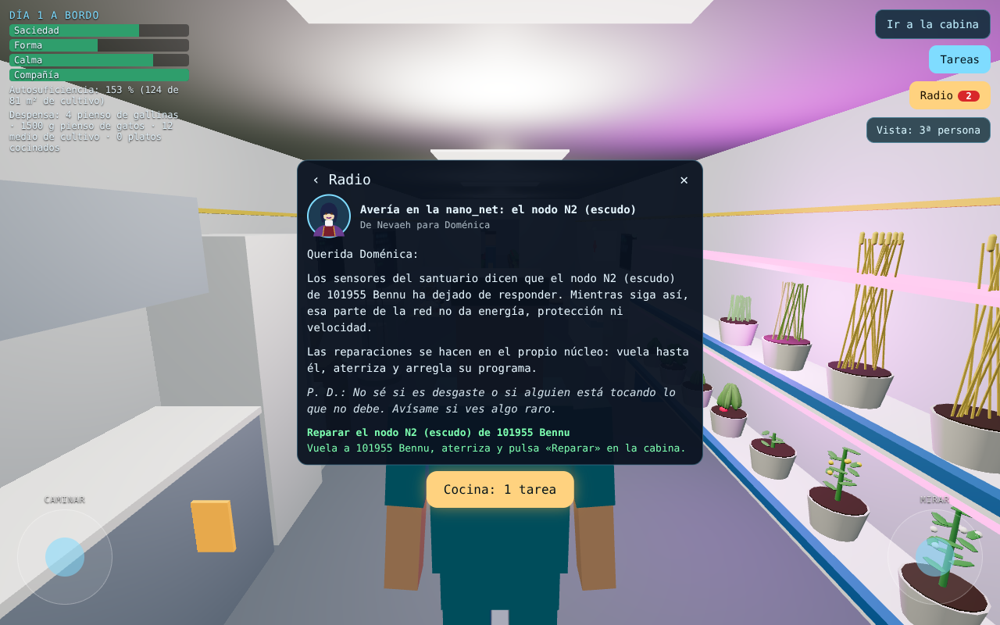 | 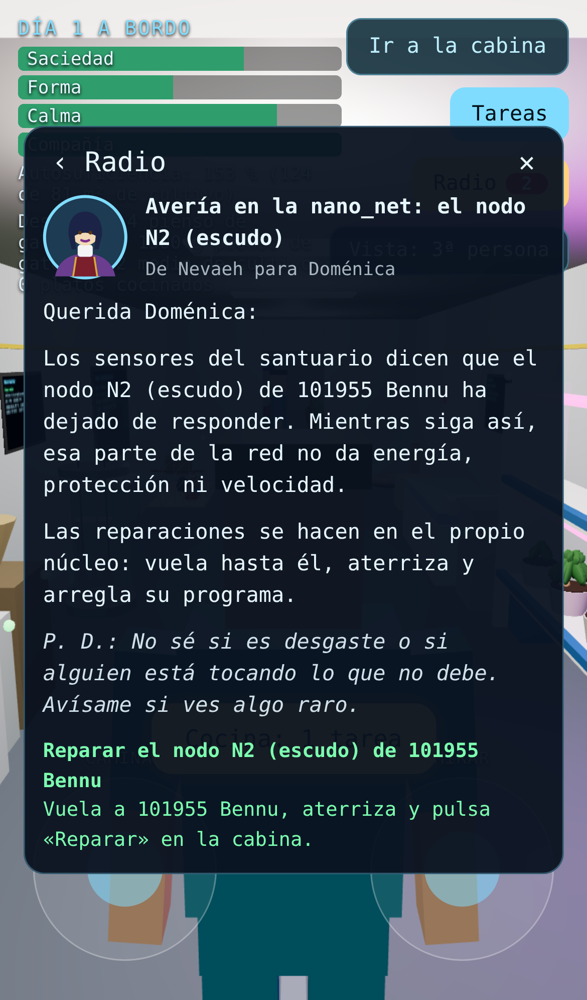 |

## Preguntas abiertas para Berón

- **¿Cuántos núcleos y dónde?** Ahora solo existe Bennu. Con más asteroides, cada uno podría ser un núcleo y las redes se enlazarían entre sí.
- **¿Quién está detrás de las averías?** El sabotaje del borrador encaja con las averías: ¿algunas deberían ser provocadas, con pistas en el código corrupto?
- **¿Qué protege el escudo?** Hoy solo atenúa sacudidas de asteroides furiosos dentro de la red. Podría proteger de lluvias de polvo o de impactos durante los viajes.
- **¿Qué da la energía?** Ahora repara el casco con drones. Otras opciones: recargar el soporte vital o alimentar las máquinas del hábitat sin gastar.
- **¿Se gasta el asteroide?** Hoy los nodos no consumen masa del núcleo. Se podría restar regolito por nodo, usando la masa real.
- **Viajes programados.** La velocidad de la red debería alimentar el viaje automático entre asteroides, que aún no existe.
