# Orden de las acciones en pantalla

Continúa [accesos.md](accesos.md) y [componentes.md](componentes.md). Pruebas en [../testing.md](../testing.md).

Encargo del diseñador: probar la jugabilidad y la UX, investigar cómo ordenar mejor las acciones, arreglar el fallo de los retos (tres toques sobre la misma opción errónea: el primero marcaba el fallo, el segundo lo «desmarcaba» y el tercero terminaba la misión) y rehacer la vista HUD de los retos, cuyas barras eran demasiado transparentes.

## 1. Lo que dice la investigación

| Fuente | Qué aporta |
| --- | --- |
| Steven Hoober, [How Do Users Really Hold Mobile Devices?](https://www.uxmatters.com/mt/archives/2013/02/how-do-users-really-hold-mobile-devices.php) (UXmatters, 2013), 1 333 observaciones | 49 % usa el móvil con una mano, 36 % lo acuna (una mano sujeta, el pulgar o el índice de la otra toca), 15 % con dos manos. La gente cambia de agarre según la tarea. |
| Hoober, [Design for Fingers, Touch, and People](https://www.uxmatters.com/mt/archives/2017/03/design-for-fingers-touch-and-people-part-1.php) (2017) | El centro de la pantalla es lo más fácil y preciso de tocar (≈7 mm de error); las esquinas, lo peor (≈11–12 mm). La gente mira y toca primero el centro; los bordes sirven para lo secundario. |
| Josh Clark, *Designing for Touch* (A Book Apart, 2015) | La «zona del pulgar»: abajo y al centro es cómodo, arriba y en la esquina opuesta se estira la mano. Las acciones frecuentes abajo; las que rompen algo, lejos del pulgar. |
| Apple, [Human Interface Guidelines: Layout](https://developer.apple.com/design/human-interface-guidelines/layout) y [Accessibility](https://developer.apple.com/design/human-interface-guidelines/accessibility) | Objetivos de toque de al menos 44×44 pt. Lo importante arriba en la jerarquía visual, controles al alcance; no tapar el contenido con controles. Respetar las zonas seguras (`env(safe-area-inset-*)`). |
| Google, [Material Design 3: accessibility basics](https://m3.material.io/foundations/accessible-design/accessibility-basics) | Objetivos de 48×48 dp con 8 dp de separación. Una sola acción principal por pantalla (el FAB), abajo a la derecha o al centro; las secundarias, en menús. |
| W3C, [WCAG 2.2 · 2.5.8 Target Size (Minimum)](https://www.w3.org/WAI/WCAG22/Understanding/target-size-minimum.html), [1.4.3 Contrast (Minimum)](https://www.w3.org/WAI/WCAG22/Understanding/contrast-minimum.html), [1.4.11 Non-text Contrast](https://www.w3.org/WAI/WCAG22/Understanding/non-text-contrast.html) | Mínimo 24×24 px por objetivo; texto 4,5:1 (3:1 si es grande); bordes y estados de controles 3:1. |
| Nielsen Norman Group, [Progressive Disclosure](https://www.nngroup.com/articles/progressive-disclosure/) | Mostrar primero lo que casi siempre se usa y dejar lo demás a un toque. Mejora el aprendizaje y reduce errores. |
| Fagerholt y Lorentzon, *Beyond the HUD* (Chalmers, 2009) | Clasifica la interfaz de un juego en diegética, espacial, meta y no diegética. Lo no diegético (botones, contadores) debe ser constante y estar siempre en el mismo sitio para no competir con la escena. |
| Celia Hodent, *The Gamer's Brain* (CRC Press, 2017) | La atención es limitada: una interfaz que cambia de sitio obliga a buscar; la consistencia entre modos reduce la carga. El feedback de cada acción debe ser inmediato y claro (forma + color, no solo color). |
| Convenciones de juegos de móvil (Genshin Impact, PUBG Mobile, Call of Duty Mobile; [Game UI Database](https://www.gameuidatabase.com/)) | Joystick de movimiento abajo a la izquierda; botones de acción abajo a la derecha, el principal más grande y más cerca del pulgar; ajustes y mapa arriba, en los bordes; la acción contextual («Abrir», «Recoger») aparece encima de los botones de acción, siempre en el mismo sitio. |

### Reglas que salen de ahí

1. **Una sola acción principal, siempre en el mismo sitio.** La acción que pide el momento (entrar en la nave, salir al exterior, entrar en su mente, lanzar la sonda) vive en la **columna de contexto**: encima del pulgar derecho en la cabina y en la sonda; abajo al centro, encima de los mandos, en los modos de caminar (interior, estación, paseo).
2. **Pulgar izquierdo orienta, pulgar derecho mueve y actúa.** En la cabina, GIRAR y MIRAR a la izquierda; MOVER, Motor y la acción principal a la derecha.
3. **Lo secundario, plegado.** En el móvil los conmutadores de vuelo (aterrizaje, acople, nombres, cámara, tiempo, centrar) van en el menú **☰ Mandos** de arriba a la derecha. En escritorio, con sitio, siguen a la vista.
4. **El estado arriba a la izquierda, breve.** El HUD de la cabina enseña en el móvil lo esencial (distancia, velocidad, Δv, casco, asistente, propulsores); las componentes de la velocidad, el giro y cada tanque quedan para el escritorio.
5. **El contexto agrupado.** El mensaje que explica la acción, la confianza del asteroide, el viaje en curso y la región van juntos en la columna de contexto, encima de la acción, en ese orden de abajo arriba (lo más ligado a la acción, más cerca).
6. **Nada se solapa** a 390×664 (iPhone 13 con las barras de Safari) ni a 1280×800. La suite de experiencia lo comprueba en cada pantalla.
7. **Objetivos de toque ≥ 44 px** de alto en los botones nuevos y en las opciones de los retos (también en la vista HUD).
8. **Un fallo se ve con forma y color**: ✗ y rojo en la opción, número en ámbar o rojo; un acierto, ✓ y verde. Nunca solo color.

## 2. Auditoría

Hecha jugando: el recorrido `acciones-movil` / `acciones-escritorio` de la suite de experiencia visita cada pantalla como llega un jugador, la captura y lista los controles que se solapan (dos elementos visibles cuyo rectángulo se cruza y que siguen arriba en su propio centro; un botón fijo sobre una lista que se desplaza no cuenta). Móvil: iPhone 13, 390×844 de pantalla y **390×664 visibles** con las barras de Safari, el caso más estrecho. Escritorio: 1280×800.

| Pantalla | Antes | Después |
| --- | --- | --- |
| Cabina (acoplada, vuelo libre, acoplada a la estación), móvil | La columna de seis conmutadores (Aterrizaje, Acople, Nombres, Cámara, Tiempo, Centrar) tapaba el HUD de telemetría; «Entrar en la nave» arriba a la derecha, lejos del pulgar; la etiqueta de región encima del HUD; el aviso en mitad de la escena; MIRAR encima de Centrar. 4 solapes por pantalla. | Conmutadores en **☰ Mandos**; HUD breve; acción principal y su contexto en la columna de contexto encima de MOVER; MIRAR junto a GIRAR. 0 solapes. |
| Módulo posado en Bennu, móvil (la pantalla más cargada) | «Salir de la nave» (la acción principal) perdida en medio de la columna de conmutadores; aviso, ficha de confianza y mando MIRAR compitiendo en el centro; el botón del duelo, a media altura (44vh). | Columna de contexto: de abajo arriba **Salir de la nave / Entrar en su mente**, el aviso que la explica, la confianza del asteroide, el viaje y la región. 0 solapes. |
| Cabina, escritorio | La etiqueta de región tapaba la ficha de confianza; posado, el aviso tapaba la ficha y el HUD. | Columna de contexto abajo a la derecha; la ayuda de teclado pasa abajo a la izquierda. 0 solapes. |
| Reto (duelo, tareas), vista HUD | Barras de aciertos y de «Intentos» casi transparentes (celdas `#ffffff22`); «Intentos» contaba hacia abajo, así que un fallo **apagaba** una celda (se leía como «desmarcar»); la opción fallada no quedaba marcada y se podía volver a tocar; al perder, la pantalla seguía diciendo «inténtalo otra vez» y el «Cerrar» aparecía donde estaban las opciones. | Ver la sección 4. |
| Interior: ingravidez y anillo | Consistente: estado arriba a la izquierda, Tareas/Radio/Vista arriba a la derecha, la acción de la zona («Bajar al módulo», «Cocina: 8 tareas») abajo al centro encima de los mandos. El estado del interior no se leía sobre carteles claros. Elegir una tarea en el eje no decía nada y tardaba minutos (planeo a 0,5 m/s + ascensor). | Placa oscura bajo el estado; elegir una tarea en el eje avisa «Bajas al anillo para…» y ella se impulsa por los asideros a 1,5 m/s. |
| Tablero de tareas | Los avisos del interior caían encima de la lista. | Con el tablero o la radio abiertos, los avisos bajan al pie. |
| Puente de mando, mapa | Sin solapes. Volver arriba a la derecha, como en la estación y la sonda. | Igual. |
| Consola de la sonda | Ya seguía la regla: «Lanzar sonda» encima de MOVER; «Volver al puente» arriba a la derecha. | Igual; el viaje en curso se coloca sobre GIRAR para no tapar su acción. |
| Estación: interior y las 6 pestañas (Materiales, Planos, Fabricación, Hangar, Importar, Vida) | Sin solapes. Pestañas en dos filas de tres en el móvil, Volver arriba a la derecha. | Igual. |
| Paseo espacial | Antes de salir, el reto de ponerse el traje en hoja inferior (sin solapes). Fuera: estado arriba a la izquierda, Volver a la nave arriba, acciones (Impulso, Bajar, Recoger cable, Tomar muestra) abajo a la derecha. | Igual. |

Capturas (antes / después), en `docs/screenshots/`:

| | Antes | Después |
| --- | --- | --- |
| Cabina en vuelo libre, móvil | 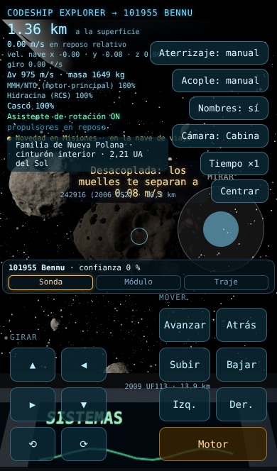 | 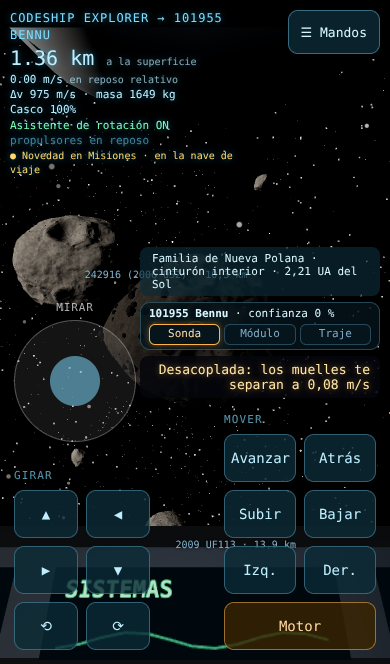 |
| Posado en Bennu, móvil | 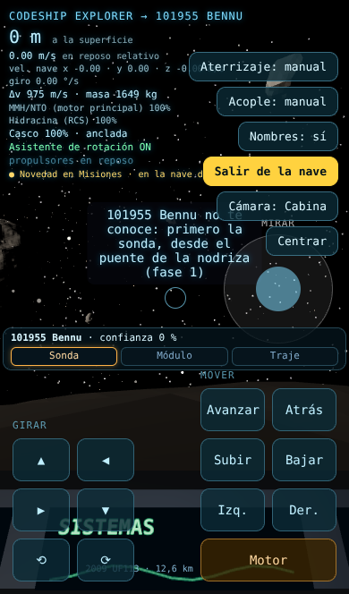 | 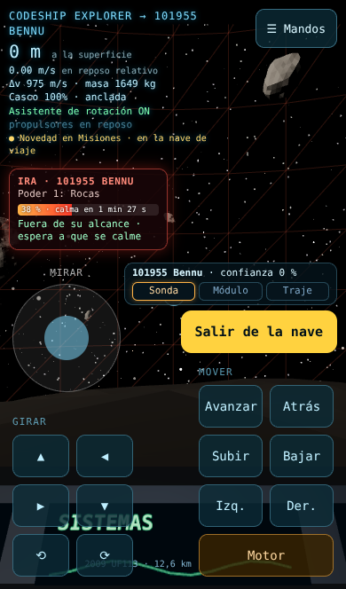 |
| Acoplado a la nodriza, móvil | 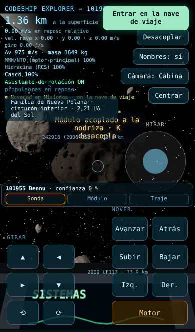 | 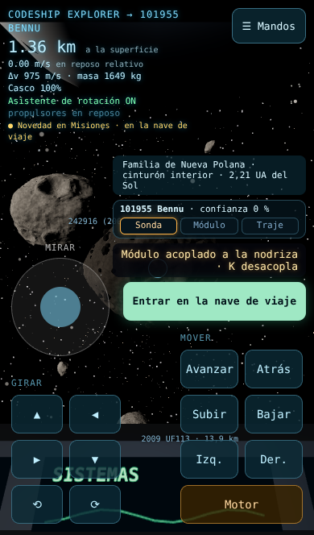 |
| Posado en Bennu, escritorio | 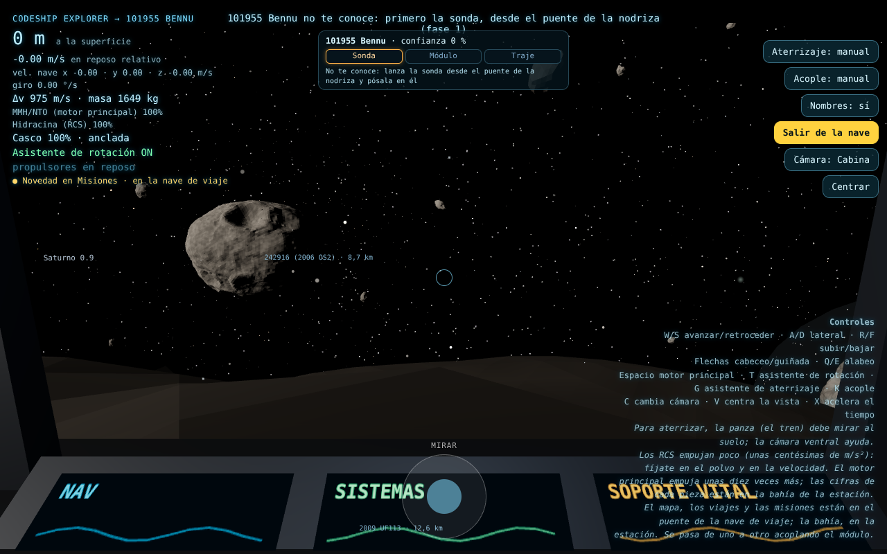 | 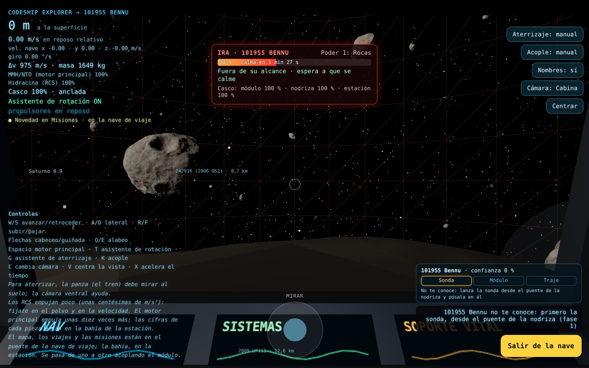 |
| Cabina acoplada, escritorio | 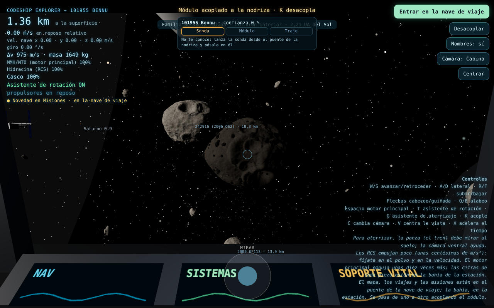 | 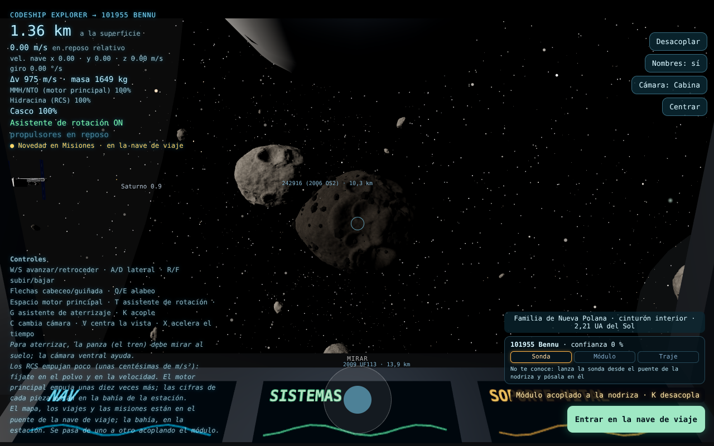 |
| Anillo, móvil | 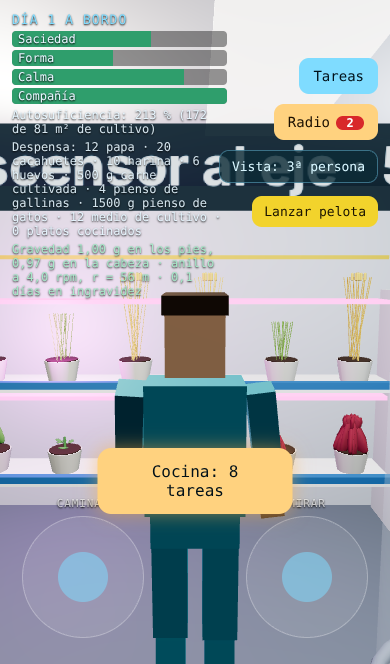 | 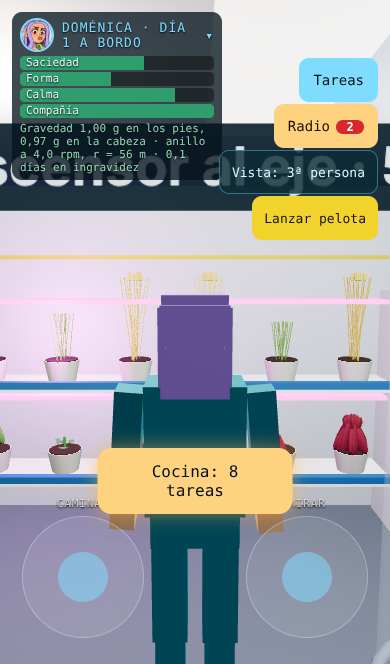 |
| Tablero de tareas, móvil | 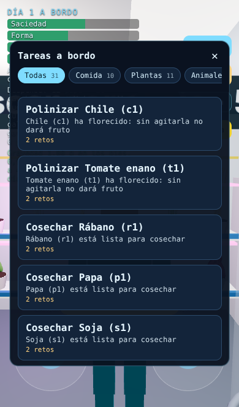 | 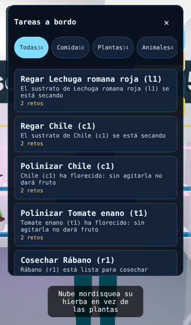 |
| Sonda, móvil | 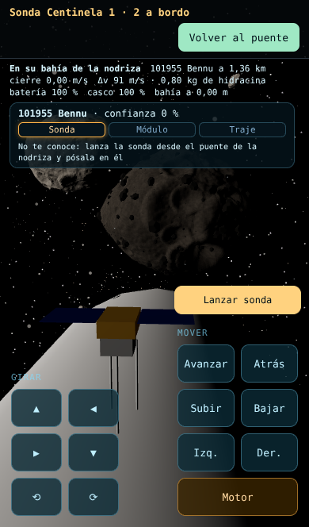 | 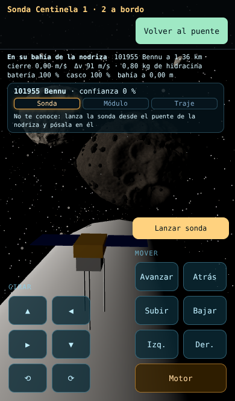 |
| Estación, pestaña Vida, móvil | 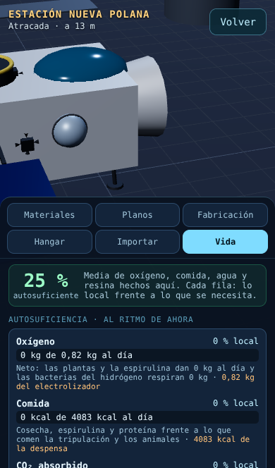 | 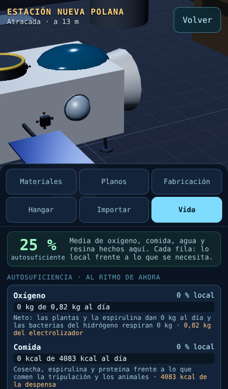 |

## 3. La organización

### Cabina y módulo posado (móvil)

```
┌──────────────────────────────┐
│ HUD breve          ☰ Mandos  │  estado arriba-izq · secundario plegado arriba-dcha
│ (distancia, velocidad, Δv…)  │
│               ┌────────────┐ │
│               │ región     │ │
│               │ viaje      │ │  columna de contexto
│   escena      │ confianza  │ │  (de abajo arriba: lo más ligado a la acción, más cerca)
│               │ aviso      │ │
│  ( MIRAR )    │[ACCIÓN]    │ │  acción principal: grande, sobre el pulgar derecho
│ GIRAR         │ MOVER      │ │
│ ▲ ◀           │ Avanzar …  │ │
│ ▶ ▼           │ … Motor    │ │
└──────────────────────────────┘
  pulgar izquierdo: orienta      pulgar derecho: mueve y actúa
```

- **☰ Mandos** despliega Aterrizaje, Acople, Nombres, Cámara, Tiempo, Centrar (y en desarrollo, Estación). En escritorio la columna sigue a la vista: hay sitio y el ratón llega a todo.
- La **columna de contexto** (`.ctx-dock`, creada en `main.ts`) reúne, de abajo arriba: la acción principal (Entrar en su mente / Convencer · nivel N, Entrar en la nave de viaje / en la estación, Salir de la nave), el aviso que la explica, la ficha de confianza del asteroide, el chip del viaje y la región. Fuera de la cabina solo muestra el chip del viaje, abajo al centro, donde estaba.
- El HUD del móvil oculta las líneas de detalle (componentes de la velocidad, giro, cada tanque); en escritorio siguen.
- Después de un duelo, su pantalla de resultado tiene el botón para volver (Continuar / Cerrar): ya no aparece además «Volver a la cabina» encima.

### En todos los vehículos y modos

| Sitio | Qué va | Cabina | Sonda | Interior / estación | Paseo |
| --- | --- | --- | --- | --- | --- |
| Arriba a la izquierda | Estado | HUD | telemetría | barras, despensa, gravedad | traje, oxígeno, cable |
| Arriba a la derecha | Salir / menú | ☰ Mandos | Volver al puente | Tareas, Radio, Vista (Salir en la estación) | Volver a la nave |
| Sobre el pulgar derecho / abajo al centro | Acción principal del momento | columna de contexto | Lanzar sonda, Convencer | botón de la zona («Bajar al módulo», «Cocina: 8 tareas») | Impulso, Tomar muestra |
| Abajo, a los lados | Mandos de movimiento | GIRAR+MIRAR / MOVER | GIRAR / MOVER | Caminar o Manos / Mirar (+ Impulsarse) | Caminar / Mirar |

## 4. Los retos: el fallo de los tres toques y la vista HUD

**Qué pasaba** (reproducido con el recorrido `cocina` y con la prueba `ChoreRun … crema de cacahuete`): en una cadena de pasos (crema de cacahuete: 7 pasos, 3 fallos permitidos) un fallo no cambia de paso, y la pantalla volvía a pintar las mismas opciones sin marcar la fallada. Cada toque sobre la misma opción errónea contaba **otro** fallo: el primero bajaba «Intentos» de 3 a 2, el segundo a 1 —con las celdas casi transparentes y contando hacia abajo, se veía como si el fallo se «desmarcara»— y el tercero agotaba los intentos: el reto se perdía, pero la pantalla seguía diciendo «Así no: inténtalo otra vez» con un único botón «Cerrar» justo donde estaban las opciones, así que parecía que la misión había terminado.

**Arreglo (para todos los retos: ordenar, completar, predecir, reparar, especificar; en las dos vistas)**:

- Dominio: `ChoreRun` recuerda las respuestas erróneas del paso (`Attempts`, `mind-duel/domain/attempts.ts`). Repetir una respuesta ya fallada **no cuenta** otro fallo, no pierde el reto y no avanza el paso; el fallo de la primera vez se queda contado para siempre (`mistakes` solo sube). Con TDD: `chore.test.ts`, `attempts.test.ts`.
- Pantalla (`ui/duel-view.ts`): la opción fallada se queda **marcada** (✗, roja, `aria-disabled`); tocarla otra vez dice «Esa ya falló: prueba otra» sin enviar nada. En «ordenar», el mismo orden fallado tampoco se envía («Ese orden ya falló: cambia algo»). También vale para los duelos con asteroides, gatos y la nano_net, que comparten pantalla.
- Fin del reto explícito: **«✓ Conseguido»** (pasos y fallos) con «Continuar», o **«✗ Reto perdido»** (fallos de máximo; no se ha gastado nada, se puede repetir) con «Cerrar».
- Un toque doble no responde dos veces: tras cada respuesta los toques se ignoran 0,3 s, y 0,9 s cuando el reto acaba (el botón del resultado aparece donde estaban las opciones).

**Indicadores escritos** en lugar de barras, con el estilo del velocímetro de la cabina (monoespaciada, número grande, halo `0 0 6px`, los mismos colores `ok #7dffb0` y `warn #ffb347` del HUD):

- `Aciertos 2/7 pasos` en verde en cuanto hay uno; `Fallos 1/3` en pálido con 0, **ámbar** con fallos y **rojo** cuando uno más pierde el reto (con «uno más y se pierde»). Los fallos solo cuentan hacia arriba.
- El número que cambia **late** (escala 1,6 → 1 con brillo, 0,7 s; sin animación con `prefers-reduced-motion`).
- En la vista HUD van sobre una **placa oscura** (`#020a12` al 85 %) con halo negro: incluso con la escena blanca detrás el contraste es ≈ 11:1 (verde), ≈ 8:1 (ámbar) y ≈ 5:1 (rojo), por encima del AA (4,5:1).
- Opciones en HUD: fondo casi opaco, 44 px de alto, borde de 2 px para el bloque colocado (seleccionado) y para la opción fallada (roja con ✗).

Antes (código de `integracion` al empezar), el mismo recorrido `cocina`: tres toques sobre «60 °C».

| Toque 1 | Toque 2 | Toque 3, vista HUD: reto perdido sin decirlo |
| --- | --- | --- |
| 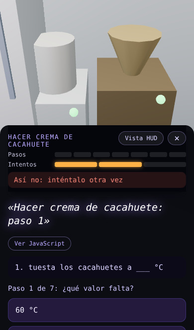 | 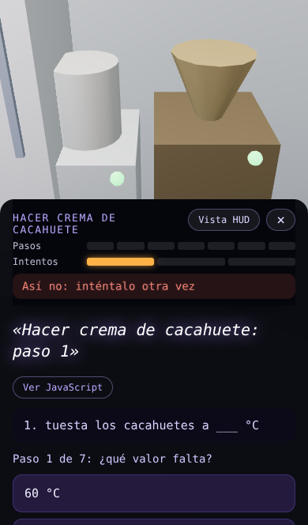 | 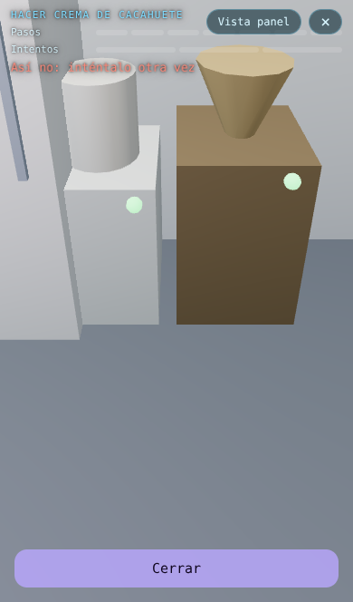 |

Después:

| Toque 3: sigue «Fallos 1/3», la opción marcada | Vista HUD con un fallo | Vista HUD, reto perdido |
| --- | --- | --- |
| 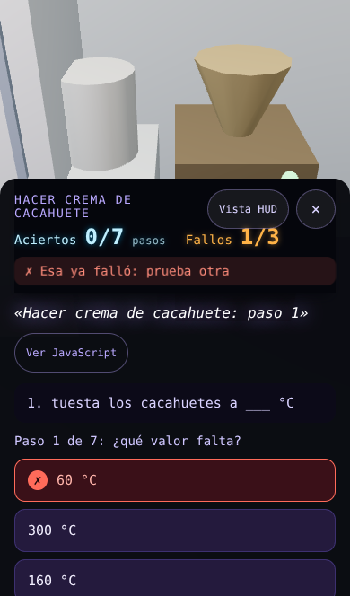 | 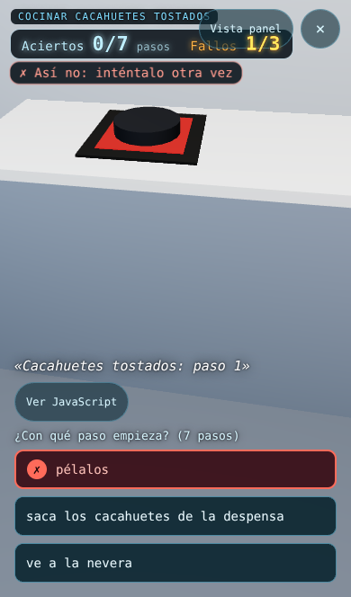 | 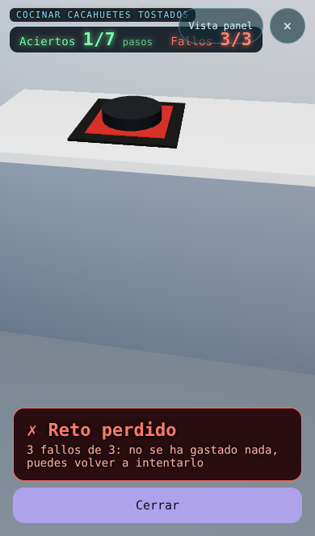 |

## 5. Problemas encontrados jugando

Apuntados por la suite (`j.problem`) o vistos en sus capturas:

| # | Problema | Estado |
| --- | --- | --- |
| 1 | Repetir la misma opción errónea contaba un fallo nuevo cada vez y terminaba perdiendo el reto (crema de cacahuete). | Arreglado (dominio + pantalla). |
| 2 | Barras de aciertos e intentos casi invisibles en HUD; «Intentos» contaba hacia abajo. | Arreglado: indicadores escritos que solo suben. |
| 3 | Al perder, «inténtalo otra vez» y un «Cerrar» donde estaban las opciones: un toque de más cerraba sin ver nada. | Arreglado: resultado explícito y 0,9 s sin toques. |
| 4 | Tras ganar un duelo con un asteroide, dos botones para lo mismo («Volver a la cabina» y «Cerrar»). | Arreglado: solo el del resultado. |
| 5 | Elegir una tarea flotando en el eje no daba ninguna señal y tardaba más de un minuto (planeo a 0,5 m/s + ascensor de medio minuto). | Arreglado: aviso y tirón por los asideros a 1,5 m/s. El ascensor sigue lento a propósito (Coriolis). |
| 6 | En la cabina del móvil los conmutadores tapaban el HUD; la acción principal se perdía entre ellos. | Arreglado (sección 3). |
| 7 | Avisos encima de la lista de tareas; aviso de misión encima del resultado del duelo. | Arreglado. |
| 8 | El estado del interior no se leía sobre carteles claros. | Arreglado: placa oscura. |
| 9 | En la hoja de retos (390×664 visibles) la tercera opción o la bandeja de «ordenar» quedan por debajo del borde: hay que desplazar. | Mejorado (hoja más alta y frase más pequeña en pantallas bajas); en los retos de ordenar con cinco o más bloques sigue haciendo falta desplazar. Abierto: probar una bandeja en horizontal. |
| 10 | En el eje, el cartel 3D «Puente de mando» queda cortado arriba, detrás del estado. | Abierto (cosmético). |

## 6. Reglas para lo que venga

1. Toda acción nueva que dependa del momento entra en la columna de contexto (o en el botón de zona de los modos de caminar), no en una esquina nueva.
2. Un conmutador o ajuste nuevo de vuelo va en ☰ Mandos.
3. Ningún elemento fijo nuevo sin pasar `npm run experiencia -- acciones-movil acciones-escritorio`: 0 solapes en 390×664 y 1280×800.
4. Botones ≥ 44 px de alto en móvil; texto sobre la escena con placa o halo hasta 4,5:1.
5. El feedback de un acierto o un fallo lleva forma (✓/✗) además de color, y un número que solo sube.
