# Orden de las acciones en pantalla

Continúa [accesos.md](accesos.md) y [componentes.md](componentes.md). Pruebas en [../testing.md](../testing.md).

Encargo del diseñador: probar la jugabilidad y la UX, investigar cómo ordenar mejor las acciones, arreglar el fallo de los retos (tres toques sobre la misma opción errónea: el primero marcaba el fallo, el segundo lo «desmarcaba» y el tercero terminaba la misión) y rehacer la vista HUD de los retos, cuyas barras eran demasiado transparentes.

## 1. Lo que dice la investigación

| Fuente | Qué aporta |
| --- | --- |
| Steven Hoober, [How Do Users Really Hold Mobile Devices?](https://www.uxmatters.com/mt/archives/2013/02/how-do-users-really-hold-mobile-devices.php) (UXmatters, 2013), 1 333 observaciones | 49 % usa el móvil con una mano, 36 % lo acuna (una mano sujeta, el pulgar o el índice de la otra toca), 15 % con dos manos. La gente cambia de agarre según la tarea. |
| Hoober, [Design for Fingers, Touch, and People](https://www.uxmatters.com/mt/archives/2017/03/design-for-fingers-touch-and-people-part-1.php) (2017) | El centro de la pantalla es lo más fácil y preciso de tocar (≈7 mm de error); las esquinas, lo peor (≈11–12 mm). La gente mira y toca primero el centro; los bordes sirven para lo secundario. |
| Josh Clark, *Designing for Touch* (A Book Apart, 2015) | La «zona del pulgar»: abajo y al centro es cómodo, arriba y en la esquina opuesta se estira la mano. Las acciones frecuentes abajo; las que rompen algo, lejos del pulgar. |
| Apple, [Human Interface Guidelines: Layout](https://developer.apple.com/design/human-interface-guidelines/layout) y [Accessibility](https://developer.apple.com/design/human-interface-guidelines/accessibility) | Objetivos de toque de al menos 44×44 pt. Lo importante arriba en la jerarquía visual, controles al alcance; no tapar el contenido con controles. Respetar las zonas seguras (`env(safe-area-inset-*)`). |
| Google, [Material Design 3: accessibility basics](https://m3.material.io/foundations/accessible-design/accessibility-basics) | Objetivos de 48×48 dp con 8 dp de separación. Una sola acción principal por pantalla (el FAB), abajo a la derecha o al centro; las secundarias, en menús. |
| W3C, [WCAG 2.2 · 2.5.8 Target Size (Minimum)](https://www.w3.org/WAI/WCAG22/Understanding/target-size-minimum.html), [1.4.3 Contrast (Minimum)](https://www.w3.org/WAI/WCAG22/Understanding/contrast-minimum.html), [1.4.11 Non-text Contrast](https://www.w3.org/WAI/WCAG22/Understanding/non-text-contrast.html) | Mínimo 24×24 px por objetivo; texto 4,5:1 (3:1 si es grande); bordes y estados de controles 3:1. |
| Nielsen Norman Group, [Progressive Disclosure](https://www.nngroup.com/articles/progressive-disclosure/) | Mostrar primero lo que casi siempre se usa y dejar lo demás a un toque. Mejora el aprendizaje y reduce errores. |
| Fagerholt y Lorentzon, *Beyond the HUD* (Chalmers, 2009) | Clasifica la interfaz de un juego en diegética, espacial, meta y no diegética. Lo no diegético (botones, contadores) debe ser constante y estar siempre en el mismo sitio para no competir con la escena. |
| Celia Hodent, *The Gamer's Brain* (CRC Press, 2017) | La atención es limitada: una interfaz que cambia de sitio obliga a buscar; la consistencia entre modos reduce la carga. El feedback de cada acción debe ser inmediato y claro (forma + color, no solo color). |
| Convenciones de juegos de móvil (Genshin Impact, PUBG Mobile, Call of Duty Mobile; [Game UI Database](https://www.gameuidatabase.com/)) | Joystick de movimiento abajo a la izquierda; botones de acción abajo a la derecha, el principal más grande y más cerca del pulgar; ajustes y mapa arriba, en los bordes; la acción contextual («Abrir», «Recoger») aparece encima de los botones de acción, siempre en el mismo sitio. |

### Reglas que salen de ahí

1. **Una sola acción principal, siempre en el mismo sitio.** La acción que pide el momento (entrar en la nave, salir al exterior, entrar en su mente, lanzar la sonda) vive en la **columna de contexto**: encima del pulgar derecho en la cabina y en la sonda; abajo al centro, encima de los mandos, en los modos de caminar (interior, estación, paseo).
2. **Pulgar izquierdo orienta, pulgar derecho mueve y actúa.** En la cabina, GIRAR y MIRAR a la izquierda; MOVER, Motor y la acción principal a la derecha.
3. **Lo secundario, plegado.** Los mandos de vuelo secundarios (aterrizaje, acople, tiempo, centrar) son iconos que brotan de una raíz arriba a la derecha y se recogen solos (§3, «Iconos de raíz»). Los ajustes que no cambian mientras se vuela (Nombres, ayuda de teclado, vista de retos, cámara inicial, sonido) no están en el HUD: están en la esterilla de yoga ([habitaculo.md](habitaculo.md)).
4. **El estado arriba a la izquierda, breve.** El HUD de la cabina enseña en el móvil lo esencial (distancia, velocidad, Δv, casco, asistente, propulsores); las componentes de la velocidad, el giro y cada tanque quedan para el escritorio.
5. **El contexto agrupado.** El mensaje que explica la acción, la confianza del asteroide, el viaje en curso y la región van juntos en la columna de contexto, encima de la acción, en ese orden de abajo arriba (lo más ligado a la acción, más cerca).
6. **Nada se solapa** a 390×664 (iPhone 13 con las barras de Safari) ni a 1280×800. La suite de experiencia lo comprueba en cada pantalla.
7. **Objetivos de toque ≥ 44×44 px** en el móvil: botones de menú (Tareas, Radio, Vista, iconos de raíz), cierres ✕, chips de filtro, pestañas, botones del viaje y opciones de los retos (también en la vista HUD). La suite lo comprueba antes de cada toque, junto con que nada tape el centro del control y que tenga nombre accesible.
8. **Un fallo se ve con forma y color**: ✗ y rojo en la opción, número en ámbar o rojo; un acierto, ✓ y verde. Nunca solo color.

## 2. Auditoría

Hecha jugando: el recorrido `acciones-movil` / `acciones-escritorio` de la suite de experiencia visita cada pantalla como llega un jugador, la captura y lista los controles que se solapan (dos elementos visibles cuyo rectángulo se cruza y que siguen arriba en su propio centro; un botón fijo sobre una lista que se desplaza no cuenta). Móvil: iPhone 13, 390×844 de pantalla y **390×664 visibles** con las barras de Safari, el caso más estrecho. Escritorio: 1280×800.

| Pantalla | Antes | Después |
| --- | --- | --- |
| Cabina (acoplada, vuelo libre, acoplada a la estación), móvil | La columna de seis conmutadores (Aterrizaje, Acople, Nombres, Cámara, Tiempo, Centrar) tapaba el HUD de telemetría; «Entrar en la nave» arriba a la derecha, lejos del pulgar; la etiqueta de región encima del HUD; el aviso en mitad de la escena; MIRAR encima de Centrar. 4 solapes por pantalla. | Conmutadores en **☰ Mandos**; HUD breve; acción principal y su contexto en la columna de contexto encima de MOVER; MIRAR junto a GIRAR. 0 solapes. |
| Módulo posado en Bennu, móvil (la pantalla más cargada) | «Salir de la nave» (la acción principal) perdida en medio de la columna de conmutadores; aviso, ficha de confianza y mando MIRAR compitiendo en el centro; el botón del duelo, a media altura (44vh). | Columna de contexto: de abajo arriba **Salir de la nave / Entrar en su mente**, el aviso que la explica, la confianza del asteroide, el viaje y la región. 0 solapes. |
| Cabina, escritorio | La etiqueta de región tapaba la ficha de confianza; posado, el aviso tapaba la ficha y el HUD. | Columna de contexto abajo a la derecha; la ayuda de teclado pasa abajo a la izquierda. 0 solapes. |
| Reto (duelo, tareas), vista HUD | Barras de aciertos y de «Intentos» casi transparentes (celdas `#ffffff22`); «Intentos» contaba hacia abajo, así que un fallo **apagaba** una celda (se leía como «desmarcar»); la opción fallada no quedaba marcada y se podía volver a tocar; al perder, la pantalla seguía diciendo «inténtalo otra vez» y el «Cerrar» aparecía donde estaban las opciones. | Ver la sección 4. |
| Interior: ingravidez y anillo | Consistente: estado arriba a la izquierda, Tareas/Radio/Vista arriba a la derecha, la acción de la zona («Bajar al módulo», «Cocina: 8 tareas») abajo al centro encima de los mandos. El estado del interior no se leía sobre carteles claros. Elegir una tarea en el eje no decía nada y tardaba minutos (planeo a 0,5 m/s + ascensor). | Placa oscura bajo el estado; elegir una tarea en el eje avisa «Bajas al anillo para…» y ella se impulsa por los asideros a 1,5 m/s. |
| Estado del interior en el móvil (con el retrato de Doménica) | Retrato, cuatro barras, autosuficiencia, despensa (cinco líneas) y gravedad: un bloque de media pantalla que tapaba la escena por la izquierda. | Retrato y nombre, las cuatro barras más finas y la línea de gravedad; **autosuficiencia y despensa se pliegan** y se ven tocando el estado (▾/▴). En escritorio, todo a la vista. |
| Tablero de tareas | Los avisos del interior caían encima de la lista. | Con el tablero o la radio abiertos, los avisos bajan al pie. |
| Puente de mando, mapa | Sin solapes. Volver arriba a la derecha, como en la estación y la sonda. | Igual. |
| Consola de la sonda | Ya seguía la regla: «Lanzar sonda» encima de MOVER; «Volver al puente» arriba a la derecha. | Igual; el viaje en curso se coloca sobre GIRAR para no tapar su acción. |
| Estación: interior y las 6 pestañas (Materiales, Planos, Fabricación, Hangar, Importar, Vida) | Sin solapes. Pestañas en dos filas de tres en el móvil, Volver arriba a la derecha. | Igual. |
| Paseo espacial | Antes de salir, el reto de ponerse el traje en hoja inferior (sin solapes). Fuera: estado arriba a la izquierda, Volver a la nave arriba, acciones (Impulso, Bajar, Recoger cable, Tomar muestra) abajo a la derecha. | Igual. |
| Cabina con un asteroide enfadado (rama `embestida`) | En escritorio la ficha de sometimiento (confianza y niveles) arriba al centro tapaba la cabecera de la tarjeta de ira; en el móvil, la línea de radio de los niveles (abajo a 330 px) caía encima de la tarjeta, del mando MIRAR y de la etiqueta de región. | La ficha ya vive en la columna de contexto (abajo a la derecha). Con la tarjeta de ira a la vista, la radio de los niveles va **a su derecha** en el móvil y **encima de MIRAR** en escritorio. La auditoría pone a Bennu enfadado y una línea de radio a la vez (`cabina-ira`). 0 solapes. |

Capturas (antes / después), en `docs/screenshots/`:

| | Antes | Después |
| --- | --- | --- |
| Cabina en vuelo libre, móvil | 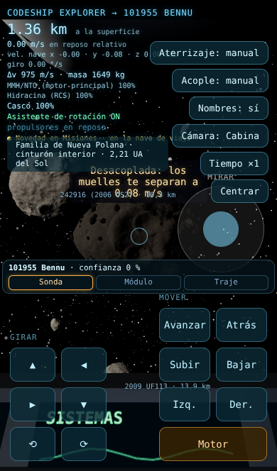 | 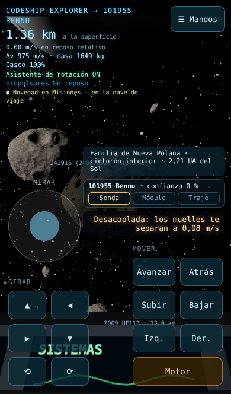 |
| Posado en Bennu, móvil | 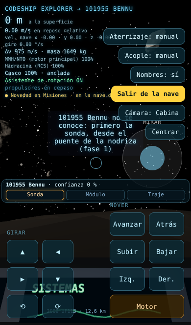 | 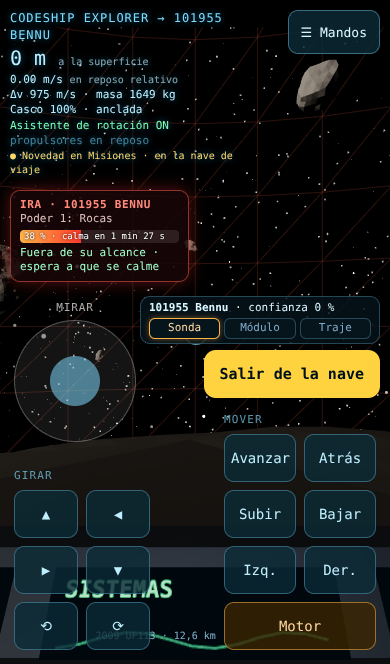 |
| Acoplado a la nodriza, móvil | 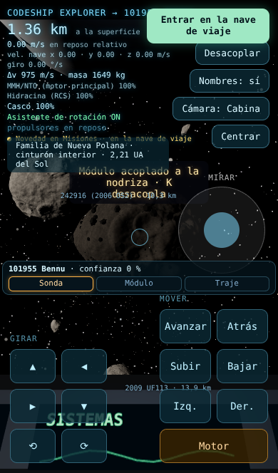 | 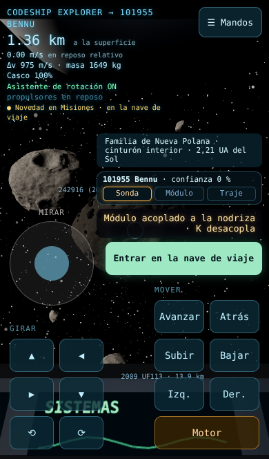 |
| Posado en Bennu, escritorio | 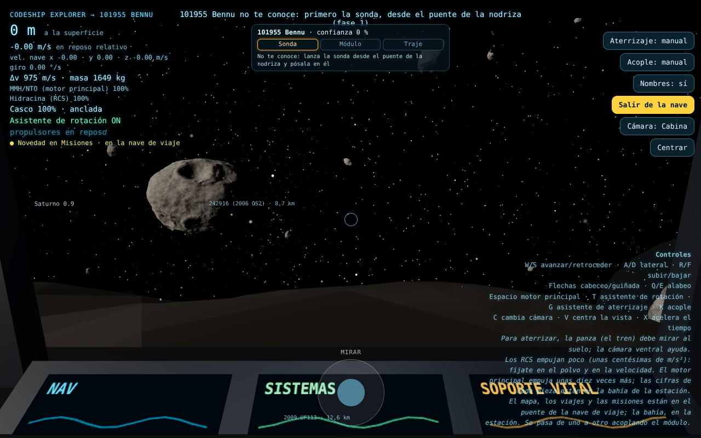 | 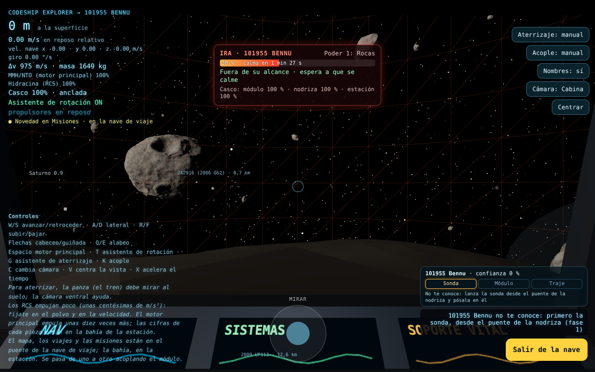 |
| Cabina acoplada, escritorio | 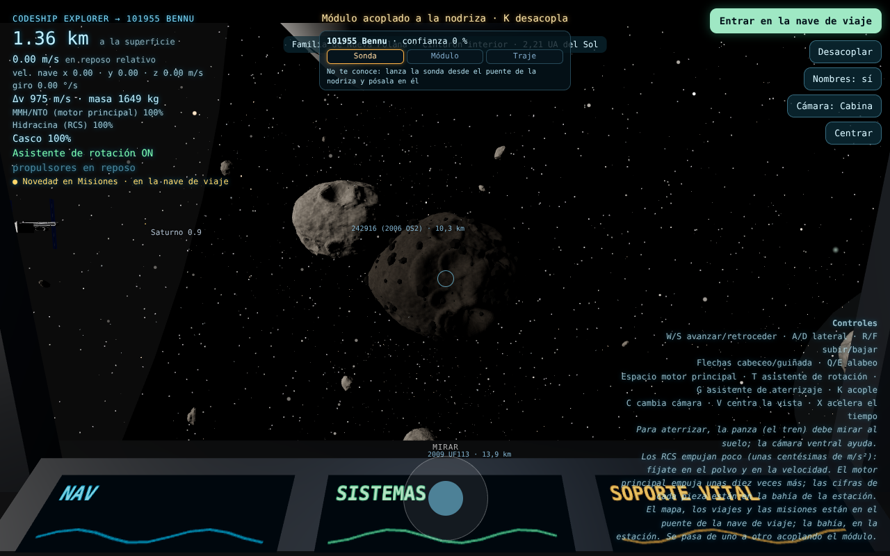 | 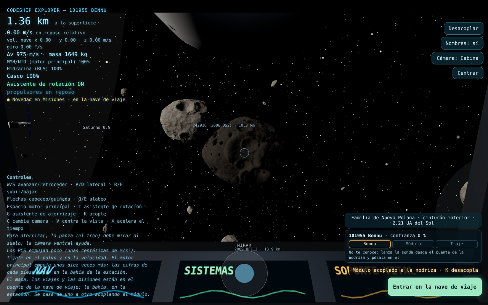 |
| Anillo, móvil | 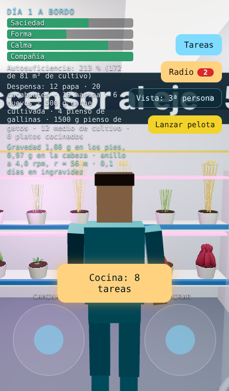 | 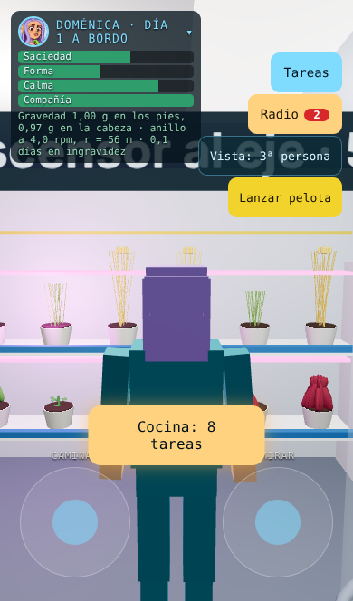 |
| Tablero de tareas, móvil | 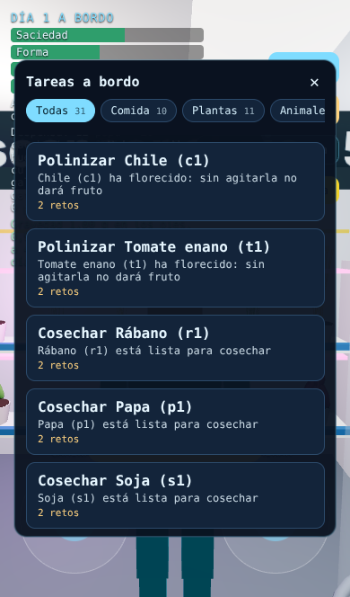 | 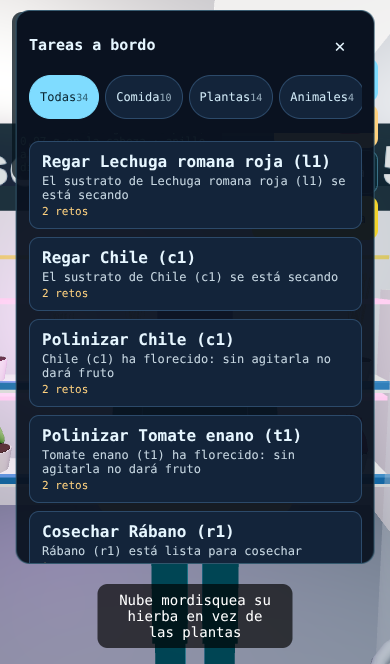 |
| Sonda, móvil | 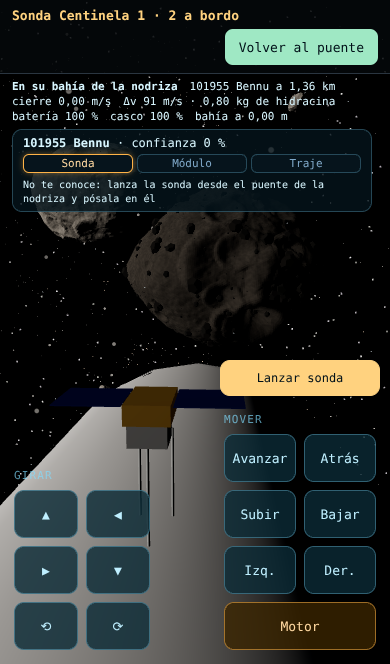 | 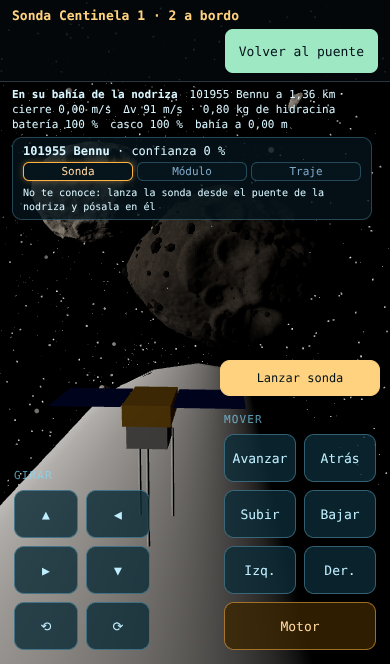 |
| Estación, pestaña Vida, móvil | 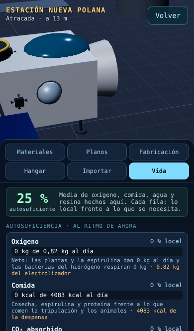 | 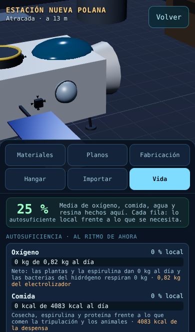 |
| Asteroide enfadado y radio, móvil | (nueva con `embestida`) | 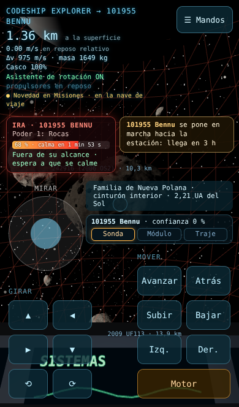 |
| Asteroide enfadado y radio, escritorio | (nueva con `embestida`) | 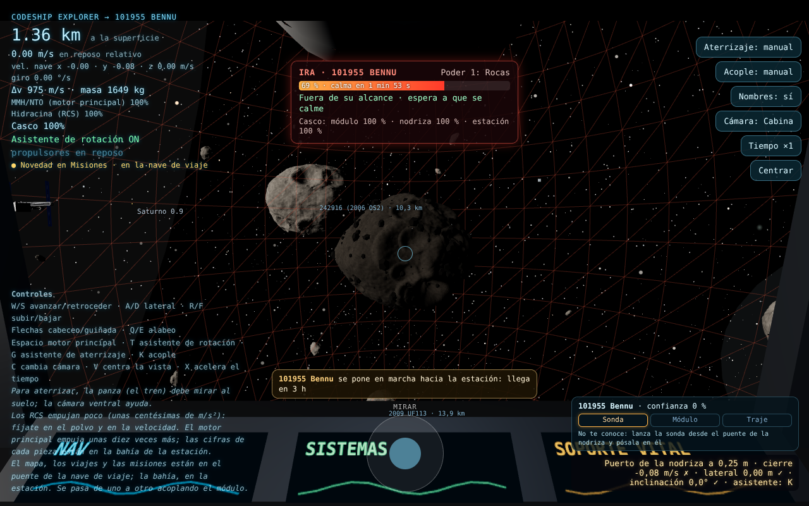 |

## 3. La organización

### Cabina y módulo posado (móvil)

```
┌──────────────────────────────┐
│ HUD breve        ojo ⇧ raíz  │  estado arriba-izq · ojo, levantarse y raíz arriba-dcha
│ (distancia, velocidad, Δv…)  │
│               ┌────────────┐ │
│               │ región     │ │
│               │ viaje      │ │  columna de contexto
│   escena      │            │ │  (de abajo arriba: lo más ligado a la acción, más cerca)
│               │ aviso      │ │
│  ( MIRAR )    │            │ │  (las acciones de modo, en máquinas del habitáculo)
│ GIRAR         │ MOVER      │ │
│ ▲ ◀           │ Avanzar …  │ │
│ ▶ ▼           │ … Motor    │ │
└──────────────────────────────┘
  pulgar izquierdo: orienta      pulgar derecho: mueve y actúa
```

- **Catálogo de iconos** (`src/ui/icon-catalog.ts`, Berón 2026-11-19): cada icono de `icons.ts` con lo que dibuja, lo que significa y dónde se usa; su prueba lo compara con el código. Antes de usar un icono para algo nuevo, mirar si está libre (`usedIn: []`) o añadir uno.
- **Iconos de raíz** (antes «☰ Mandos», retirado): arriba a la derecha, fijos, el **ojo** (cámara: cabina, exterior, ventral, trasera; 1ª/3ª persona; nombre accesible «Cámara: …», tecla C) y **Levantarse** (al habitáculo, H). De la raíz brotan Aterrizaje (G), Acople (K, solo en alcance), Tiempo y Centrar, y se recogen a los 5 s. Las etiquetas salen con una pulsación larga o siempre con la ayuda de teclado encendida. Todos ≥ 44 px y con nombre.
- **Sin botones de modo en la cabina:** «Entrar en la nave de viaje / en la estación», «Salir de la nave» (EVA), «Entrar en su mente» y «Nombres» ya no están en el HUD. Son máquinas del habitáculo del módulo: consola de acople, escotilla EVA, consola de la mente y esterilla ([habitaculo.md](habitaculo.md)). Fase y confianza del asteroide tampoco: viven en la consola de la mente y en la ficha del mapa.
- La **columna de contexto** (`.ctx-dock`, creada en `main.ts`) reúne el aviso, el chip del viaje y la región. Fuera de la cabina solo muestra el chip del viaje, abajo al centro, donde estaba.
- El HUD del móvil oculta las líneas de detalle (componentes de la velocidad, giro, cada tanque); en escritorio siguen.
- Después de un duelo, su pantalla de resultado tiene el botón para volver (Continuar / Cerrar): ya no aparece además «Volver a la cabina» encima.

### En todos los vehículos y modos

| Sitio | Qué va | Cabina | Sonda | Interior / estación | Paseo |
| --- | --- | --- | --- | --- | --- |
| Arriba a la izquierda | Estado | HUD | telemetría | barras, despensa, gravedad | traje, oxígeno, cable |
| Arriba a la derecha | Salir / menú | ojo, Levantarse, raíz | Volver al puente | Tareas, Radio, Vista (Salir en la estación); en el habitáculo y el puente, ojo y Tareas | Volver a la nave |
| Sobre el pulgar derecho / abajo al centro | Acción principal del momento | aviso (la acción, en una máquina del habitáculo) | Lanzar sonda, Convencer | botón de la zona («Bajar al módulo», «Cocina: 8 tareas») | Impulso, Tomar muestra |
| Abajo, a los lados | Mandos de movimiento | GIRAR+MIRAR / MOVER | GIRAR / MOVER | Caminar o flechas de salto (0 g) / Mirar | Caminar / Mirar |

### Habitáculo del módulo y puente de la nodriza

Salas a pie con cámara de casa de muñecas: arriba a la izquierda dónde está; arriba a la derecha el ojo (3ª/1ª persona, V) y Tareas (T); abajo MOVERSE y MIRAR; la tarjeta de la máquina junto a la que está, abajo (móvil) o abajo a la derecha (escritorio), con su acción principal (Intro). Un toque sobre una máquina la lleva andando. En el puente, bajo el título, la lista corta de avisos y una luz de color en cada consola. Con un reto abierto, todo eso se oculta (como H26).

### Mandos de la Switch, iguales en todos los niveles (2026-11-19, reglas.md §5.7–5.8)

Berón: «un solo sistema para todos los niveles, no copias». Los santuarios 1 y 3 y las salas a pie de las naves (las
cubiertas de la Starship, la estación, la cabina del LM y el puente) usan el mismo mando (`src/ui/game-pad.ts` sobre
`src/ui/action-pad.ts`). Cada nivel solo dice qué hace cada botón:

| Botón | Santuario 1 | Santuario 3 | Naves (0 g) |
| --- | --- | --- | --- |
| Cruceta ↑ / ↓ | Acercar / Alejar | Acercar / Alejar | Acercar / Alejar |
| B | Correr (sprint; en el agua, crol) | Correr | apagado |
| A | Saltar | Saltar | apagado |
| X | Trepar | Trepar | apagado |
| Y, L, ZL, R, ZR, ← → | apagados | apagados | apagados |
| «+» | Misiones | Tareas | Tareas |
| «−» | Áreas | Áreas | Áreas |
| Captura | Vista (1.ª/3.ª) | Vista | Vista |
| Inicio | Ajustes generales (y «Pantalla de inicio») | Ajustes (guarda y vuelve al inicio) | Ajustes (guarda y vuelve al inicio) |

- En ingravidez no se corre, salta ni trepa (§2.6): ella se mueve a saltos con las flechas de la escena; por eso A, B y X
  salen apagados en vez de inventarles otro uso.
- Lo que está en el mando (Vista, Tareas o Misiones, Áreas) no brota del engranaje (`data-pad` en `RootItem.pad`); el
  engranaje solo sale si queda algo más (Trayecto con un viaje, los botones propios de un modo).
- El mando se oculta en los retos (la hoja y la elección de reto), el pilotaje manual (`has-rcs-pad`, la cabina, el brazo en
  manual), las ventanas a pantalla completa (Tareas, Misiones, Áreas, ajustes, Navegación), los viajes automáticos y las
  pantallas de consola (`action-pad.css`). Solo lo muestra la escena en la que ella se mueve (`GamePad.use` al entrar,
  `GamePad.release` al salir).
- **Botón naranja** (`src/ui/interaction.ts`): «Reto: <cosa>» con el icono de reto cuando lo que hay cerca da un reto (las
  cosas del santuario 1, los puestos, simuladores y el lanzamiento del 3, y en las naves las tarjetas con retos `chore:` o
  `brazo:`); el nombre de la máquina con su icono si es otra cosa (escotilla, pantalla, ascensor). Con varios retos, el
  santuario 1 abre `RetoPicker`; el 3 y las naves muestran la tarjeta de la máquina, que ya los lista.
- **Andar en la Tierra** (`src/modules/aerial-sanctuary/application/free-walk.ts`, con pruebas): andar, correr, nadar, saltar,
  trepar y caer de un borde, igual en los dos santuarios; cada uno pone su paso (1,6 / 1,4 m/s andando) y su caída máxima
  (sin límite en el 1, 10 m en el 3). Poses y vista bajo el agua: `src/adapters/three/walk-look.ts`.

### Menú árbol general (2026-11-17, reglas.md §5.8–5.9)

Petición de Berón (18:22): un solo icono raíz, un **engranaje**, arriba a la derecha en todos los modos (cabina del LM, habitáculo, Starship, puente, estación). Al tocarlo se vuelve una **X** («Cerrar menú») y debajo brotan, en este orden: **Vista** (la cámara o 1ª/3ª persona), **Tareas**, **Áreas** ([areas.md](areas.md)), los botones propios del modo (en la cabina: tiempo, nivelar, el interruptor de acople, dejar el puesto…) **Panel** (solo junto a una máquina o un área), los botones propios del modo (en la cabina: tiempo, nivelar, el interruptor de acople, dejar el puesto…) y, solo mientras hay un viaje o una operación a distancia en marcha, **Trayecto**. **Solo se recoge con su X** (Berón, 2026-11-18): usar un icono no lo cierra y puede quedarse abierto todo el tiempo.

- Todo lo que antes estaba fijo fuera del menú (el ojo, Tareas, el interruptor de acople, «Dejar el puesto») brota ahora del engranaje: ya no hay iconos sueltos en el HUD.
- Un icono que abre una ventana pequeña (Trayecto, Panel) se vuelve una **X** («Cerrar trayecto», «Cerrar panel») mientras está abierta.
- **Se oculta un momento solo** durante los retos (el pilotaje manual cuenta como reto: el panel de pilotaje a mano de la Starship y el brazo en manual) y con las ventanas que ocupan casi toda la pantalla (**Tareas**, **Misiones**, **Áreas**), que toman el ancho completo y tienen su propio cierre. Al cerrarlas, el menú vuelve tal como estaba (abierto o cerrado). Excepción: en la cabina del LM el menú son los propios mandos de vuelo (levantarse, acople), así que no se oculta al pilotar a mano.
- **Panel**: la tarjeta de la máquina o del área donde está ella (sus acciones) ya no sale sola al llegar, en ningún vehículo. «Panel» la muestra y pasa a ser la X que la oculta; solo brota cuando hay una tarjeta que mostrar, y al ir a otra máquina se oculta otra vez (`src/ui/machine-panel.ts`, `body.panel-on`). Intro sigue usando la máquina con teclado.
- **Trayecto** es una ventana de solo estado: destino, fase, distancia, lo que falta en tiempo real y una barra. Sin «Ver trayecto» ni «Mando»: esos están solo en los mandos de pilotaje (§5.9). Se cierra sola al acabar el viaje.
- Con un reto abierto, el menú y sus ventanas se ocultan (como todo, sección 7).
- Código: `src/ui/root-menu.ts` (`RootMenu.global` pone Áreas, Panel y Trayecto en todos los menús; `root-menu.css` lo oculta con los retos y las ventanas grandes), `src/ui/hud-windows.ts` (las ventanas avisan al menú), `src/ui/trip-window.ts`. Recorrido: PX-42.

### Lista de tareas: lista y ajustes (2026-11-17)

Petición de Berón: «En las misiones sería ideal poner un icono de engranaje al lado del de cerrar: ocultaría las misiones y mostraría la opción de teletransporte/viaje, y ahí también tendríamos los filtros, y añadiríamos filtros de vehículo nave/estación. Por defecto se podría seleccionar automáticamente según dónde esté el personaje, pero también se podría elegir en los ajustes. Luego el botón de engranaje se convierte en un icono de lista y, al pulsarlo, oculta los ajustes y muestra las misiones; eso va alineado con la lógica del menú en árbol, ¿no?».

Sí: es la misma revelación progresiva del menú raíz (NN/g, sección 1). La cabecera tiene dos botones a la derecha, **[⚙︎][✕]**, de 44 px y con nombre accesible («Ajustes de tareas», «Cerrar tareas»). El ⚙︎ cambia la vista entera (no abre otra ventana encima) y pasa a ser el **icono de lista** («Volver a la lista de tareas»), en el mismo sitio, igual que la raíz que brota y se recoge. La lista se queda con las tareas y su «Ir», los chips de grupo (Berón, 2026-11-18: los filtros de grupo van en la lista) y una línea que dice qué enseña («En la estación (automático) · 20 de 55»); si hay tareas en otros vehículos, cuántas y que están en ⚙︎ › Todos. Viaje/Teletransporte y el vehículo viven en los ajustes. «Automático» enseña solo el vehículo donde está ella. Detalle en [viaje-a-una-tarea.md](viaje-a-una-tarea.md#ajustes-de-tareas). Capturas: `docs/screenshots/tareas-ajustes-*-movil.png` (PX-42).

## 4. Los retos: el fallo de los tres toques y la vista HUD

**Qué pasaba** (reproducido con el recorrido `cocina` y con la prueba `ChoreRun … crema de cacahuete`): en una cadena de pasos (crema de cacahuete: 7 pasos, 3 fallos permitidos) un fallo no cambia de paso, y la pantalla volvía a pintar las mismas opciones sin marcar la fallada. Cada toque sobre la misma opción errónea contaba **otro** fallo: el primero bajaba «Intentos» de 3 a 2, el segundo a 1 —con las celdas casi transparentes y contando hacia abajo, se veía como si el fallo se «desmarcara»— y el tercero agotaba los intentos: el reto se perdía, pero la pantalla seguía diciendo «Así no: inténtalo otra vez» con un único botón «Cerrar» justo donde estaban las opciones, así que parecía que la misión había terminado.

**Arreglo (para todos los retos: ordenar, completar, predecir, reparar, especificar; en las dos vistas)**:

- Dominio: `ChoreRun` recuerda las respuestas erróneas del paso (`Attempts`, `mind-duel/domain/attempts.ts`). Repetir una respuesta ya fallada **no cuenta** otro fallo, no pierde el reto y no avanza el paso; el fallo de la primera vez se queda contado para siempre (`mistakes` solo sube). Con TDD: `chore.test.ts`, `attempts.test.ts`.
- Pantalla (`ui/duel-view.ts`): la opción fallada se queda **marcada** (✗, roja, `aria-disabled`); tocarla otra vez dice «Esa ya falló: prueba otra» sin enviar nada. En «ordenar», el mismo orden fallado tampoco se envía («Ese orden ya falló: cambia algo»). También vale para los duelos con asteroides, gatos y la nano_net, que comparten pantalla.
- Fin del reto explícito: **«✓ Conseguido»** (pasos y fallos) con «Continuar», o **«✗ Reto perdido»** (fallos de máximo; no se ha gastado nada, se puede repetir) con «Cerrar».
- Un toque doble no responde dos veces: tras cada respuesta los toques se ignoran 0,3 s, y 0,9 s cuando el reto acaba (el botón del resultado aparece donde estaban las opciones).

**Indicadores escritos** en lugar de barras, con el estilo del velocímetro de la cabina (monoespaciada, número grande, halo `0 0 6px`, los mismos colores `ok #7dffb0` y `warn #ffb347` del HUD):

- `Aciertos 2/7 pasos` en verde en cuanto hay uno; `Fallos 1/3` en pálido con 0, **ámbar** con fallos y **rojo** cuando uno más pierde el reto (con «uno más y se pierde»). Los fallos solo cuentan hacia arriba.
- El número que cambia **late** (escala 1,6 → 1 con brillo, 0,7 s; sin animación con `prefers-reduced-motion`).
- En la vista HUD van sobre una **placa oscura** (`#020a12` al 85 %) con halo negro: incluso con la escena blanca detrás el contraste es ≈ 11:1 (verde), ≈ 8:1 (ámbar) y ≈ 5:1 (rojo), por encima del AA (4,5:1).
- Opciones en HUD: fondo casi opaco, 44 px de alto, borde de 2 px para el bloque colocado (seleccionado) y para la opción fallada (roja con ✗).
- **En la vista HUD cada paso cabe entero, sin desplazar** (390×664 y 1280×800, 2026-11-18). No se dibujan las casillas vacías: los bloques colocados llevan su número y, paso a paso, la pregunta dice cuál toca. Bloques y opciones son objetivos de 44 px de dos líneas como mucho (13 px). «Ver JavaScript» va al lado de la idea, y en «Ordenar todo» no se repite «Ordena los pasos». En el móvil la cabecera (botones, título, Aciertos/Fallos, el aviso) y la línea del plan van en la misma columna, no fijas encima: un aviso empuja los pasos en vez de taparlos. En pantallas anchas la línea del plan va abajo a la izquierda, lejos de los botones. Los recorridos lo comprueban paso a paso en la HUD (`Journey.fits`: «El paso … no cabe en …»).
- **La vista panel no cambia** (reglas §4.4): en un móvil deja el 30 % de arriba a la escena y la hoja se desplaza. Una ordenación no cabe en ella sin desplazar, ni siquiera de tres bloques cortos (748 px para 465 visibles en 390×664). Que la HUD sea la vista por defecto lo decide Berón; hasta entonces los recorridos en vista panel siguen avisando «Hay que desplazar…».

Antes (código de `integracion` al empezar), el mismo recorrido `cocina`: tres toques sobre «60 °C».

| Toque 1 | Toque 2 | Toque 3, vista HUD: reto perdido sin decirlo |
| --- | --- | --- |
| 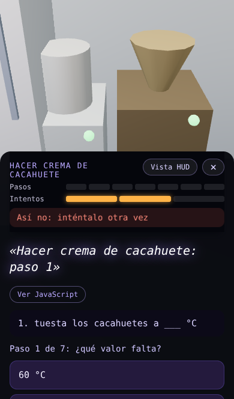 | 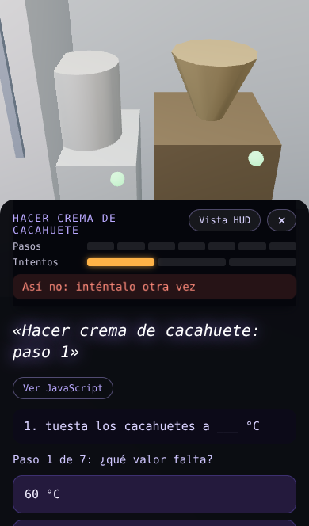 | 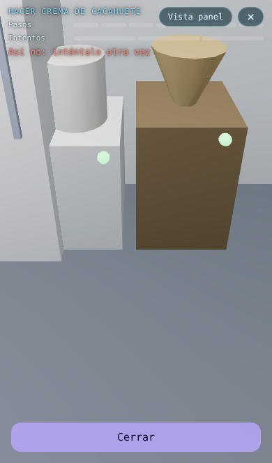 |

Después:

| Toque 3: sigue «Fallos 1/3», la opción marcada | Vista HUD con un fallo | Vista HUD, reto perdido |
| --- | --- | --- |
| 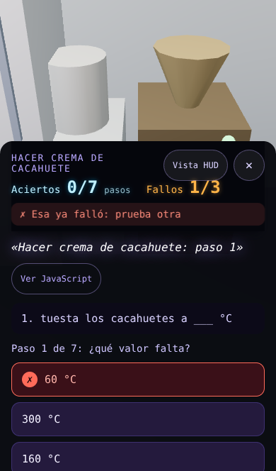 | 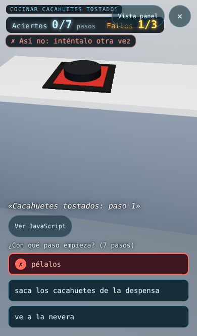 | 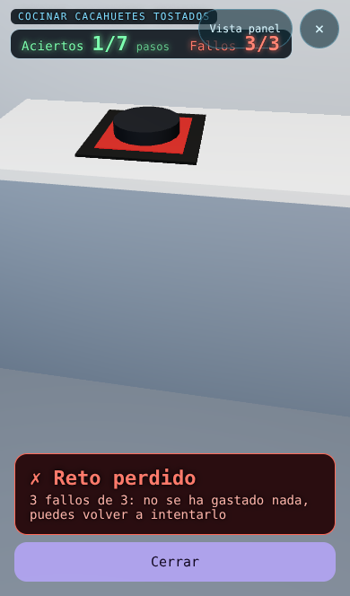 |

## 5. Problemas encontrados jugando

Apuntados por la suite (`j.problem`) o vistos en sus capturas:

| # | Problema | Estado |
| --- | --- | --- |
| 1 | Repetir la misma opción errónea contaba un fallo nuevo cada vez y terminaba perdiendo el reto (crema de cacahuete). | Arreglado (dominio + pantalla). |
| 2 | Barras de aciertos e intentos casi invisibles en HUD; «Intentos» contaba hacia abajo. | Arreglado: indicadores escritos que solo suben. |
| 3 | Al perder, «inténtalo otra vez» y un «Cerrar» donde estaban las opciones: un toque de más cerraba sin ver nada. | Arreglado: resultado explícito y 0,9 s sin toques. |
| 4 | Tras ganar un duelo con un asteroide, dos botones para lo mismo («Volver a la cabina» y «Cerrar»). | Arreglado: solo el del resultado. |
| 5 | Elegir una tarea flotando en el eje no daba ninguna señal y tardaba más de un minuto (planeo a 0,5 m/s + ascensor de medio minuto). | Arreglado: aviso y tirón por los asideros a 1,5 m/s. El ascensor sigue lento a propósito (Coriolis). |
| 6 | En la cabina del móvil los conmutadores tapaban el HUD; la acción principal se perdía entre ellos. | Arreglado (sección 3). |
| 7 | Avisos encima de la lista de tareas; aviso de misión encima del resultado del duelo. | Arreglado. |
| 8 | El estado del interior no se leía sobre carteles claros. | Arreglado: placa oscura. |
| 9 | En la hoja de retos (390×664 visibles) la tercera opción o la bandeja de «ordenar» quedan por debajo del borde: hay que desplazar. | Mejorado (hoja más alta y frase más pequeña en pantallas bajas); en los retos de ordenar con cinco o más bloques sigue haciendo falta desplazar. Abierto: probar una bandeja en horizontal. |
| 10 | En el eje, el cartel 3D «Puente de mando» queda cortado arriba, detrás del estado. | Abierto (cosmético). |
| 11 | La cabina tenía nueve botones a la vista (Mandos, Nombres, Cámara, Entrar, EVA, duelo, ficha de confianza…). | Arreglado: ojo, Levantarse y la raíz; lo demás en máquinas del habitáculo y en la esterilla. |

## 6. Reglas para lo que venga

1. Toda acción nueva que dependa del momento entra en la columna de contexto (o en el botón de zona de los modos de caminar), no en una esquina nueva.
2. Un botón nuevo del HUD brota del engranaje del menú árbol (reglas.md §5.8); si abre una ventana, se vuelve la X que la cierra. Un filtro o una opción de una lista no va encima de la lista: va en sus ajustes, tras el ⚙︎ de su cabecera (como la lista de tareas). Un mando de vuelo nuevo es un icono de la raíz (≥ 44 px, con nombre accesible y tecla); un ajuste que no cambia mientras se vuela va en los ajustes de la esterilla. Una acción de modo (entrar, salir, desacoplar) es una máquina del habitáculo, no un botón del HUD.
3. Ningún elemento fijo nuevo sin pasar `npm run experiencia -- acciones-movil acciones-escritorio`: 0 solapes en 390×664 y 1280×800.
4. Botones ≥ 44 px de alto en móvil; texto sobre la escena con placa o halo hasta 4,5:1.
5. El feedback de un acierto o un fallo lleva forma (✓/✗) además de color, y un número que solo sube.
6. Una interfaz nueva monta su raíz en `#app` y con eso ya respeta los retos (sección 7): no se añade a ninguna lista. Nada puede quedarse a la vista con un reto abierto (no hay excepciones ni marca para pedirlas): lo que el reto tenga que enseñar se dibuja en su escena o en su hoja.

## 7. Foco del reto

**Encargo** (Berón, 2026-11-16): «Habíamos quedado en que al entrar en un reto se ocultarían botones de otras interfaces y otros elementos (¿quizás interfaces enteras?), pero parece que no se está cumpliendo». La regla existía (H26) como una lista de selectores en `acciones.css` y en otras hojas; desde entonces llegaron muchas interfaces que no estaban en la lista. La auditoría de PX-25 (H47–H56 en [hallazgos.md](../qa/hallazgos.md)) encontró interfaces de más en la mesa de navegación del puente (la consola entera), la cabina del módulo (retícula), las pantallas de la estación, la bahía de la nave, el aviso del teletransporte y los avisos de misión, y una docena de raíces que ninguna regla cubría. En el anillo, el acuario, el yoga, la cocina y las máquinas de la estación, el traje y la mente desde el habitáculo la lista vieja sí bastaba.

**La regla** ([reglas.md](reglas.md) §4.3). Mientras hay un reto abierto (`body.in-duel`), en pantalla solo quedan:

1. **la hoja del reto** (`.duel`, en cualquiera de sus dos vistas, panel o HUD; la vista panel no cambia). Dentro de ella va la línea del paso (`.plan-caption`, la que dice qué parte del plan acaba de dibujarse): la hoja la guarda entre dibujos (`DuelView.hold`) y se sigue viendo arriba a la izquierda, como antes;
2. **la escena 3D** (el lienzo del juego, con el encuadre que pone el reto y los pasos visibles dibujados en ella).

Nada más, **sin excepciones** (Berón, 2026-11-17: reglas generales sin excepciones): ni iconos de la raíz, ni barra del viaje a una tarea con «Parar», ni ficha del viaje con «Ver trayecto», ni indicadores del aterrizaje, ni fichas de estación, estado del interior (`.ihud`) y líneas de estado, ni cruceta, palancas de mirar y caminar, ni avisos del entorno, avisos de misión, estado del acuario, cámaras del dique, carteles de las consolas del puente, tarjetas de las máquinas del habitáculo, ajustes, fichas del mapa, mandos de la sonda o el HUD de cualquier modo (vuelo, interior, estación, habitáculo del módulo, puente, paseo espacial).

**Un solo mecanismo** (`src/ui/foco-reto.css`, importado por `duel-view.ts`). Toda la interfaz del juego cuelga de una capa, `#app`: cada pantalla monta allí su raíz, y la hoja del reto se monta a su lado. Una sola regla oculta todas las raíces que no son la escena, la hoja o algo marcado a propósito:

```css
body.in-duel > :not(#app, script, style),
body.in-duel #app > :not(canvas, .duel) { display: none !important; }
```

No es una lista: una interfaz nueva queda oculta durante los retos sin que nadie se acuerde de añadirla. Tampoco hay una marca para dejar algo a la vista: la regla nombra sus dos cosas y nada más (hasta 2026-11-17 la línea del paso era una tercera, fuera de la hoja; ahora va dentro). Las reglas viejas de `body.in-duel …` de cada hoja se quedan (no estorban), pero ya no hacen falta.

**El plan se dibuja en la escena del reto** (antes, una excepción: `data-duel-keep` dejaba a la vista la capa del puente con el mapa de navegación mientras dibujaba el plan de un viaje; quitada en la rama `cabina-lm`). Los pasos de un reto que programa un viaje o un aterrizaje dibujan el plan en la escena 3D (`PlanOverlay`). Una sola regla para todos los sitios (`PlanOverlay.view`, llamada en `present()` de `main.ts`): si la vista que hay en pantalla enseña al menos la mitad de los puntos del plan sobre la hoja (la cabina del módulo, la consola de la sonda, la cámara ventral del aterrizaje), se queda; si no (la mesa de navegación del puente, cuya cámara mira por la ventana, o una sala que no es la escena del espacio), el lienzo pasa a la escena del plan con una cámara que lo encuadra entero en la franja que deja la hoja (arriba en vertical, a la izquierda en horizontal). Se decide una vez por plan, sin parpadeos, y vuelve al cerrar el reto. El mapa se oculta con el reto como cualquier interfaz y, al cerrarlo, enseña el plan unos segundos.

**Excepciones decididas.**

- **Mirar la escena**: no queda ningún botón de cámara (ni el ojo ni las palancas de mirar). El reto ya encuadra la escena para que se vea el paso, y un botón de cámara sería otra interfaz encima. El lienzo no se oculta, así que el arrastre sobre la escena sigue funcionando en los modos que lo tienen.
- **Alertas críticas** (un ataque de un asteroide enfadado: un proyectil o una embestida que vuela hacia la nave o la estación en la que está Doménica, o hacia la sonda mientras la pilota; `AsteroidWrath.underAttack`, `WrathMode.critical`): **terminan el reto**, como «×», en lugar de taparlo o quedar tapadas. El que lo abrió lo cancela como siempre, no se gasta nada y se puede repetir después; al cerrarse vuelven el aviso, la ficha de la ira y los mandos para esquivar (`DuelView.interrupt`, llamado desde el bucle de `main.ts`). Un asteroide enfadado que solo la tiene a su alcance no es todavía un ataque (eso es `threatened`, que frena el tiempo): así un reto perdido enseña su resultado antes de que lleguen las rocas. No se pausa: los retos los abren nueve sitios distintos, cada uno con su estado, y una pausa obligaría a guardarlo en todos; terminarlo sin coste es igual de justo y más simple.
- **Ver trayecto** se dibuja dentro del lienzo y a pantalla completa, así que la regla de capas no lo alcanza: mientras hay un reto se queda abierto pero sin dibujar (`TripPreview.held`), y vuelve al cerrarlo. El invariante lo comprueba aparte.
- **Avisos que llegan durante un reto** (misión, radio, entorno): no se ven encima de la hoja. El aviso de misión, que antes bajaba al pie de la pantalla, espera debajo y cuenta sus 7 s cuando el reto se cierra (`mission-log.ts`), para no perderse.

**Antes y después** (PX-25, iPhone 13; hallazgos H47–H56):

| | Mesa de navegación (viaje) | Importar (estación) | Bahía (cambiar pieza) | Aviso de misión durante una receta |
| --- | --- | --- | --- | --- |
| Antes | 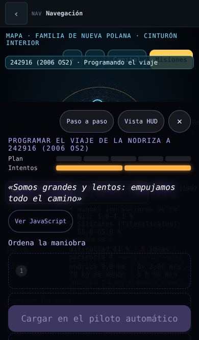 | 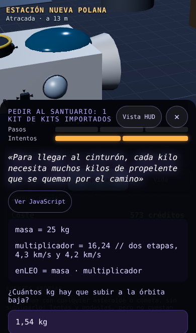 | 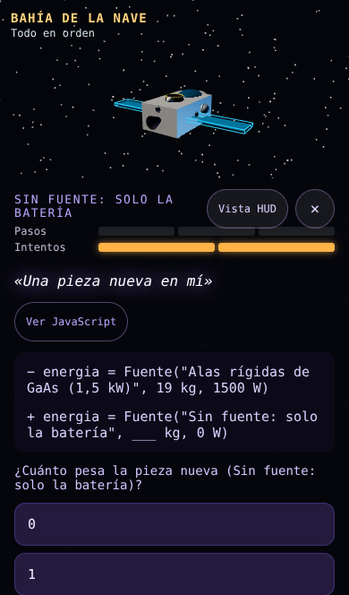 | 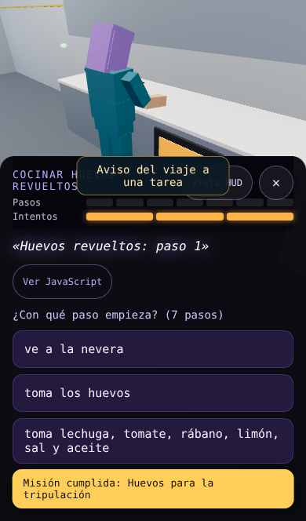 |
| Después | 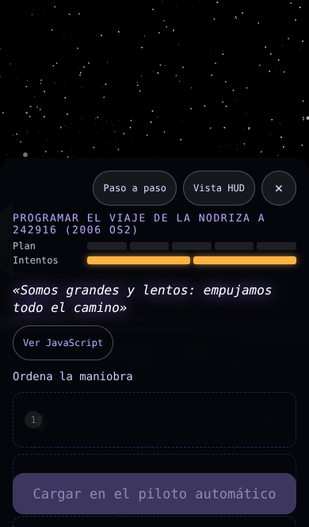 | 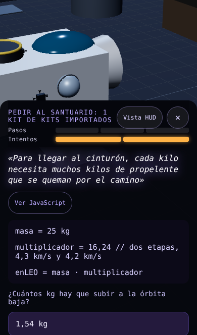 | 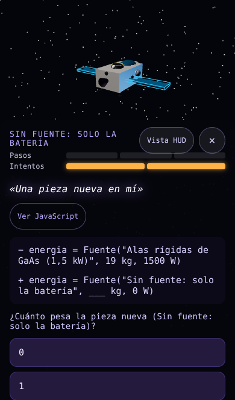 | 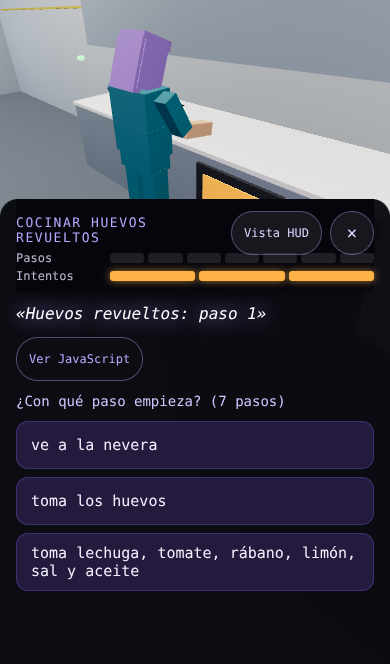 |

**Cómo se comprueba.** `j.onlyChallengeVisible()` (`tools/experiencia/lib.mjs`) recorre todos los elementos fuera de la hoja, la escena y lo marcado, y falla si alguno pinta algo en la pantalla (texto, fondo, borde, imagen o control) o si un toque en una rejilla de 12 px cae en él. `j.waitDuel()` lo llama cada vez que un recorrido abre un reto, así que lo cumplen todos los recorridos; PX-25 (`foco`) abre cada clase de reto en cada sitio, con toques, y guarda una captura de cada uno en `docs/screenshots/foco-<sitio>-movil.png`.
