# Auditoría de animaciones de los retos

Generado por `tools/experiencia/animaciones.mjs` (recorrido PX-20, `npm run experiencia -- PX-20`), en un iPhone 13 (390 × 664 visibles, 1×).
Cada reto se juega con toques en las respuestas correctas, en «paso a paso» (cada bloque bien colocado es un paso). Tras cada paso se mide en la escena 3D (`src/adapters/three/interior/step-audit.ts`):

- **Alcance**: cada objeto a ≤ 0.8 m de una de sus manos, o sobre el sitio del paso (≤ 0,45 m) con ella de pie delante (≤ 0,9 m).
- **A la vista**: alguna parte del objeto en la franja de escena sobre la hoja del reto y sin muebles ni su cuerpo delante.
- **Sin atravesar**: el centro del objeto no está dentro de otra pieza (encimera, pared, máquina).
- **Gesto**: su pose se aparta de la de espera al menos 0.3 rad, y su mano se ve.
- **Planes de viaje y aterrizaje**: cada paso añade su parte del plan, con rótulo, y sus puntos quedan en pantalla sobre la hoja.

Regla (docs/qa/README.md): todo reto o visual de paso nuevo debe pasar esta auditoría.

**189 de 226 pasos bien.**

Tareas del anillo jugadas: 38 (18 clases).
Sin visual de pasos (no se pueden auditar hasta que lo tengan; abiertos): la cocina de la estación (`station-life.ts` abre la hoja sin `StepVisual`), las tareas de nano_net en un núcleo y las de las máquinas de la estación (fabricar, refinar, importar).

| Tarea | Paso | Se ve | Captura | Resultado |
|---|---|---|---|---|
| Cocinar Huevos revueltos | ve a la nevera | tomar · nevera | 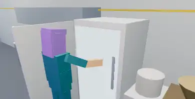 | ✗ shells0 no se ve (tapado por BoxGeometry); shells0 dentro de otra pieza (BoxGeometry); shells1 no se ve (tapado por BoxGeometry); shells1 dentro de otra pieza (BoxGeometry) |
| Cocinar Huevos revueltos | toma los huevos | cascar · encimera |  | ✓ bien |
| Cocinar Huevos revueltos | calienta la plancha | calentar · fogon | 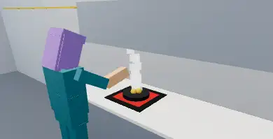 | ✓ bien |
| Cocinar Huevos revueltos | revuelve los huevos | remover · fogon | 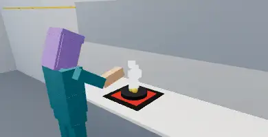 | ✓ bien |
| Cocinar Huevos revueltos | 71 °C | calentar · fogon | 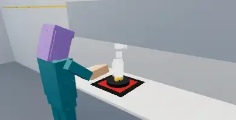 | ✓ bien |
| Cocinar Huevos revueltos | especia con sal y pimienta | sazonar · fogon |  | ✓ bien |
| Cocinar Huevos revueltos | emplata | emplatar · encimera |  | ✓ bien |
| Cocinar Ensalada de la nave | toma lechuga, tomate, rábano, limón, sal y aceite | tomar · nevera | 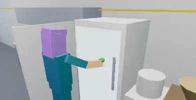 | ✗ food0 no se ve (tapado por BoxGeometry); food0 dentro de otra pieza (BoxGeometry); food1 no se ve (tapado por BoxGeometry); food1 dentro de otra pieza (BoxGeometry) |
| Cocinar Ensalada de la nave | lava los vegetales | lavar · encimera |  | ✓ bien |
| Cocinar Ensalada de la nave | corta los vegetales | cortar · encimera | 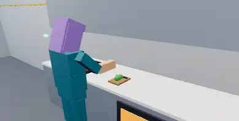 | ✓ bien |
| Cocinar Ensalada de la nave | mezcla todo en el bol | batir · encimera | 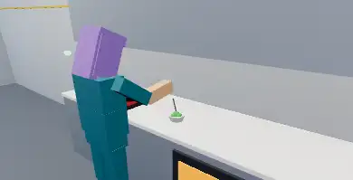 | ✓ bien |
| Cocinar Ensalada de la nave | aliña con sal, limón y aceite | sazonar · encimera |  | ✓ bien |
| Cocinar Ensalada de la nave | emplata | emplatar · encimera |  | ✓ bien |
| Cocinar Tortilla de papa | pela las papas | cortar · encimera |  | ✓ bien |
| Cocinar Tortilla de papa | córtalas en láminas finas | cortar · encimera |  | ✓ bien |
| Cocinar Tortilla de papa | fríelas a fuego medio hasta que estén tiernas | calentar · fogon |  | ✓ bien |
| Cocinar Tortilla de papa | bate los huevos con sal | batir · encimera | 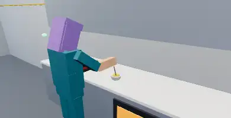 | ✓ bien |
| Cocinar Tortilla de papa | mezcla las papas con el huevo | batir · encimera |  | ✓ bien |
| Cocinar Tortilla de papa | cuaja un lado en la sartén | calentar · fogon |  | ✓ bien |
| Cocinar Tortilla de papa | dale la vuelta con un plato | calentar · fogon |  | ✓ bien |
| Cocinar Tortilla de papa | 71 °C | calentar · fogon | 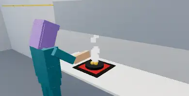 | ✓ bien |
| Cocinar Chapati (pan plano de trigo) | mezcla la harina integral con agua y sal | batir · encimera |  | ✓ bien |
| Cocinar Chapati (pan plano de trigo) | amasa hasta que la masa esté lisa | amasar · encimera |  | ✓ bien |
| Cocinar Chapati (pan plano de trigo) | deja reposar la masa | reposar · encimera |  | ✓ bien |
| Cocinar Chapati (pan plano de trigo) | divídela en bolitas | cortar · encimera |  | ✓ bien |
| Cocinar Chapati (pan plano de trigo) | estira cada bolita en un disco | amasar · encimera |  | ✓ bien |
| Cocinar Chapati (pan plano de trigo) | cuécelo en la plancha caliente por los dos lados | calentar · fogon |  | ✓ bien |
| Cocinar Chapati (pan plano de trigo) | sirve caliente | emplatar · encimera |  | ✓ bien |
| Cocinar Tofu salteado con chile | corta el tofu en dados | cortar · encimera |  | ✓ bien |
| Cocinar Tofu salteado con chile | sécalo con un paño | lavar · encimera |  | ✓ bien |
| Cocinar Tofu salteado con chile | saltea el tofu hasta dorarlo | calentar · fogon |  | ✓ bien |
| Cocinar Tofu salteado con chile | añade el chile picado | verter · fogon | 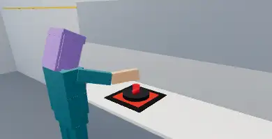 | ✓ bien |
| Cocinar Tofu salteado con chile | sazona con sal y soja | sazonar · fogon |  | ✓ bien |
| Cocinar Tofu salteado con chile | sirve | emplatar · encimera | 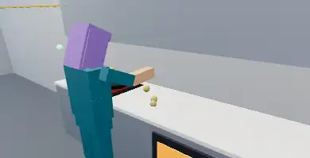 | ✓ bien |
| Cocinar Carne cultivada con papas | saca la carne de la cámara fría | tomar · nevera |  | ✗ food0 dentro de otra pieza (BoxGeometry); food1 dentro de otra pieza (BoxGeometry) |
| Cocinar Carne cultivada con papas | sécala y sálala | lavar · encimera |  | ✓ bien |
| Cocinar Carne cultivada con papas | cuece las papas | hervir · fogon |  | ✓ bien |
| Cocinar Carne cultivada con papas | calienta la plancha | calentar · fogon | 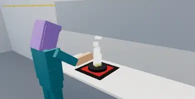 | ✓ bien |
| Cocinar Carne cultivada con papas | 71 °C | calentar · fogon |  | ✓ bien |
| Cocinar Carne cultivada con papas | deja reposar la carne | reposar · encimera | 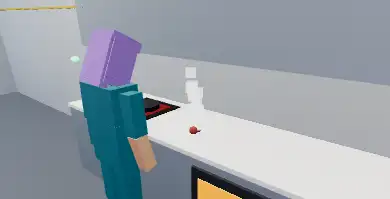 | ✓ bien |
| Cocinar Carne cultivada con papas | emplata con las papas | emplatar · encimera |  | ✓ bien |
| Cocinar Milpa con chile | toma frijol, maíz nixtamalizado, amaranto y chile | tomar · despensa | 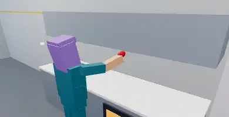 | ✓ bien |
| Cocinar Milpa con chile | prepara la masa de maíz | amasar · encimera | 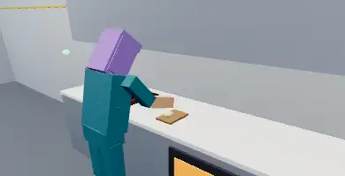 | ✓ bien |
| Cocinar Milpa con chile | cuece los frijoles | hervir · fogon |  | ✓ bien |
| Cocinar Milpa con chile | tuesta el amaranto | hornear · fogon |  | ✓ bien |
| Cocinar Milpa con chile | haz la salsa de chile | batir · encimera |  | ✓ bien |
| Cocinar Milpa con chile | arma el plato de milpa | emplatar · encimera |  | ✓ bien |
| Cocinar Cacahuetes tostados | saca los cacahuetes de la despensa | tomar · despensa | 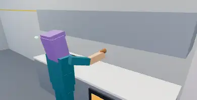 | ✓ bien |
| Cocinar Cacahuetes tostados | pélalos | cortar · encimera |  | ✓ bien |
| Cocinar Cacahuetes tostados | extiéndelos en la bandeja | verter · encimera | 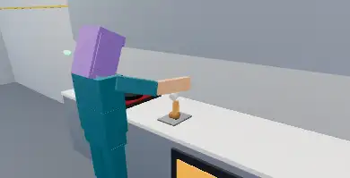 | ✓ bien |
| Cocinar Cacahuetes tostados | 160 °C | hornear · horno |  | ✓ bien |
| Cocinar Cacahuetes tostados | remueve a media cocción | remover · horno | 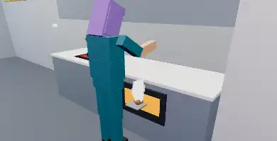 | ✓ bien |
| Cocinar Cacahuetes tostados | déjalos enfriar | reposar · encimera |  | ✓ bien |
| Cocinar Cacahuetes tostados | sirve con una pizca de sal | emplatar · encimera |  | ✓ bien |
| Cocinar Gachas de avena con cacahuete | mide la avena de la despensa seca | tomar · despensa |  | ✓ bien |
| Cocinar Gachas de avena con cacahuete | hiérvela en agua | hervir · fogon | 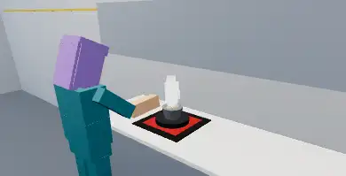 | ✓ bien |
| Cocinar Gachas de avena con cacahuete | remueve hasta que espese | remover · fogon | 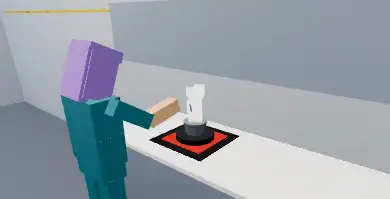 | ✓ bien |
| Cocinar Gachas de avena con cacahuete | pica los cacahuetes | cortar · encimera | 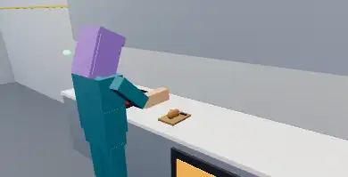 | ✓ bien |
| Cocinar Gachas de avena con cacahuete | sirve las gachas en el bol | emplatar · encimera |  | ✓ bien |
| Cocinar Gachas de avena con cacahuete | cúbrelas con el cacahuete | emplatar · encimera |  | ✓ bien |
| Cocinar Llapingachos con salsa de maní | cuece las papas | hervir · fogon | 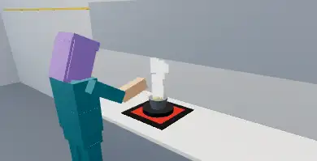 | ✓ bien |
| Cocinar Llapingachos con salsa de maní | aplástalas con cebolla, comino y achiote | amasar · encimera |  | ✓ bien |
| Cocinar Llapingachos con salsa de maní | forma las tortitas | amasar · encimera | 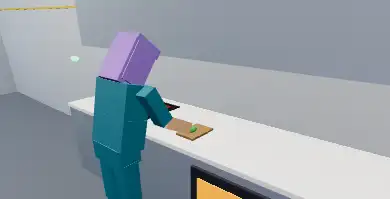 | ✓ bien |
| Cocinar Llapingachos con salsa de maní | dóralas en la plancha | calentar · fogon | 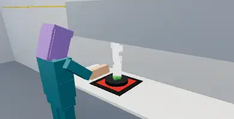 | ✓ bien |
| Cocinar Llapingachos con salsa de maní | muele el maní con cebolla para la salsa | moler · encimera |  | ✓ bien |
| Cocinar Llapingachos con salsa de maní | 71 °C | calentar · fogon | 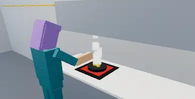 | ✓ bien |
| Cocinar Llapingachos con salsa de maní | sirve con la salsa de maní | emplatar · encimera |  | ✓ bien |
| Cocinar Bol de fruta de la cubierta | recoge fresas e higos maduros | tomar · nevera | 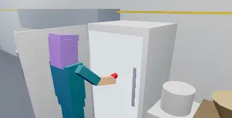 | ✗ food0 no se ve (tapado por BoxGeometry); food0 dentro de otra pieza (BoxGeometry); food1 no se ve (tapado por BoxGeometry); food1 dentro de otra pieza (BoxGeometry) |
| Cocinar Bol de fruta de la cubierta | lávalos con cuidado | lavar · encimera |  | ✓ bien |
| Cocinar Bol de fruta de la cubierta | quita el rabito a las fresas | cortar · encimera |  | ✓ bien |
| Cocinar Bol de fruta de la cubierta | corta los higos en cuartos | cortar · encimera |  | ✓ bien |
| Cocinar Bol de fruta de la cubierta | mezcla la fruta en el bol | batir · encimera |  | ✓ bien |
| Cocinar Bol de fruta de la cubierta | esparce cacahuete picado | verter · encimera |  | ✓ bien |
| Cocinar Bol de fruta de la cubierta | sirve frío | emplatar · encimera |  | ✓ bien |
| Cocinar Desayuno completo: avena, fresas y crema de cacahuete | hierve la avena en agua | hervir · fogon | 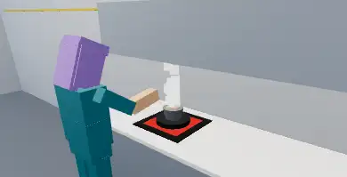 | ✓ bien |
| Cocinar Desayuno completo: avena, fresas y crema de cacahuete | remueve hasta que espese | remover · fogon | 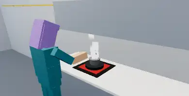 | ✓ bien |
| Cocinar Desayuno completo: avena, fresas y crema de cacahuete | lava y corta las fresas | lavar · encimera |  | ✓ bien |
| Cocinar Desayuno completo: avena, fresas y crema de cacahuete | sirve las gachas | emplatar · encimera |  | ✓ bien |
| Cocinar Desayuno completo: avena, fresas y crema de cacahuete | añade dos cucharadas de crema de cacahuete | verter · encimera | 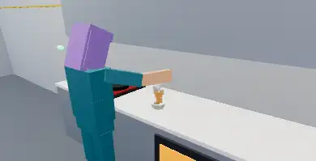 | ✓ bien |
| Cocinar Desayuno completo: avena, fresas y crema de cacahuete | cubre con las fresas | emplatar · encimera | 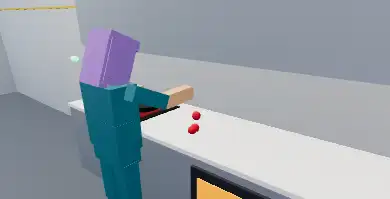 | ✓ bien |
| Cocinar Higos asados con crema de cacahuete | lava los higos | lavar · encimera | 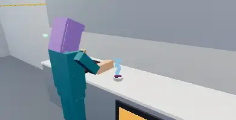 | ✓ bien |
| Cocinar Higos asados con crema de cacahuete | córtalos por la mitad | cortar · encimera |  | ✓ bien |
| Cocinar Higos asados con crema de cacahuete | ponlos en la bandeja con el corte hacia arriba | verter · encimera | 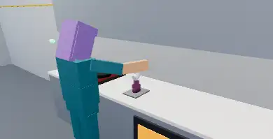 | ✓ bien |
| Cocinar Higos asados con crema de cacahuete | ásalos en el horno hasta que se ablanden | hornear · horno | 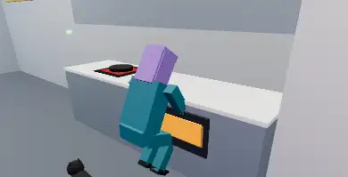 | ✓ bien |
| Cocinar Higos asados con crema de cacahuete | sirve con una cucharada de crema de cacahuete | emplatar · encimera |  | ✗ food1 dentro de otra pieza (BoxGeometry); food2 lejos de sus manos (0.87 m) y fuera del puesto |
| Cocinar Chapati con fresas y crema de cacahuete | amasa harina, agua y sal | amasar · encimera | 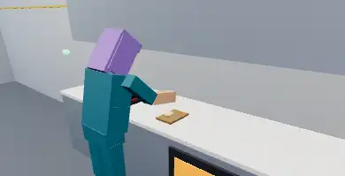 | ✓ bien |
| Cocinar Chapati con fresas y crema de cacahuete | estira los discos | amasar · encimera |  | ✓ bien |
| Cocinar Chapati con fresas y crema de cacahuete | cuécelos en la plancha caliente | calentar · fogon |  | ✓ bien |
| Cocinar Chapati con fresas y crema de cacahuete | unta la crema de cacahuete | verter · fogon |  | ✓ bien |
| Cocinar Chapati con fresas y crema de cacahuete | corta las fresas en láminas | cortar · encimera |  | ✓ bien |
| Cocinar Chapati con fresas y crema de cacahuete | enrolla el chapati con las fresas | emplatar · encimera |  | ✓ bien |
| Cocinar Mercimek (sopa turca de lenteja) | toma lenteja roja, zanahoria, cebolla, comino y limón | tomar · despensa | 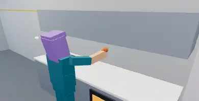 | ✓ bien |
| Cocinar Mercimek (sopa turca de lenteja) | sofríe cebolla y zanahoria | calentar · fogon | 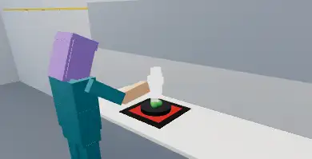 | ✓ bien |
| Cocinar Mercimek (sopa turca de lenteja) | añade la lenteja y agua | verter · fogon |  | ✓ bien |
| Cocinar Mercimek (sopa turca de lenteja) | cuece hasta deshacer | hervir · fogon | 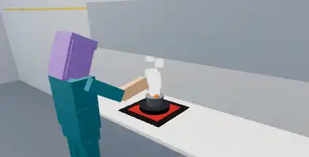 | ✓ bien |
| Cocinar Mercimek (sopa turca de lenteja) | tritura la sopa | moler · fogon | 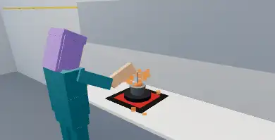 | ✓ bien |
| Cocinar Mercimek (sopa turca de lenteja) | sazona con comino | sazonar · fogon | 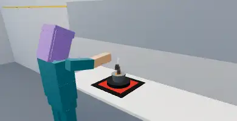 | ✓ bien |
| Cocinar Mercimek (sopa turca de lenteja) | sirve con limón | emplatar · encimera |  | ✓ bien |
| Reparar procesador de soja | vacía el depósito | lavar · objetivo |  | ✓ bien |
| Reparar procesador de soja | desatasca el filtro | reparar · objetivo |  | ✓ bien |
| Reparar procesador de soja | cambia la junta de la prensa | reparar · objetivo |  | ✓ bien |
| Reparar procesador de soja | llena con agua limpia | reparar · objetivo |  | ✓ bien |
| Reparar procesador de soja | haz un ciclo de prueba | revisar · objetivo |  | ✓ bien |
| Reparar procesador de soja | 100 °C | reparar · objetivo |  | ✓ bien |
| Moler trigo | limpia el grano | lavar · encimera |  | ✓ bien |
| Moler trigo | ajusta las muelas | moler · molino | 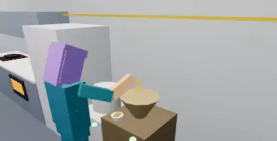 | ✓ bien |
| Moler trigo | muele el trigo | moler · molino |  | ✓ bien |
| Moler trigo | tamiza la harina | verter · encimera |  | ✓ bien |
| Moler trigo | guarda la harina | emplatar · encimera |  | ✓ bien |
| Preparar pienso de gallinas | muele el trigo | moler · molino | 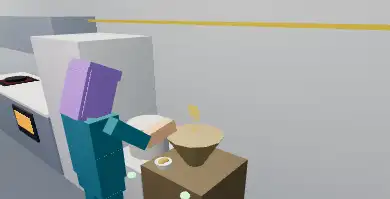 | ✓ bien |
| Preparar pienso de gallinas | muele la soja | moler · molino | 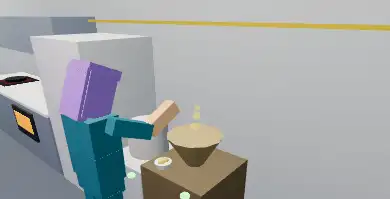 | ✓ bien |
| Preparar pienso de gallinas | añade calcio de cáscara triturada | verter · encimera |  | ✓ bien |
| Preparar pienso de gallinas | mezcla el pienso | batir · encimera |  | ✓ bien |
| Preparar pienso de gallinas | guárdalo seco | emplatar · encimera |  | ✓ bien |
| Hacer crema de cacahuete | 160 °C | hornear · horno |  | ✓ bien |
| Hacer crema de cacahuete | 138 °C | hornear · horno | 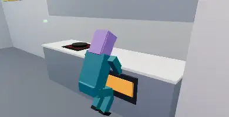 | ✓ bien |
| Hacer crema de cacahuete | quítales la piel | cortar · encimera |  | ✓ bien |
| Hacer crema de cacahuete | muélelos en grueso | moler · molino | 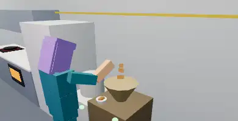 | ✓ bien |
| Hacer crema de cacahuete | muélelos en fino | moler · molino | 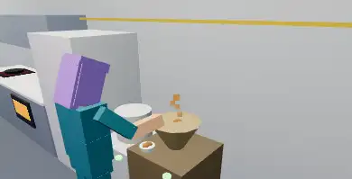 | ✓ bien |
| Hacer crema de cacahuete | añade sal | sazonar · encimera |  | ✓ bien |
| Hacer crema de cacahuete | envasa la crema | emplatar · encimera |  | ✓ bien |
| Reparar bastidores de cultivo | corta la corriente de los LED | reparar · objetivo | 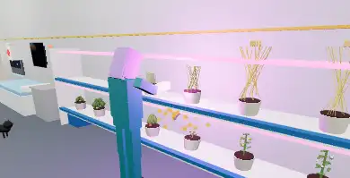 | ✓ bien |
| Reparar bastidores de cultivo | cambia la bomba de la solución | reparar · objetivo | 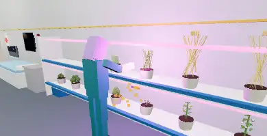 | ✓ bien |
| Reparar bastidores de cultivo | purga el aire de los tubos | lavar · objetivo | 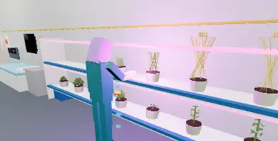 | ✓ bien |
| Reparar bastidores de cultivo | comprueba el caudal | revisar · objetivo | 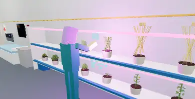 | ✗ tablet dentro de otra pieza (CylinderGeometry) |
| Reparar bastidores de cultivo | vuelve a encender los LED | reparar · objetivo | 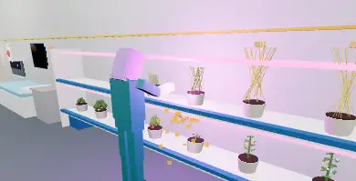 | ✓ bien |
| Reparar bastidores de cultivo | 5,8 | reparar · objetivo |  | ✓ bien |
| Regar Lechuga romana roja (l1) | 0,4 | regar · objetivo |  | ✓ bien |
| Regar Lechuga romana roja (l1) | llenar la regadera | regar · objetivo |  | ✓ bien |
| Regar Lechuga romana roja (l1) | regar la base del tallo | regar · objetivo |  | ✓ bien |
| Regar Lechuga romana roja (l1) | comprobar que drena | revisar · objetivo |  | ✓ bien |
| Curar Lechuga romana roja (l2) | revisar las hojas | revisar · objetivo |  | ✓ bien |
| Curar Lechuga romana roja (l2) | cortar las hojas dañadas | cosechar · objetivo |  | ✓ bien |
| Curar Lechuga romana roja (l2) | asegurar la maceta | revisar · objetivo |  | ✓ bien |
| Curar Lechuga romana roja (l2) | regar la base | regar · objetivo |  | ✓ bien |
| Curar Lechuga romana roja (l2) | 0,6 | revisar · objetivo |  | ✓ bien |
| Polinizar Chile (c1) | Agita la planta con suavidad para que el polen caiga en sus flores | agitar · objetivo |  | ✓ bien |
| Polinizar Chile (c1) | sujetar la maceta | agitar · objetivo |  | ✓ bien |
| Polinizar Chile (c1) | agitar el tallo con suavidad | agitar · objetivo |  | ✓ bien |
| Polinizar Chile (c1) | repetir en cada flor abierta | agitar · objetivo |  | ✓ bien |
| Cosechar Rábano (r1) | comprobar que está madura | revisar · objetivo |  | ✓ bien |
| Cosechar Rábano (r1) | cortar con tijeras limpias | cortar · objetivo |  | ✓ bien |
| Cosechar Rábano (r1) | guardar en la despensa | cosechar · objetivo |  | ✓ bien |
| Cosechar Rábano (r1) | 2 | cosechar · objetivo |  | ✓ bien |
| Sembrar el biorreactor | saca un vial del tanque de nitrógeno | tomar · objetivo |  | ✓ bien |
| Sembrar el biorreactor | descongélalo a 37 °C | hornear · objetivo |  | ✗ bowl no se ve (tapado por CylinderGeometry); food0 no se ve (tapado por CylinderGeometry); food1 no se ve (tapado por CylinderGeometry); food2 no se ve (tapado por CylinderGeometry) |
| Sembrar el biorreactor | filtra el medio a 0,2 µm | verter · objetivo |  | ✓ bien |
| Sembrar el biorreactor | llena el biorreactor con medio | verter · objetivo |  | ✓ bien |
| Sembrar el biorreactor | siembra las células con microportadores | verter · objetivo |  | ✓ bien |
| Sembrar el biorreactor | 37 °C | programar · objetivo |  | ✓ bien |
| Sembrar el biorreactor | 9 | programar · objetivo |  | ✓ bien |
| Enfermería: golpe de Doménica | vía aérea | curar · objetivo |  | ✓ bien |
| Enfermería: golpe de Doménica | inmoviliza la zona | curar · objetivo |  | ✓ bien |
| Enfermería: golpe de Doménica | haz una ecografía | revisar · objetivo |  | ✓ bien |
| Enfermería: golpe de Doménica | aplica frío | curar · objetivo |  | ✓ bien |
| Enfermería: golpe de Doménica | da analgesia según el peso | curar · objetivo |  | ✓ bien |
| Enfermería: golpe de Doménica | deja en reposo | reposar · objetivo |  | ✓ bien |
| Intervalos 4 × 4 min en la cinta | 169 lpm | entrenar · objetivo |  | ✓ bien |
| Intervalos 4 × 4 min en la cinta | 16 min | entrenar · objetivo |  | ✓ bien |
| Intervalos 4 × 4 min en la cinta | 19,3 km/h | entrenar · objetivo |  | ✓ bien |
| Intervalos 4 × 4 min en la cinta | En la ISS un arnés de hombros y cintura con gomas sujeta a la corredora; en el anillo la sujeta su peso | entrenar · objetivo |  | ✓ bien |
| Upa-yoga de cuello y hombros | — | — |  | ✓ bien |
| Dar de comer a Luna | 119 kcal | servir · objetivo |  | ✓ bien |
| Dar de comer a Luna | 99 g | servir · objetivo |  | ✓ bien |
| Dar de comer a Luna | pesar la ración | servir · objetivo |  | ✓ bien |
| Dar de comer a Luna | servirla en su comedero | servir · objetivo |  | ✓ bien |
| Dar de comer a Luna | cambiar el agua | verter · objetivo |  | ✓ bien |
| Calmar a Luna | Espera a distancia | mimar · objetivo |  | ✓ bien |
| Calmar a Luna | hablar en voz baja | mimar · objetivo |  | ✓ bien |
| Calmar a Luna | dejarle su escondite | mimar · objetivo |  | ✓ bien |
| Calmar a Luna | jugar con la caña cuando se acerque | jugar · objetivo |  | ✓ bien |
| Programar a Luna: respetar plantas | cuando aparezca una planta nueva | programar · objetivo |  | ✓ bien |
| Programar a Luna: respetar plantas | olfatearla | programar · objetivo |  | ✓ bien |
| Programar a Luna: respetar plantas | seguir mi camino | programar · objetivo |  | ✓ bien |
| Programar a Luna: respetar plantas | fin | programar · objetivo |  | ✓ bien |
| Programar a Luna: respetar plantas | La olfatea | programar · objetivo |  | ✓ bien |
| Programar a Luna: respetar plantas | Cuando veas una planta nueva, olfatéala y sigue tu camino | programar · objetivo |  | ✓ bien |
| Dar de comer a Coco | 108 kcal | servir · objetivo |  | ✓ bien |
| Dar de comer a Coco | 90 g de carne | servir · objetivo |  | ✓ bien |
| Dar de comer a Coco | pedirle que se siente | mimar · objetivo |  | ✓ bien |
| Dar de comer a Coco | servir la ración | servir · objetivo |  | ✓ bien |
| Dar de comer a Coco | cambiar el agua | verter · objetivo |  | ✗ food0 lejos de sus manos (0.82 m) y fuera del puesto |
| Programar a Coco: jugar gatos | cuando vea un gato | programar · objetivo |  | ✓ bien |
| Programar a Coco: jugar gatos | hacer la reverencia de juego | programar · objetivo |  | ✓ bien |
| Programar a Coco: jugar gatos | jugar sin morder fuerte | programar · objetivo |  | ✓ bien |
| Programar a Coco: jugar gatos | fin | programar · objetivo |  | ✓ bien |
| Programar a Coco: jugar gatos | Espera | programar · objetivo |  | ✓ bien |
| Programar a Coco: jugar gatos | Cuando veas un gato, invítalo con la reverencia y juega suave | programar · objetivo |  | ✓ bien |
| Programar la puerta del gallinero | cuando amanezca | programar · objetivo |  | ✗ tablet lejos de sus manos (0.83 m) y fuera del puesto; tablet no se ve (tapado por BoxGeometry); tablet dentro de otra pieza (BoxGeometry) |
| Programar la puerta del gallinero | abrir la puerta | programar · objetivo |  | ✗ tablet lejos de sus manos (0.83 m) y fuera del puesto; tablet no se ve (tapado por BoxGeometry); tablet dentro de otra pieza (BoxGeometry) |
| Programar la puerta del gallinero | fin | programar · objetivo |  | ✗ tablet lejos de sus manos (0.83 m) y fuera del puesto; tablet no se ve (tapado por BoxGeometry); tablet dentro de otra pieza (BoxGeometry) |
| Programar la puerta del gallinero | cuando anochezca | programar · objetivo |  | ✗ tablet lejos de sus manos (0.83 m) y fuera del puesto; tablet no se ve (tapado por BoxGeometry); tablet dentro de otra pieza (BoxGeometry) |
| Programar la puerta del gallinero | contar las gallinas dentro | programar · objetivo |  | ✗ tablet lejos de sus manos (0.83 m) y fuera del puesto; tablet no se ve (tapado por BoxGeometry); tablet dentro de otra pieza (BoxGeometry) |
| Programar la puerta del gallinero | cerrar la puerta si están todas | programar · objetivo |  | ✗ tablet lejos de sus manos (0.83 m) y fuera del puesto; tablet no se ve (tapado por BoxGeometry); tablet dentro de otra pieza (BoxGeometry) |
| Programar la puerta del gallinero | fin | programar · objetivo |  | ✗ tablet lejos de sus manos (0.83 m) y fuera del puesto; tablet no se ve (tapado por BoxGeometry); tablet dentro de otra pieza (BoxGeometry) |
| Programar la puerta del gallinero | Se queda abierta hasta que entre la que falta | programar · objetivo |  | ✗ tablet lejos de sus manos (0.83 m) y fuera del puesto; tablet no se ve (tapado por BoxGeometry); tablet dentro de otra pieza (BoxGeometry) |
| Dar de comer a las gallinas | 330 g | servir · objetivo |  | ✗ bowl no se ve (tapado por BoxGeometry); bowl dentro de otra pieza (BoxGeometry); food0 no se ve (tapado por BoxGeometry); food0 dentro de otra pieza (BoxGeometry); food1 no se ve (tapado por BoxGeometry); food1 dentro de otra pieza (BoxGeometry); food2 no se ve (tapado por BoxGeometry); food2 dentro de otra pieza (BoxGeometry) |
| Dar de comer a las gallinas | 14 h | servir · objetivo |  | ✗ bowl no se ve (tapado por BoxGeometry); bowl dentro de otra pieza (BoxGeometry); food0 no se ve (tapado por BoxGeometry); food0 dentro de otra pieza (BoxGeometry); food1 no se ve (tapado por BoxGeometry); food1 dentro de otra pieza (BoxGeometry); food2 no se ve (tapado por BoxGeometry); food2 dentro de otra pieza (BoxGeometry) |
| Dar de comer a las gallinas | llenar el comedero | servir · objetivo |  | ✗ bowl no se ve (tapado por BoxGeometry); bowl dentro de otra pieza (BoxGeometry); food0 no se ve (tapado por BoxGeometry); food0 dentro de otra pieza (BoxGeometry); food1 no se ve (tapado por BoxGeometry); food1 dentro de otra pieza (BoxGeometry); food2 no se ve (tapado por BoxGeometry); food2 dentro de otra pieza (BoxGeometry) |
| Dar de comer a las gallinas | limpiar el bebedero | lavar · objetivo |  | ✗ food0 lejos de sus manos (0.97 m) y fuera del puesto; food0 no se ve (tapado por BoxGeometry); food0 dentro de otra pieza (BoxGeometry); food1 lejos de sus manos (0.92 m) y fuera del puesto; food1 no se ve (tapado por BoxGeometry); food1 dentro de otra pieza (BoxGeometry) |
| Dar de comer a las gallinas | revisar que todas comen | revisar · objetivo |  | ✗ tablet no se ve (tapado por BoxGeometry); tablet dentro de otra pieza (BoxGeometry) |
| Polinizar Tomate enano (bancal-tomate) | Agita la planta con suavidad para que el polen caiga en sus flores | agitar · objetivo |  | ✓ bien |
| Polinizar Tomate enano (bancal-tomate) | sujetar la maceta | agitar · objetivo |  | ✓ bien |
| Polinizar Tomate enano (bancal-tomate) | agitar el tallo con suavidad | agitar · objetivo |  | ✓ bien |
| Polinizar Tomate enano (bancal-tomate) | repetir en cada flor abierta | agitar · objetivo |  | ✓ bien |
| Dar de comer a las medakas | 0,3 g | revisar · objetivo |  | ✓ bien |
| Dar de comer a las medakas | toma la ración de escamas | revisar · objetivo |  | ✓ bien |
| Dar de comer a las medakas | esparce las escamas en la superficie | servir · objetivo |  | ✗ bowl no se ve (fuera de la franja sobre la hoja); food0 no se ve (fuera de la franja sobre la hoja); food1 no se ve (fuera de la franja sobre la hoja); food2 no se ve (tapado por BoxGeometry); food2 dentro de otra pieza (BoxGeometry) |
| Dar de comer a las medakas | mira que coman todo en dos minutos | revisar · objetivo |  | ✓ bien |
| Dar de comer a las medakas | limpia lo que sobre | lavar · objetivo |  | ✓ bien |
| Programar un viaje (consola de navegación del anillo) | orientar la nodriza hacia 242916 (2006 OS2) | — |  | ✗ sin rótulo del paso |
| Programar un viaje (consola de navegación del anillo) | encender los 18 propulsores eléctricos 2 h 30 min | — |  | ✗ sin rótulo del paso |
| Programar un viaje (consola de navegación del anillo) | dar la vuelta a mitad de camino (4,5 km) | — |  | ✗ sin rótulo del paso |
| Programar un viaje (consola de navegación del anillo) | frenar 2 h 30 min hasta aparcar a 1350 m | — |  | ✗ sin rótulo del paso |
| Programar un viaje (consola de navegación del anillo) | desacoplar el módulo de aterrizaje | — |  | ✗ sin rótulo del paso |
| Programar un viaje (consola de navegación del anillo) | volar el módulo hasta 300 m de la superficie | ✓ Ruta trazada: 3 tramos, 10,1 km |  | ✗ ninguno de sus 4 puntos queda en pantalla sobre la hoja |
| Programar un viaje (consola de navegación del anillo) | 2 | ✓ Empuje: 16 m/s hacia 242916 (2006 OS2), Δv 32 m/s |  | ✗ ninguno de sus 9 puntos queda en pantalla sobre la hoja |
| Programar un viaje (consola de navegación del anillo) | 5 h 00 min | ✓ Llegada en 5 h 02 min |  | ✗ ninguno de sus 41 puntos queda en pantalla sobre la hoja |
| Programar un viaje (consola de navegación del anillo) | si recorrido >= distancia / 2 entonces | ✓ Punto de frenado a 474 m de la llegada | = distancia / 2 entonces"> | ✗ ninguno de sus 75 puntos queda en pantalla sobre la hoja |
| Programar un viaje (consola de navegación del anillo) | Lleva la nodriza a 1350 m de 242916 (2006 OS2) rodeando las rocas y para del todo; luego desacopla el módulo de aterrizaje, acércalo a 300 m apuntando al asteroide y devuélveme los mandos | ✓ Plan completo: el piloto automático lo vuela |  | ✓ bien |
| Aterrizar el módulo con un programa | fijar el sitio: el suelo bajo el módulo, a 298 m | — |  | ✗ sin rótulo del paso |
| Aterrizar el módulo con un programa | girar la panza al suelo (menos de 30°) | — |  | ✗ sin rótulo del paso |
| Aterrizar el módulo con un programa | ir a la velocidad del suelo (0,22 m/s): sin deriva lateral | — |  | ✗ sin rótulo del paso |
| Aterrizar el módulo con un programa | bajar como mucho a 1,5 m/s frenando con el RCS | — |  | ✗ sin rótulo del paso |
| Aterrizar el módulo con un programa | a 3 m del suelo, bajar a 0,040 m/s | — |  | ✗ sin rótulo del paso |
| Aterrizar el módulo con un programa | al tocar, anclar las patas y apagar los propulsores | — |  | ✗ sin rótulo del paso |
