# Auditoría de animaciones de los retos

Generado por `tools/experiencia/animaciones.mjs` (recorrido PX-20, `npm run experiencia -- PX-20`), en un iPhone 13 (390 × 664 visibles, 1×).
Cada reto se juega con toques en las respuestas correctas, en «paso a paso» (cada bloque bien colocado es un paso). Tras cada paso se mide en la escena 3D (`src/adapters/three/interior/step-audit.ts`):

- **Alcance**: cada objeto a ≤ 0.8 m de una de sus manos, o sobre el sitio del paso (≤ 0,45 m) con ella de pie delante (≤ 0,9 m).
- **A la vista**: alguna parte del objeto en la franja de escena sobre la hoja del reto y sin muebles ni su cuerpo delante.
- **Sin atravesar**: el centro del objeto no está dentro de otra pieza (encimera, pared, máquina).
- **Gesto**: su pose se aparta de la de espera al menos 0.3 rad, y su mano se ve.
- **Planes de viaje y aterrizaje**: cada paso añade su parte del plan, con rótulo, y sus puntos quedan en pantalla sobre la hoja.

Regla (docs/qa/README.md): todo reto o visual de paso nuevo debe pasar esta auditoría.

**38 de 38 pasos bien.**

Sin anillo (REAL_ONLY, src/core/realism.ts): sus tareas y su consola de navegación no se juegan.
Tareas del anillo jugadas: 0 (0 clases).
Estación: sin sitio a bordo para «laboratorio-bio»: no hay módulo con rack donde montarlo, no se juega.
El viaje desde la consola de navegación: el mapa se oculta con el reto como toda interfaz (foco del reto, sin excepciones) y el plan se dibuja en la escena del reto, que lo encuadra en la franja sobre la hoja cuando la vista de la consola no lo ve (PlanOverlay.view).
Estación (escala 1,5): la cocina y las máquinas (refinar, fabricar, laboratorio de biología, importar) con Doménica en los estribos de cada una. Sin visual de pasos, aplazados con nano_net (sistema ficticio, al backlog): los retos de nano_net.

| Tarea | Paso | Se ve | Captura | Resultado |
|---|---|---|---|---|
| Aterrizar el módulo con un programa | fijar el sitio: el suelo bajo el módulo, a 296 m | ✓ Sitio fijado bajo la nave, a 300 m |  | ✓ bien |
| Aterrizar el módulo con un programa | vSuelo: 0,22 m/s, la misma que el suelo | ✓ Igualar el suelo: 0,219 m/s de deriva |  | ✓ bien |
| Aterrizar el módulo con un programa | 5,8 m/s | ✓ Perfil de descenso: hasta 1,5 m/s, frenando con el RCS |  | ✓ bien |
| Aterrizar el módulo con un programa | velocidad = 0,040   // menos de 0,10: las patas aguantan | ✓ Frenado final a 3 m: 0,04 m/s |  | ✓ bien |
| Aterrizar el módulo con un programa | Al tocar 101955 Bennu a menos de 0,10 m/s con la panza a menos de 30°, anclar las patas y apaga los propulsores; si rebota, para y avísame | ✓ Anclas listas: al tocar, se clavan |  | ✓ bien |
| Aterrizar la sonda con un programa (consola de la sonda en el puente) | fijar el sitio: el suelo bajo la sonda, a 299 m | ✓ Sitio fijado bajo la nave, a 300 m |  | ✓ bien |
| Aterrizar la sonda con un programa (consola de la sonda en el puente) | vSuelo: 0,22 m/s, la misma que el suelo | ✓ Igualar el suelo: 0,219 m/s de deriva | 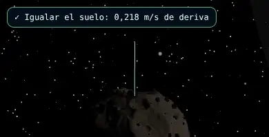 | ✓ bien |
| Aterrizar la sonda con un programa (consola de la sonda en el puente) | 0,22 m/s | ✓ Perfil de descenso: hasta 0,1 m/s, frenando con el RCS | 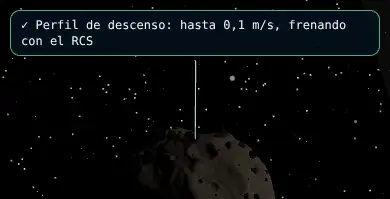 | ✓ bien |
| Aterrizar la sonda con un programa (consola de la sonda en el puente) | velocidad = 0,020   // menos de 0,10: se asienta tras unos rebotes | ✓ Frenado final a 3 m: 0,02 m/s |  | ✓ bien |
| Aterrizar la sonda con un programa (consola de la sonda en el puente) | Al tocar 101955 Bennu a menos de 0,10 m/s con la panza a menos de 30°, dejar que los rebotes se apaguen con las ruedas quietas y grabar los acelerómetros y apaga los propulsores; si rebota, para y avísame | ✓ Sin anclas: al tocar rebota y se asienta; los acelerómetros lo graban | 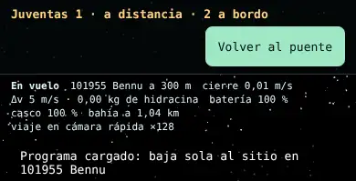 | ✓ bien |
| Estación: Cocinar Chapati (pan plano de trigo) | mezcla la harina integral con agua y sal | batir · objetivo | 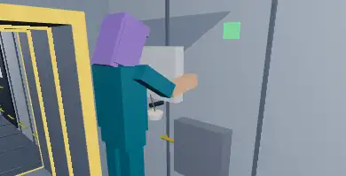 | ✓ bien |
| Estación: Cocinar Chapati (pan plano de trigo) | amasa hasta que la masa esté lisa | amasar · objetivo |  | ✓ bien |
| Estación: Cocinar Chapati (pan plano de trigo) | deja reposar la masa | reposar · objetivo |  | ✓ bien |
| Estación: Cocinar Chapati (pan plano de trigo) | divídela en bolitas | cortar · objetivo | 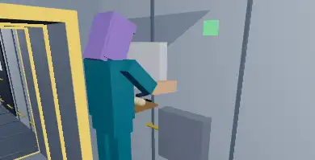 | ✓ bien |
| Estación: Cocinar Chapati (pan plano de trigo) | estira cada bolita en un disco | amasar · objetivo | 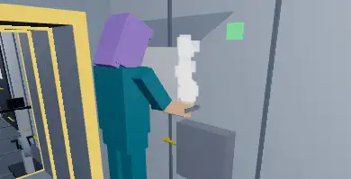 | ✓ bien |
| Estación: Cocinar Chapati (pan plano de trigo) | cuécelo en la plancha caliente por los dos lados | calentar · objetivo |  | ✓ bien |
| Estación: Cocinar Chapati (pan plano de trigo) | sirve caliente | emplatar · objetivo |  | ✓ bien |
| Estación: refinar (Extracción térmica del agua) | 18 kg | programar · objetivo |  | ✓ bien |
| Estación: refinar (Extracción térmica del agua) | tritura la roca | moler · objetivo |  | ✓ bien |
| Estación: refinar (Extracción térmica del agua) | cierra el horno | reparar · objetivo | 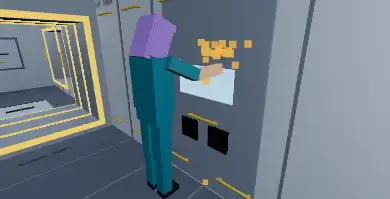 | ✓ bien |
| Estación: refinar (Extracción térmica del agua) | calienta la roca en vacío | calentar · objetivo | 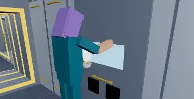 | ✓ bien |
| Estación: refinar (Extracción térmica del agua) | condensa el vapor en la trampa fría | programar · objetivo |  | ✓ bien |
| Estación: refinar (Extracción térmica del agua) | guarda el agua en el tanque | emplatar · objetivo |  | ✓ bien |
| Estación: fabricar (Pieza pequeña de metal impresa (soporte o herramienta)) | 0,13 kg | reparar · objetivo | 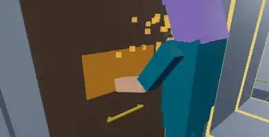 | ✓ bien |
| Estación: fabricar (Pieza pequeña de metal impresa (soporte o herramienta)) | 2029,87 kg | reparar · objetivo | 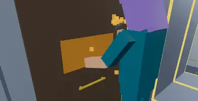 | ✓ bien |
| Estación: fabricar (Pieza pequeña de metal impresa (soporte o herramienta)) | carga el polvo de hierro | reparar · objetivo |  | ✓ bien |
| Estación: fabricar (Pieza pequeña de metal impresa (soporte o herramienta)) | imprime la pieza capa a capa | reparar · objetivo |  | ✓ bien |
| Estación: fabricar (Pieza pequeña de metal impresa (soporte o herramienta)) | quita los soportes | cortar · objetivo |  | ✓ bien |
| Estación: fabricar (Pieza pequeña de metal impresa (soporte o herramienta)) | comprueba las medidas | revisar · objetivo | 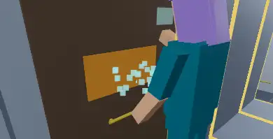 | ✓ bien |
| Estación: importar (pedido de xenón) | 162,39 kg | programar · objetivo |  | ✓ bien |
| Estación: importar (pedido de xenón) | 229 créditos | programar · objetivo |  | ✓ bien |
| Estación: importar (pedido de xenón) | el Santuario carga el pedido en el Falcon Heavy | programar · objetivo |  | ✓ bien |
| Estación: importar (pedido de xenón) | el cohete lo sube a la órbita baja | programar · objetivo |  | ✓ bien |
| Estación: importar (pedido de xenón) | la etapa de salida enciende 4,3 km/s | programar · objetivo | 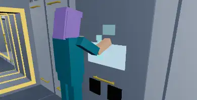 | ✓ bien |
| Estación: importar (pedido de xenón) | la etapa vacía se suelta | programar · objetivo |  | ✓ bien |
| Estación: importar (pedido de xenón) | la carga cruza 372 días por la elipse de Hohmann | programar · objetivo |  | ✓ bien |
| Estación: importar (pedido de xenón) | la etapa de llegada enciende 4,2 km/s | programar · objetivo | 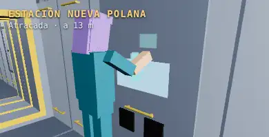 | ✓ bien |
| Estación: importar (pedido de xenón) | el brazo de la estación atrapa la carga | programar · objetivo |  | ✓ bien |
