# Auditoría de animaciones de los retos

Generado por `tools/experiencia/animaciones.mjs` (recorrido PX-20, `npm run experiencia -- PX-20`), en un iPhone 13 (390 × 664 visibles, 1×).
Cada reto se juega con toques en las respuestas correctas, en «paso a paso» (cada bloque bien colocado es un paso). Tras cada paso se mide en la escena 3D (`src/adapters/three/interior/step-audit.ts`):

- **Alcance**: cada objeto a ≤ 0.8 m de una de sus manos, o sobre el sitio del paso (≤ 0,45 m) con ella de pie delante (≤ 0,9 m).
- **A la vista**: alguna parte del objeto en la franja de escena sobre la hoja del reto y sin muebles ni su cuerpo delante.
- **Sin atravesar**: el centro del objeto no está dentro de otra pieza (encimera, pared, máquina).
- **Gesto**: su pose se aparta de la de espera al menos 0.3 rad, y su mano se ve.
- **Planes de viaje y aterrizaje**: cada paso añade su parte del plan, con rótulo, y sus puntos quedan en pantalla sobre la hoja.

Regla (docs/qa/README.md): todo reto o visual de paso nuevo debe pasar esta auditoría.

**161 de 162 pasos bien.**

Tareas del anillo jugadas: 21 (15 clases).
El viaje desde la consola de navegación del anillo: el mapa cubre la escena, así que el plan se dibuja en el mapa, encuadrado en la franja sobre la hoja (sus puntos se miden en el mapa).
Estación (escala 1,5): la cocina y las máquinas (refinar, fabricar, laboratorio de biología, importar) con Doménica en los estribos de cada una. Sin visual de pasos, aplazados con nano_net (sistema ficticio, al backlog): los retos de nano_net.

| Tarea | Paso | Se ve | Captura | Resultado |
|---|---|---|---|---|
| Reparar cocina | corta la corriente | reparar · objetivo | 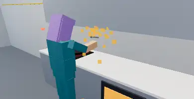 | ✓ bien |
| Reparar cocina | revisa la placa | revisar · objetivo | 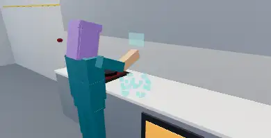 | ✓ bien |
| Reparar cocina | cambia el fusible | reparar · objetivo |  | ✓ bien |
| Reparar cocina | limpia el filtro de la campana | lavar · objetivo | 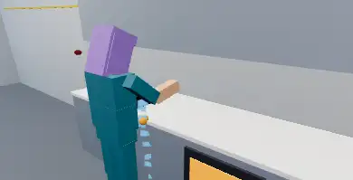 | ✓ bien |
| Reparar cocina | enciende y prueba | reparar · objetivo |  | ✓ bien |
| Reparar cocina | 4 °C | reparar · objetivo | 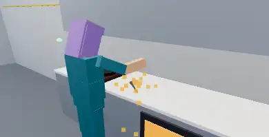 | ✓ bien |
| Moler trigo | limpia el grano | lavar · encimera |  | ✓ bien |
| Moler trigo | ajusta las muelas | moler · molino |  | ✓ bien |
| Moler trigo | muele el trigo | moler · molino |  | ✓ bien |
| Moler trigo | tamiza la harina | verter · encimera |  | ✓ bien |
| Moler trigo | guarda la harina | emplatar · encimera |  | ✓ bien |
| Hacer tofu | remoja la soja | lavar · encimera |  | ✓ bien |
| Hacer tofu | muélela con agua | moler · procesador | 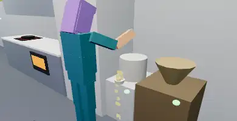 | ✓ bien |
| Hacer tofu | 100 °C | hervir · procesador | 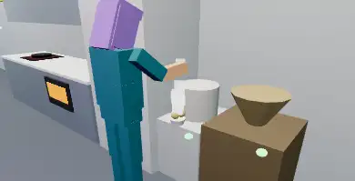 | ✓ bien |
| Hacer tofu | filtra la leche de soja | verter · procesador | 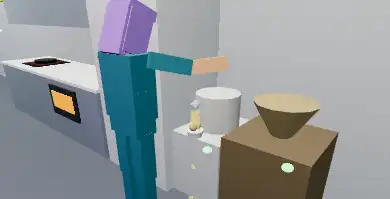 | ✓ bien |
| Hacer tofu | cuaja con nigari | remover · procesador |  | ✓ bien |
| Hacer tofu | prensa la cuajada | amasar · encimera | 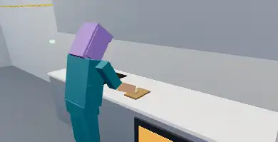 | ✓ bien |
| Preparar pienso de gallinas | muele el trigo | moler · molino |  | ✓ bien |
| Preparar pienso de gallinas | muele la soja | moler · molino |  | ✓ bien |
| Preparar pienso de gallinas | añade calcio de cáscara triturada | verter · encimera |  | ✓ bien |
| Preparar pienso de gallinas | mezcla el pienso | batir · encimera |  | ✓ bien |
| Preparar pienso de gallinas | guárdalo seco | emplatar · encimera |  | ✓ bien |
| Hacer crema de cacahuete | 160 °C | hornear · horno | 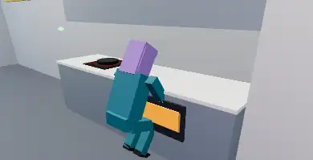 | ✓ bien |
| Hacer crema de cacahuete | 138 °C | hornear · horno |  | ✓ bien |
| Hacer crema de cacahuete | quítales la piel | cortar · encimera | 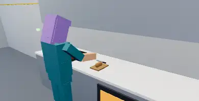 | ✓ bien |
| Hacer crema de cacahuete | muélelos en grueso | moler · molino |  | ✓ bien |
| Hacer crema de cacahuete | muélelos en fino | moler · molino |  | ✓ bien |
| Hacer crema de cacahuete | añade sal | sazonar · encimera | 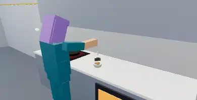 | ✓ bien |
| Hacer crema de cacahuete | envasa la crema | emplatar · encimera |  | ✓ bien |
| Curar Lechuga romana roja (l1) | revisar las hojas | revisar · objetivo | 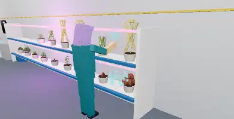 | ✓ bien |
| Curar Lechuga romana roja (l1) | cortar las hojas dañadas | cosechar · objetivo | 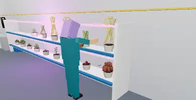 | ✓ bien |
| Curar Lechuga romana roja (l1) | asegurar la maceta | revisar · objetivo | 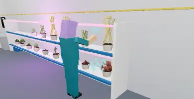 | ✓ bien |
| Curar Lechuga romana roja (l1) | regar la base | regar · objetivo | 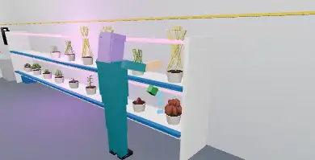 | ✓ bien |
| Curar Lechuga romana roja (l1) | 1 | revisar · objetivo | 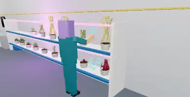 | ✓ bien |
| Regar Lechuga romana roja (l1) | 0,4 | regar · objetivo |  | ✓ bien |
| Regar Lechuga romana roja (l1) | llenar la regadera | regar · objetivo |  | ✓ bien |
| Regar Lechuga romana roja (l1) | regar la base del tallo | regar · objetivo |  | ✓ bien |
| Regar Lechuga romana roja (l1) | comprobar que drena | revisar · objetivo |  | ✓ bien |
| Polinizar Chile (c1) | Agita la planta con suavidad para que el polen caiga en sus flores | agitar · objetivo |  | ✓ bien |
| Polinizar Chile (c1) | sujetar la maceta | agitar · objetivo |  | ✓ bien |
| Polinizar Chile (c1) | agitar el tallo con suavidad | agitar · objetivo |  | ✓ bien |
| Polinizar Chile (c1) | repetir en cada flor abierta | agitar · objetivo |  | ✓ bien |
| Cosechar Rábano (r1) | comprobar que está madura | revisar · objetivo |  | ✓ bien |
| Cosechar Rábano (r1) | cortar con tijeras limpias | cortar · objetivo |  | ✓ bien |
| Cosechar Rábano (r1) | guardar en la despensa | cosechar · objetivo |  | ✓ bien |
| Cosechar Rábano (r1) | 2 | cosechar · objetivo |  | ✓ bien |
| Sembrar el biorreactor | saca un vial del tanque de nitrógeno | tomar · objetivo | 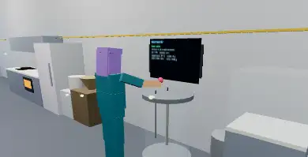 | ✓ bien |
| Sembrar el biorreactor | descongélalo a 37 °C | hornear · objetivo | 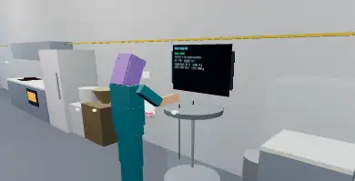 | ✓ bien |
| Sembrar el biorreactor | filtra el medio a 0,2 µm | verter · objetivo |  | ✓ bien |
| Sembrar el biorreactor | llena el biorreactor con medio | verter · objetivo |  | ✓ bien |
| Sembrar el biorreactor | siembra las células con microportadores | verter · objetivo |  | ✓ bien |
| Sembrar el biorreactor | 37 °C | programar · objetivo | 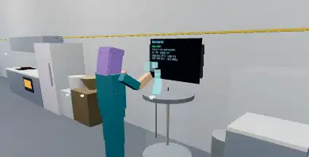 | ✓ bien |
| Sembrar el biorreactor | 9 | programar · objetivo | 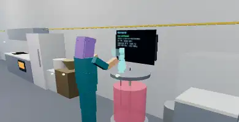 | ✓ bien |
| Enfermería: golpe de Doménica | vía aérea | curar · objetivo | 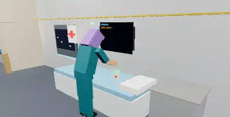 | ✓ bien |
| Enfermería: golpe de Doménica | inmoviliza la zona | curar · objetivo |  | ✓ bien |
| Enfermería: golpe de Doménica | haz una ecografía | revisar · objetivo |  | ✓ bien |
| Enfermería: golpe de Doménica | aplica frío | curar · objetivo |  | ✓ bien |
| Enfermería: golpe de Doménica | da analgesia según el peso | curar · objetivo |  | ✓ bien |
| Enfermería: golpe de Doménica | deja en reposo | reposar · objetivo |  | ✗ food0 no se ve (tapado por BoxGeometry) |
| Intervalos 4 × 4 min en la cinta | 169 lpm | entrenar · objetivo |  | ✓ bien |
| Intervalos 4 × 4 min en la cinta | 16 min | entrenar · objetivo |  | ✓ bien |
| Intervalos 4 × 4 min en la cinta | 19,3 km/h | entrenar · objetivo | 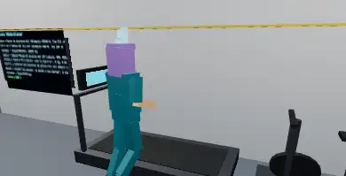 | ✓ bien |
| Intervalos 4 × 4 min en la cinta | En la ISS un arnés de hombros y cintura con gomas sujeta a la corredora; en el anillo la sujeta su peso | entrenar · objetivo | 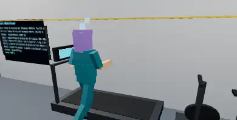 | ✓ bien |
| Dar de comer a Luna | 119 kcal | servir · objetivo |  | ✓ bien |
| Dar de comer a Luna | 99 g | servir · objetivo |  | ✓ bien |
| Dar de comer a Luna | pesar la ración | servir · objetivo |  | ✓ bien |
| Dar de comer a Luna | servirla en su comedero | servir · objetivo | 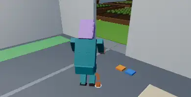 | ✓ bien |
| Dar de comer a Luna | cambiar el agua | verter · objetivo | 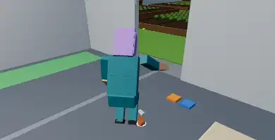 | ✓ bien |
| Programar a Luna: hacer amigos | cuando vea al gato nuevo | programar · objetivo | 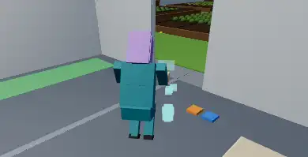 | ✓ bien |
| Programar a Luna: hacer amigos | acercarme despacio | programar · objetivo |  | ✓ bien |
| Programar a Luna: hacer amigos | saludar nariz con nariz | programar · objetivo | 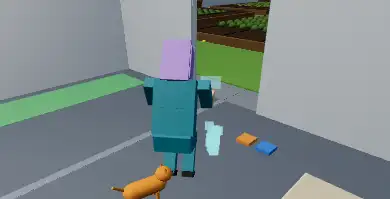 | ✓ bien |
| Programar a Luna: hacer amigos | fin | programar · objetivo | 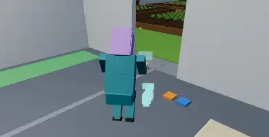 | ✓ bien |
| Programar a Luna: hacer amigos | Saluda | programar · objetivo |  | ✓ bien |
| Programar a Luna: hacer amigos | bufar() | programar · objetivo |  | ✓ bien |
| Dar de comer a Coco | 108 kcal | servir · objetivo |  | ✓ bien |
| Dar de comer a Coco | 90 g de carne | servir · objetivo | 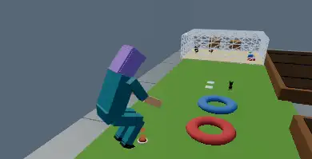 | ✓ bien |
| Dar de comer a Coco | pedirle que se siente | mimar · objetivo | 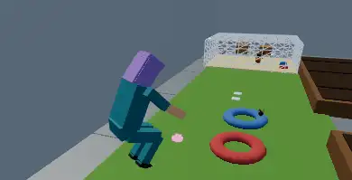 | ✓ bien |
| Dar de comer a Coco | servir la ración | servir · objetivo |  | ✓ bien |
| Dar de comer a Coco | cambiar el agua | verter · objetivo |  | ✓ bien |
| Programar a Coco: jugar gatos | cuando vea un gato | programar · objetivo |  | ✓ bien |
| Programar a Coco: jugar gatos | hacer la reverencia de juego | programar · objetivo |  | ✓ bien |
| Programar a Coco: jugar gatos | jugar sin morder fuerte | programar · objetivo |  | ✓ bien |
| Programar a Coco: jugar gatos | fin | programar · objetivo |  | ✓ bien |
| Programar a Coco: jugar gatos | Espera | programar · objetivo |  | ✓ bien |
| Programar a Coco: jugar gatos | Cuando veas un gato, invítalo con la reverencia y juega suave | programar · objetivo |  | ✓ bien |
| Programar la puerta del gallinero | cuando amanezca | programar · objetivo | 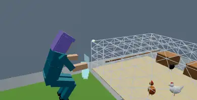 | ✓ bien |
| Programar la puerta del gallinero | abrir la puerta | programar · objetivo | 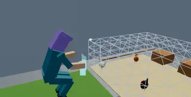 | ✓ bien |
| Programar la puerta del gallinero | fin | programar · objetivo | 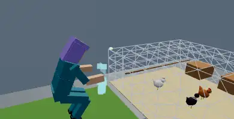 | ✓ bien |
| Programar la puerta del gallinero | cuando anochezca | programar · objetivo | 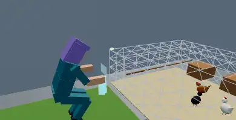 | ✓ bien |
| Programar la puerta del gallinero | contar las gallinas dentro | programar · objetivo |  | ✓ bien |
| Programar la puerta del gallinero | cerrar la puerta si están todas | programar · objetivo | 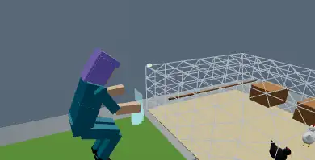 | ✓ bien |
| Programar la puerta del gallinero | fin | programar · objetivo |  | ✓ bien |
| Programar la puerta del gallinero | Se queda abierta hasta que entre la que falta | programar · objetivo | 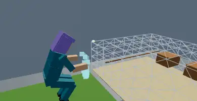 | ✓ bien |
| Dar de comer a las gallinas | 330 g | servir · objetivo |  | ✓ bien |
| Dar de comer a las gallinas | 14 h | servir · objetivo | 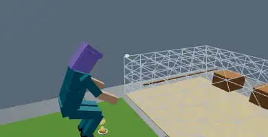 | ✓ bien |
| Dar de comer a las gallinas | llenar el comedero | servir · objetivo |  | ✓ bien |
| Dar de comer a las gallinas | limpiar el bebedero | lavar · objetivo |  | ✓ bien |
| Dar de comer a las gallinas | revisar que todas comen | revisar · objetivo |  | ✓ bien |
| Curar Papa (bancal-papa-1) | revisar las hojas | revisar · objetivo | 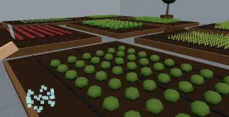 | ✓ bien |
| Curar Papa (bancal-papa-1) | cortar las hojas dañadas | cosechar · objetivo | 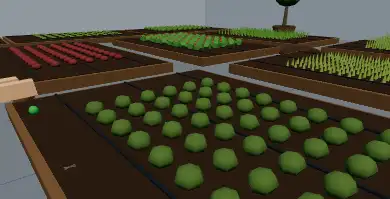 | ✓ bien |
| Curar Papa (bancal-papa-1) | asegurar la maceta | revisar · objetivo | 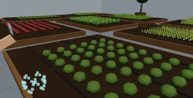 | ✓ bien |
| Curar Papa (bancal-papa-1) | regar la base | regar · objetivo | 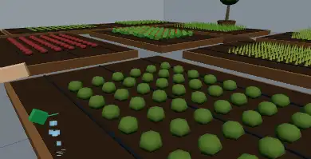 | ✓ bien |
| Curar Papa (bancal-papa-1) | 1 | revisar · objetivo | 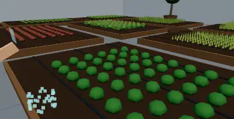 | ✓ bien |
| Polinizar Tomate enano (bancal-tomate) | Agita la planta con suavidad para que el polen caiga en sus flores | agitar · objetivo | 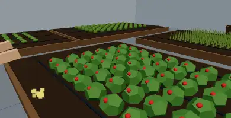 | ✓ bien |
| Polinizar Tomate enano (bancal-tomate) | sujetar la maceta | agitar · objetivo | 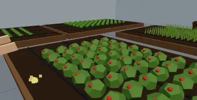 | ✓ bien |
| Polinizar Tomate enano (bancal-tomate) | agitar el tallo con suavidad | agitar · objetivo |  | ✓ bien |
| Polinizar Tomate enano (bancal-tomate) | repetir en cada flor abierta | agitar · objetivo |  | ✓ bien |
| Dar de comer a las medakas | 0,3 g | revisar · objetivo |  | ✓ bien |
| Dar de comer a las medakas | toma la ración de escamas | revisar · objetivo | 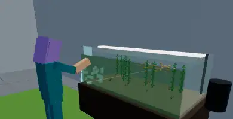 | ✓ bien |
| Dar de comer a las medakas | esparce las escamas en la superficie | servir · objetivo | 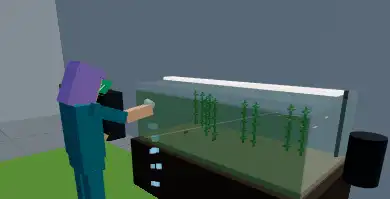 | ✓ bien |
| Dar de comer a las medakas | mira que coman todo en dos minutos | revisar · objetivo |  | ✓ bien |
| Dar de comer a las medakas | limpia lo que sobre | lavar · objetivo | 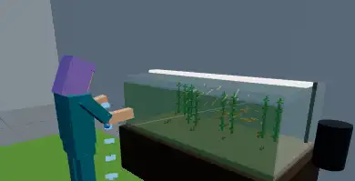 | ✓ bien |
| Programar un viaje (consola de navegación del anillo) | orientar la nodriza hacia 242916 (2006 OS2) | ✓ Ruta trazada: 3 tramos, 10,1 km | 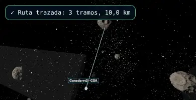 | ✓ bien |
| Programar un viaje (consola de navegación del anillo) | 2 | ✓ Empuje: 16 m/s hacia 242916 (2006 OS2), Δv 32 m/s | 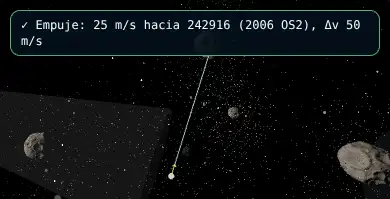 | ✓ bien |
| Programar un viaje (consola de navegación del anillo) | 5 h 00 min | ✓ Llegada en 5 h 02 min | 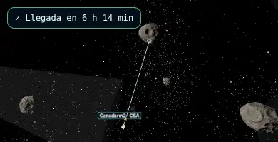 | ✓ bien |
| Programar un viaje (consola de navegación del anillo) | si recorrido >= distancia / 2 entonces | ✓ Punto de frenado a 474 m de la llegada | = distancia / 2 entonces"> | ✓ bien |
| Programar un viaje (consola de navegación del anillo) | Lleva la nodriza a 1350 m de 242916 (2006 OS2) rodeando las rocas y para del todo; luego desacopla el módulo de aterrizaje, acércalo a 300 m apuntando al asteroide y devuélveme los mandos | ✓ Plan completo: el piloto automático lo vuela |  | ✓ bien |
| Aterrizar el módulo con un programa | fijar el sitio: el suelo bajo el módulo, a 298 m | ✓ Sitio fijado bajo la nave, a 300 m |  | ✓ bien |
| Aterrizar el módulo con un programa | vSuelo: 0,22 m/s, la misma que el suelo | ✓ Igualar el suelo: 0,219 m/s de deriva |  | ✓ bien |
| Aterrizar el módulo con un programa | 2,8 m/s | ✓ Perfil de descenso: hasta 1,5 m/s, frenando con el RCS |  | ✓ bien |
| Aterrizar el módulo con un programa | velocidad = 0,040   // menos de 0,10: las patas aguantan | ✓ Frenado final a 3 m: 0,04 m/s |  | ✓ bien |
| Aterrizar el módulo con un programa | Al tocar 101955 Bennu a menos de 0,10 m/s con la panza a menos de 30°, anclar las patas y apaga los propulsores; si rebota, para y avísame | ✓ Anclas listas: al tocar, se clavan |  | ✓ bien |
| Aterrizar la sonda con un programa (consola de la sonda en el puente) | fijar el sitio: el suelo bajo la sonda, a 299 m | ✓ Sitio fijado bajo la nave, a 300 m |  | ✓ bien |
| Aterrizar la sonda con un programa (consola de la sonda en el puente) | vSuelo: 0,22 m/s, la misma que el suelo | ✓ Igualar el suelo: 0,218 m/s de deriva |  | ✓ bien |
| Aterrizar la sonda con un programa (consola de la sonda en el puente) | 3,0 m/s | ✓ Perfil de descenso: hasta 0,6 m/s, frenando con el RCS |  | ✓ bien |
| Aterrizar la sonda con un programa (consola de la sonda en el puente) | velocidad = 0,040   // menos de 0,10: las patas aguantan | ✓ Frenado final a 3 m: 0,04 m/s |  | ✓ bien |
| Aterrizar la sonda con un programa (consola de la sonda en el puente) | Al tocar 101955 Bennu a menos de 0,10 m/s con la panza a menos de 30°, disparar las anclas de rosca de las patas y apaga los propulsores; si rebota, para y avísame | ✓ Anclas listas: al tocar, se clavan |  | ✓ bien |
| Estación: Cocinar Chapati (pan plano de trigo) | mezcla la harina integral con agua y sal | batir · objetivo |  | ✓ bien |
| Estación: Cocinar Chapati (pan plano de trigo) | amasa hasta que la masa esté lisa | amasar · objetivo |  | ✓ bien |
| Estación: Cocinar Chapati (pan plano de trigo) | deja reposar la masa | reposar · objetivo |  | ✓ bien |
| Estación: Cocinar Chapati (pan plano de trigo) | divídela en bolitas | cortar · objetivo |  | ✓ bien |
| Estación: Cocinar Chapati (pan plano de trigo) | estira cada bolita en un disco | amasar · objetivo |  | ✓ bien |
| Estación: Cocinar Chapati (pan plano de trigo) | cuécelo en la plancha caliente por los dos lados | calentar · objetivo |  | ✓ bien |
| Estación: Cocinar Chapati (pan plano de trigo) | sirve caliente | emplatar · objetivo |  | ✓ bien |
| Estación: refinar (Extracción térmica del agua) | 18 kg | programar · objetivo |  | ✓ bien |
| Estación: refinar (Extracción térmica del agua) | tritura la roca | moler · objetivo |  | ✓ bien |
| Estación: refinar (Extracción térmica del agua) | cierra el horno | reparar · objetivo |  | ✓ bien |
| Estación: refinar (Extracción térmica del agua) | calienta la roca en vacío | calentar · objetivo |  | ✓ bien |
| Estación: refinar (Extracción térmica del agua) | condensa el vapor en la trampa fría | programar · objetivo |  | ✓ bien |
| Estación: refinar (Extracción térmica del agua) | guarda el agua en el tanque | emplatar · objetivo |  | ✓ bien |
| Estación: fabricar (Motor R-4D-15 HiPAT) | 6,8 kg | reparar · objetivo |  | ✓ bien |
| Estación: fabricar (Motor R-4D-15 HiPAT) | 2001,6 kg | reparar · objetivo |  | ✓ bien |
| Estación: fabricar (Motor R-4D-15 HiPAT) | carga el polvo de níquel y hierro | reparar · objetivo |  | ✓ bien |
| Estación: fabricar (Motor R-4D-15 HiPAT) | imprime la cámara y la tobera | reparar · objetivo |  | ✓ bien |
| Estación: fabricar (Motor R-4D-15 HiPAT) | recubre la tobera de cerámica | reparar · objetivo |  | ✓ bien |
| Estación: fabricar (Motor R-4D-15 HiPAT) | monta las válvulas del kit | reparar · objetivo |  | ✓ bien |
| Estación: fabricar (Motor R-4D-15 HiPAT) | prueba la estanqueidad con helio | revisar · objetivo |  | ✓ bien |
| Estación: ajustar un biorreactor (Fotobiorreactor de espirulina) | 164,13 kWh | programar · objetivo |  | ✓ bien |
| Estación: ajustar un biorreactor (Fotobiorreactor de espirulina) | Dióxido de carbono | programar · objetivo |  | ✓ bien |
| Estación: ajustar un biorreactor (Fotobiorreactor de espirulina) | el aire de la estación | programar · objetivo |  | ✓ bien |
| Estación: ajustar un biorreactor (Fotobiorreactor de espirulina) | revisa el fotobiorreactor | revisar · objetivo |  | ✓ bien |
| Estación: ajustar un biorreactor (Fotobiorreactor de espirulina) | ajusta el caudal de CO₂ | moler · objetivo |  | ✓ bien |
| Estación: ajustar un biorreactor (Fotobiorreactor de espirulina) | recoge la espirulina | tomar · objetivo |  | ✓ bien |
| Estación: importar (pedido de xenón) | 162,39 kg | programar · objetivo |  | ✓ bien |
| Estación: importar (pedido de xenón) | 229 créditos | programar · objetivo |  | ✓ bien |
| Estación: importar (pedido de xenón) | el Santuario carga el pedido en el Falcon Heavy | programar · objetivo |  | ✓ bien |
| Estación: importar (pedido de xenón) | el cohete lo sube a la órbita baja | programar · objetivo |  | ✓ bien |
| Estación: importar (pedido de xenón) | la etapa de salida enciende 4,3 km/s | programar · objetivo |  | ✓ bien |
| Estación: importar (pedido de xenón) | la etapa vacía se suelta | programar · objetivo |  | ✓ bien |
| Estación: importar (pedido de xenón) | la carga cruza 372 días por la elipse de Hohmann | programar · objetivo |  | ✓ bien |
| Estación: importar (pedido de xenón) | la etapa de llegada enciende 4,2 km/s | programar · objetivo |  | ✓ bien |
| Estación: importar (pedido de xenón) | el brazo de la estación atrapa la carga | programar · objetivo |  | ✓ bien |
