# Auditoría de animaciones de los retos

Generado por `tools/experiencia/animaciones.mjs` (recorrido PX-20, `npm run experiencia -- PX-20`), en un iPhone 13 (390 × 664 visibles, 1×).
Cada reto se juega con toques en las respuestas correctas, en «paso a paso» (cada bloque bien colocado es un paso). Tras cada paso se mide en la escena 3D (`src/adapters/three/interior/step-audit.ts`):

- **Alcance**: cada objeto a ≤ 0.8 m de una de sus manos (a su punto más cercano), o sobre el sitio del paso (≤ 0,45 m) con ella de pie delante (≤ 0,9 m).
- **A la vista**: alguna parte del objeto en la franja de escena sobre la hoja del reto y sin muebles ni su cuerpo delante.
- **Sin atravesar**: el centro del objeto no está dentro de otra pieza (encimera, pared, máquina).
- **Gesto**: su pose se aparta de la de espera al menos 0.3 rad, y su mano se ve. En el yoga, el gesto es la asana del paso (está en ella) y cuenta su cuerpo entero, no la mano.
- **Planes de viaje y aterrizaje**: cada paso añade su parte del plan, con rótulo, y sus puntos quedan en pantalla sobre la hoja.

Regla (docs/qa/README.md): todo reto o visual de paso nuevo debe pasar esta auditoría.

## Inventario: retos del juego real (REAL_ONLY) y su animación

| Reto | Dónde se juega | Entorno real de la animación | En la auditoría |
|---|---|---|---|
| Comida de la ISS (avena, frijoles, sopa) | Cocina de la Starship (cubierta 1) y de Unity | Ella en la cocina con el envase: sacarlo, agua por la aguja del dispensador, amasar, esperar, calentador, tijeras, cuchara | Sí (Starship y estación) |
| Yoga (upa-yoga, saludo al sol) | Esterilla de la Starship (cubierta 1) y de Destiny | Ella en la esterilla, postura a postura con su asana, vista de cuerpo entero | Sí |
| Ejercicio (intervalos, continuo, fuerza) | T2, CEVIS y ARED de la cubierta 3; T2 y ARED de Tranquility | Cada entrenamiento en su máquina (la T2 en el suelo) | Sí |
| Hábitat acuático (medakas) | Rack AQH de la cubierta 3 (JAXA, voló en Kibo) | Ella en el rack | Sí |
| Catálogo de especies (amistad y ayuda de colonias) | Terminal del catálogo, cubierta 2 | Ella en el terminal (programas en la mente) | Mismo motor que el AQH |
| Reparaciones y preventivos del soporte vital | Bastidores de la Starship y de la ISS | Ella en el bastidor con la llave; las luces del procedimiento en el bastidor; los del techo, flotando bajo él | Sí (CDRA en la Starship y en la estación) |
| Refinar, fabricar (pieza impresa), importar, ajustar un biorreactor | Máquinas de la estación | Ella en los estribos de cada máquina | Sí (el biorreactor solo con su módulo montado) |
| Ponerse el traje (EVA) | Escotilla delantera del LM | Ella en la escotilla revisando el traje paso a paso | Lo comprueba PX-31 al salir (comprobado con capturas) |
| Programar un viaje | Mesa de navegación de la cubierta de vuelo | El plan se dibuja en el mapa paso a paso | Sí |
| Aterrizar el módulo o la sonda con un programa | Asiento del LM; mando de la sonda | El plan se dibuja sobre el suelo paso a paso | Sí |
| Cambiar o montar una pieza en la bahía | Bahía de la nave (pantalla de la estación) | Ella en el CBM de nadir de Unity, donde el brazo atraca el módulo, con la llave paso a paso; ver «Abierto» | No (comprobado con capturas) |
| Duelo de la mente, nano_net | Consola de la mente | Ficción que se queda (reglas §1.2): su escena es la mente, sin figura | No |
| Dormir | Camarotes | Lo hace la rama `compartimentos-reales` | No |

**Abierto:** el cambio de una pieza en la bahía se hace con Doménica en el CBM de Unity; en la ISS muchos de esos cambios los hace el brazo o un paseo espacial. Pregunta al diseñador: ¿se anima además con Canadarm2 en la vista de la Cupola, o con ella en un paseo? El duelo de la mente y nano_net son la ficción que se queda y se juegan en su propia escena.

## Hoja de contactos

**138 de 140 pasos bien.**

Sin anillo (REAL_ONLY, src/core/realism.ts): sus tareas y su consola de navegación no se juegan.
Tareas del anillo jugadas: 0 (0 clases).
Estación: sin sitio a bordo para «laboratorio-bio»: no hay módulo con rack donde montarlo, no se juega.
El viaje desde la consola de navegación: el mapa se oculta con el reto como toda interfaz (foco del reto, sin excepciones) y el plan se dibuja en la escena del reto, que lo encuadra en la franja sobre la hoja cuando la vista de la consola no lo ve (PlanOverlay.view).
Estación (escala 1,5): la cocina, su camarote de Harmony (dormir: junto al saco, mirando fuera del camarote), la esterilla de Destiny, la T2 y el ARED, el bastidor de aire y las máquinas (refinar, fabricar, laboratorio de biología, importar) con Doménica en cada una. Starship: la cocina, la esterilla, la T2, el CEVIS, el ARED, el hábitat acuático y el bastidor de aire. Sin visual de pasos, aplazados con nano_net (sistema ficticio, al backlog): los retos de nano_net.

| Tarea | Paso | Se ve | Captura | Resultado |
|---|---|---|---|---|
| Programar un viaje (mesa de navegación de la cubierta de vuelo de la Starship) | orientar la nodriza hacia 242916 (2006 OS2) | ✓ Ruta trazada: 3 tramos, 10,0 km |  | ✓ bien |
| Programar un viaje (mesa de navegación de la cubierta de vuelo de la Starship) | 2 | ✓ Empuje: 25 m/s hacia 242916 (2006 OS2), Δv 50 m/s |  | ✓ bien |
| Programar un viaje (mesa de navegación de la cubierta de vuelo de la Starship) | 6 h 13 min | ✓ Llegada en 6 h 14 min |  | ✓ bien |
| Programar un viaje (mesa de navegación de la cubierta de vuelo de la Starship) | si falta <= crucero² / (2 × a) entonces | ✓ Punto de frenado a 107 m de la llegada |  | ✓ bien |
| Programar un viaje (mesa de navegación de la cubierta de vuelo de la Starship) | Lleva la nodriza a 1350 m de 242916 (2006 OS2) rodeando las rocas, a 0 m/s de crucero, y para del todo; luego desacopla el módulo de aterrizaje, acércalo a 300 m apuntando al asteroide y devuélveme los mandos | ✓ Plan completo: el piloto automático lo vuela |  | ✓ bien |
| Aterrizar el módulo con un programa | fijar el sitio: el suelo bajo el módulo, a 296 m | ✓ Sitio fijado bajo la nave, a 300 m | 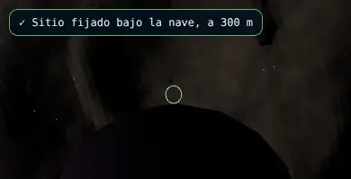 | ✓ bien |
| Aterrizar el módulo con un programa | vSuelo: 0,22 m/s, la misma que el suelo | ✓ Igualar el suelo: 0,219 m/s de deriva |  | ✓ bien |
| Aterrizar el módulo con un programa | 5,8 m/s | ✓ Perfil de descenso: hasta 1,5 m/s, frenando con el RCS |  | ✓ bien |
| Aterrizar el módulo con un programa | velocidad = 0,040   // menos de 0,10: las patas aguantan | ✓ Frenado final a 3 m: 0,04 m/s |  | ✓ bien |
| Aterrizar el módulo con un programa | Al tocar 101955 Bennu a menos de 0,10 m/s con la panza a menos de 30°, anclar las patas y apaga los propulsores; si rebota, para y avísame | ✓ Anclas listas: al tocar, se clavan |  | ✓ bien |
| Aterrizar la sonda con un programa (consola de la sonda en el puente) | fijar el sitio: el suelo bajo la sonda, a 299 m | ✓ Sitio fijado bajo la nave, a 300 m |  | ✓ bien |
| Aterrizar la sonda con un programa (consola de la sonda en el puente) | vSuelo: 0,22 m/s, la misma que el suelo | ✓ Igualar el suelo: 0,218 m/s de deriva |  | ✓ bien |
| Aterrizar la sonda con un programa (consola de la sonda en el puente) | 0,22 m/s | ✓ Perfil de descenso: hasta 0,1 m/s, frenando con el RCS |  | ✓ bien |
| Aterrizar la sonda con un programa (consola de la sonda en el puente) | velocidad = 0,020   // menos de 0,10: se asienta tras unos rebotes | ✓ Frenado final a 3 m: 0,02 m/s |  | ✓ bien |
| Aterrizar la sonda con un programa (consola de la sonda en el puente) | Al tocar 101955 Bennu a menos de 0,10 m/s con la panza a menos de 30°, dejar que los rebotes se apaguen con las ruedas quietas y grabar los acelerómetros y apaga los propulsores; si rebota, para y avísame | ✓ Sin anclas: al tocar rebota y se asienta; los acelerómetros lo graban |  | ✓ bien |
| Starship: Cocinar Avena rehidratada con crema de cacahuete (Cocinar Avena rehidratada con crema de cacahuete) | saca el envase de avena del cajón de su día | tomar · objetivo |  | ✓ bien |
| Starship: Cocinar Avena rehidratada con crema de cacahuete (Cocinar Avena rehidratada con crema de cacahuete) | conecta la aguja del dispensador al tapón del envase | verter · objetivo |  | ✓ bien |
| Starship: Cocinar Avena rehidratada con crema de cacahuete (Cocinar Avena rehidratada con crema de cacahuete) | caliente | verter · objetivo | 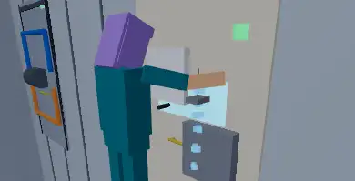 | ✓ bien |
| Starship: Cocinar Avena rehidratada con crema de cacahuete (Cocinar Avena rehidratada con crema de cacahuete) | amasa el envase para que el agua llegue a todo | amasar · objetivo | 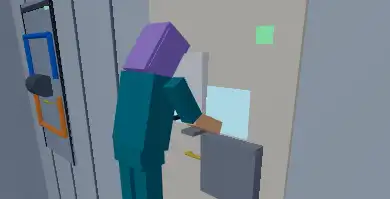 | ✓ bien |
| Starship: Cocinar Avena rehidratada con crema de cacahuete (Cocinar Avena rehidratada con crema de cacahuete) | espera a que se rehidrate | reposar · objetivo | 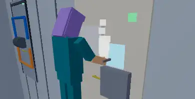 | ✓ bien |
| Starship: Cocinar Avena rehidratada con crema de cacahuete (Cocinar Avena rehidratada con crema de cacahuete) | corta la boca del envase con las tijeras | cortar · objetivo |  | ✓ bien |
| Starship: Cocinar Avena rehidratada con crema de cacahuete (Cocinar Avena rehidratada con crema de cacahuete) | come con la cuchara: la avena húmeda se queda pegada a ella | emplatar · objetivo |  | ✓ bien |
| Starship: Cocinar Frijoles termoestabilizados en tortilla (Cocinar Frijoles termoestabilizados en tortilla) | saca la bolsa de frijoles y una tortilla | tomar · objetivo | 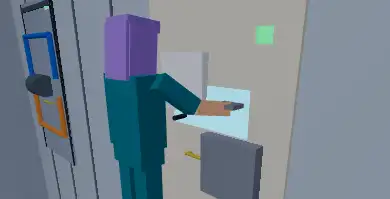 | ✓ bien |
| Starship: Cocinar Frijoles termoestabilizados en tortilla (Cocinar Frijoles termoestabilizados en tortilla) | calentador | calentar · objetivo | 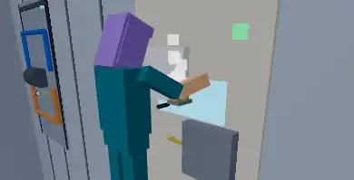 | ✓ bien |
| Starship: Cocinar Frijoles termoestabilizados en tortilla (Cocinar Frijoles termoestabilizados en tortilla) | espera a que se caliente | calentar · objetivo | 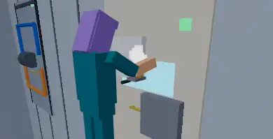 | ✓ bien |
| Starship: Cocinar Frijoles termoestabilizados en tortilla (Cocinar Frijoles termoestabilizados en tortilla) | sujeta la bandeja a la pierna con su correa | tomar · objetivo | 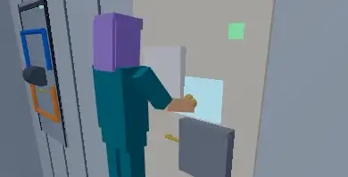 | ✓ bien |
| Starship: Cocinar Frijoles termoestabilizados en tortilla (Cocinar Frijoles termoestabilizados en tortilla) | abre la bolsa con las tijeras | cortar · objetivo | 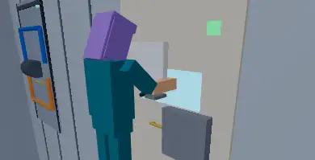 | ✓ bien |
| Starship: Cocinar Frijoles termoestabilizados en tortilla (Cocinar Frijoles termoestabilizados en tortilla) | tortilla : | emplatar · objetivo |  | ✓ bien |
| Starship: Cocinar Frijoles termoestabilizados en tortilla (Cocinar Frijoles termoestabilizados en tortilla) | enrolla y come | emplatar · objetivo |  | ✓ bien |
| Starship: Cocinar Sopa de lenteja rehidratada con tortilla (Cocinar Sopa de lenteja rehidratada con tortilla) | saca el envase de sopa de lenteja | tomar · objetivo | 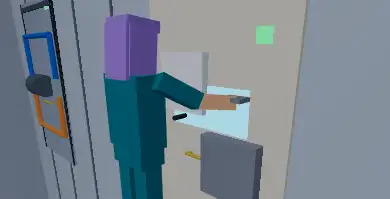 | ✓ bien |
| Starship: Cocinar Sopa de lenteja rehidratada con tortilla (Cocinar Sopa de lenteja rehidratada con tortilla) | conecta la aguja del dispensador al tapón | verter · objetivo |  | ✓ bien |
| Starship: Cocinar Sopa de lenteja rehidratada con tortilla (Cocinar Sopa de lenteja rehidratada con tortilla) | inyecta agua caliente | verter · objetivo | 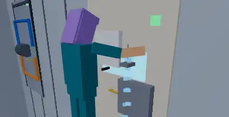 | ✓ bien |
| Starship: Cocinar Sopa de lenteja rehidratada con tortilla (Cocinar Sopa de lenteja rehidratada con tortilla) | amasa y espera a que se rehidrate | amasar · objetivo | 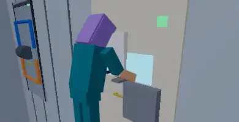 | ✓ bien |
| Starship: Cocinar Sopa de lenteja rehidratada con tortilla (Cocinar Sopa de lenteja rehidratada con tortilla) | corta una esquina y bebe el caldo primero | cortar · objetivo | 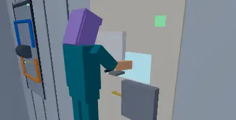 | ✓ bien |
| Starship: Cocinar Sopa de lenteja rehidratada con tortilla (Cocinar Sopa de lenteja rehidratada con tortilla) | come el resto con la cuchara y la tortilla | emplatar · objetivo | 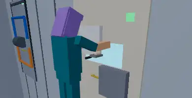 | ✓ bien |
| Starship: Upa-yoga de cuello y hombros (Upa-yoga de cuello y hombros) | Flexión · exhala | postura · objetivo | 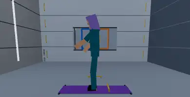 | ✓ bien |
| Starship: Upa-yoga de cuello y hombros (Upa-yoga de cuello y hombros) | Extensión · inhala | postura · objetivo | 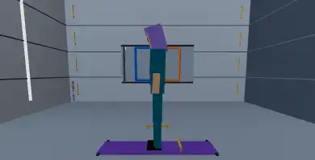 | ✓ bien |
| Starship: Upa-yoga de cuello y hombros (Upa-yoga de cuello y hombros) | Rotación · inhala | postura · objetivo | 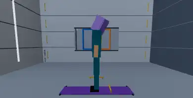 | ✓ bien |
| Starship: Upa-yoga de cuello y hombros (Upa-yoga de cuello y hombros) | Inclinación lateral · exhala | postura · objetivo | 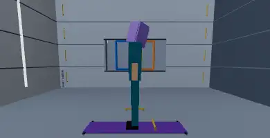 | ✓ bien |
| Starship: Upa-yoga de cuello y hombros (Upa-yoga de cuello y hombros) | Círculo completo · inhala | postura · objetivo | 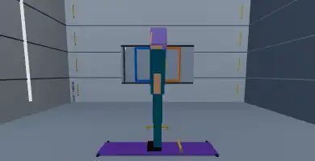 | ✓ bien |
| Starship: Upa-yoga de cuello y hombros (Upa-yoga de cuello y hombros) | Hombros hacia delante · exhala | postura · objetivo | 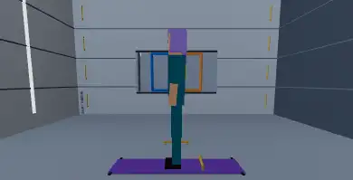 | ✓ bien |
| Starship: Saludo al Sol (Saludo al Sol) | Pranamasana · exhala | postura · objetivo | 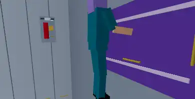 | ✓ bien |
| Starship: Saludo al Sol (Saludo al Sol) | Hasta Uttanasana · inhala | postura · objetivo | 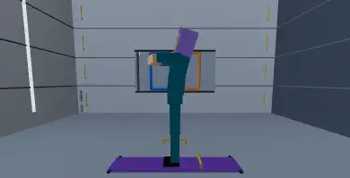 | ✓ bien |
| Starship: Saludo al Sol (Saludo al Sol) | Uttanasana · exhala | postura · objetivo | 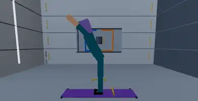 | ✓ bien |
| Starship: Saludo al Sol (Saludo al Sol) | Ashwa Sanchalanasana · inhala | postura · objetivo | 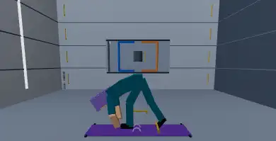 | ✓ bien |
| Starship: Saludo al Sol (Saludo al Sol) | Dandasana · retén | postura · objetivo | 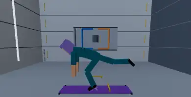 | ✓ bien |
| Starship: Saludo al Sol (Saludo al Sol) | Ashtanga Namaskara · exhala | postura · objetivo | 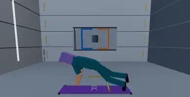 | ✓ bien |
| Starship: Saludo al Sol (Saludo al Sol) | Bhujangasana · inhala | postura · objetivo | 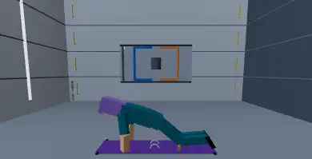 | ✓ bien |
| Starship: Saludo al Sol (Saludo al Sol) | Adho Mukha Svanasana · exhala | postura · objetivo | 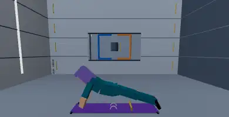 | ✓ bien |
| Starship: Saludo al Sol (Saludo al Sol) | Ashwa Sanchalanasana · inhala | postura · objetivo | 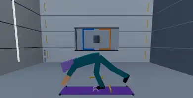 | ✓ bien |
| Starship: Saludo al Sol (Saludo al Sol) | Uttanasana · exhala | postura · objetivo | 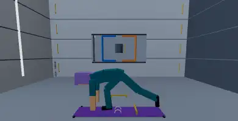 | ✓ bien |
| Starship: Saludo al Sol (Saludo al Sol) | Hasta Uttanasana · inhala | postura · objetivo | 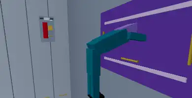 | ✓ bien |
| Starship: Saludo al Sol (Saludo al Sol) | Pranamasana · exhala | postura · objetivo | 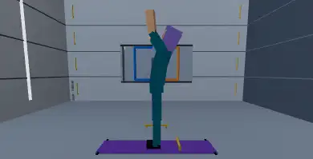 | ✓ bien |
| Starship: Intervalos 4 × 4 min en la cinta (Intervalos 4 × 4 min en la cinta) | 169 lpm | entrenar · objetivo | 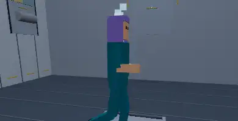 | ✓ bien |
| Starship: Intervalos 4 × 4 min en la cinta (Intervalos 4 × 4 min en la cinta) | 16 min | entrenar · objetivo | 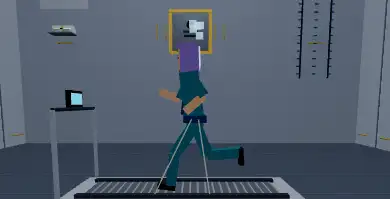 | ✓ bien |
| Starship: Intervalos 4 × 4 min en la cinta (Intervalos 4 × 4 min en la cinta) | 19,3 km/h | entrenar · objetivo | 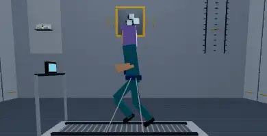 | ✓ bien |
| Starship: Intervalos 4 × 4 min en la cinta (Intervalos 4 × 4 min en la cinta) | En la ISS un arnés de hombros y cintura con gomas sujeta a la corredora; en el anillo la sujeta su peso | entrenar · objetivo | 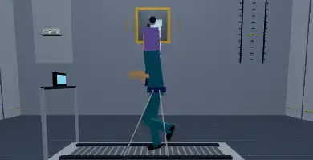 | ✓ bien |
| Starship: Intervalos 8 × 30 s en la bicicleta (Intervalos 8 × 30 s en la bicicleta) | 169 lpm | entrenar · objetivo | 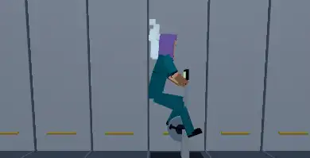 | ✓ bien |
| Starship: Intervalos 8 × 30 s en la bicicleta (Intervalos 8 × 30 s en la bicicleta) | 4 min | entrenar · objetivo | 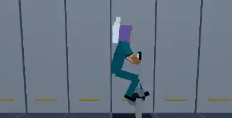 | ✓ bien |
| Starship: Intervalos 8 × 30 s en la bicicleta (Intervalos 8 × 30 s en la bicicleta) | 350 W | entrenar · objetivo | 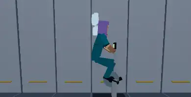 | ✓ bien |
| Starship: Intervalos 8 × 30 s en la bicicleta (Intervalos 8 × 30 s en la bicicleta) | En la ISS se pedalea con zapatillas enganchadas y correas; en el anillo basta el sillín | entrenar · objetivo | 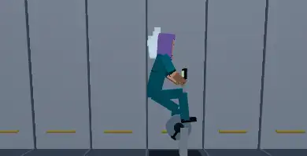 | ✓ bien |
| Starship: 30 min continuos en la bicicleta (30 min continuos en la bicicleta) | 90 min | entrenar · objetivo | 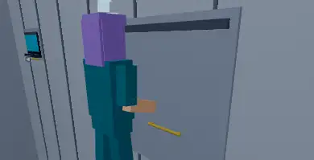 | ✓ bien |
| Starship: 30 min continuos en la bicicleta (30 min continuos en la bicicleta) | 350 W | entrenar · objetivo | 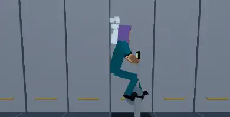 | ✓ bien |
| Starship: 30 min continuos en la bicicleta (30 min continuos en la bicicleta) | En la ISS se pedalea con zapatillas enganchadas y correas; en el anillo basta el sillín | entrenar · objetivo | 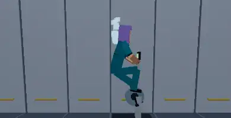 | ✓ bien |
| Starship: Fuerza 4 × 8 (Fuerza 4 × 8) | 32 | entrenar · objetivo | 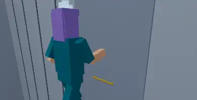 | ✓ bien |
| Starship: Fuerza 4 × 8 (Fuerza 4 × 8) | 272 kg | entrenar · objetivo | 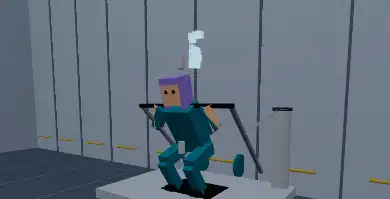 | ✓ bien |
| Starship: Fuerza 4 × 8 (Fuerza 4 × 8) | En el anillo podría ser una barra con discos; se queda la ARED porque no pesa lo que levanta | entrenar · objetivo | 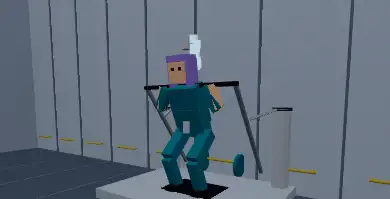 | ✓ bien |
| Starship: Dar de comer a las medakas (Dar de comer a las medakas) | 0,06 g | revisar · objetivo | 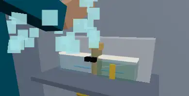 | ✓ bien |
| Starship: Dar de comer a las medakas (Dar de comer a las medakas) | toma la ración de escamas | revisar · objetivo | 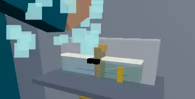 | ✓ bien |
| Starship: Dar de comer a las medakas (Dar de comer a las medakas) | esparce las escamas en la superficie | servir · objetivo | 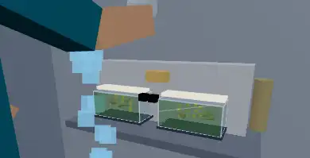 | ✓ bien |
| Starship: Dar de comer a las medakas (Dar de comer a las medakas) | mira que coman todo en dos minutos | revisar · objetivo | 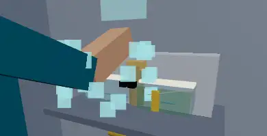 | ✓ bien |
| Starship: Dar de comer a las medakas (Dar de comer a las medakas) | limpia lo que sobre | lavar · objetivo |  | ✗ food0 no se ve (tapado por BoxGeometry); food0 dentro de otra pieza (gear-aqh); food1 dentro de otra pieza (gear-aqh) |
| Starship: Limpiar el cristal del acuario (Limpiar el cristal del acuario) | 0,4 | revisar · objetivo |  | ✓ bien |
| Starship: Limpiar el cristal del acuario (Limpiar el cristal del acuario) | revisa las algas del cristal | revisar · objetivo |  | ✓ bien |
| Starship: Limpiar el cristal del acuario (Limpiar el cristal del acuario) | limpia el cristal con el imán | lavar · objetivo |  | ✗ food1 no se ve (tapado por BoxGeometry); food1 dentro de otra pieza (gear-aqh) |
| Starship: Limpiar el cristal del acuario (Limpiar el cristal del acuario) | deja los caracoles en su sitio | reposar · objetivo |  | ✓ bien |
| Starship: Limpiar el cristal del acuario (Limpiar el cristal del acuario) | comprueba que el agua sigue clara | revisar · objetivo |  | ✓ bien |
| Starship: cambiar los lechos del CDRA (Reparar CDRA: lechos de zeolita degradados) | para el CDRA y su soplante | reparar · objetivo |  | ✓ bien |
| Starship: cambiar los lechos del CDRA (Reparar CDRA: lechos de zeolita degradados) | desmonta el lecho tapado | reparar · objetivo |  | ✓ bien |
| Starship: cambiar los lechos del CDRA (Reparar CDRA: lechos de zeolita degradados) | limpia las rejillas de polvo | reparar · objetivo |  | ✓ bien |
| Starship: cambiar los lechos del CDRA (Reparar CDRA: lechos de zeolita degradados) | monta el lecho de repuesto | reparar · objetivo |  | ✓ bien |
| Starship: cambiar los lechos del CDRA (Reparar CDRA: lechos de zeolita degradados) | comprueba la presión diferencial | reparar · objetivo |  | ✓ bien |
| Starship: cambiar los lechos del CDRA (Reparar CDRA: lechos de zeolita degradados) | 90 min | revisar · objetivo |  | ✓ bien |
| Estación: Cocinar Avena rehidratada con crema de cacahuete | saca el envase de avena del cajón de su día | tomar · objetivo |  | ✓ bien |
| Estación: Cocinar Avena rehidratada con crema de cacahuete | conecta la aguja del dispensador al tapón del envase | verter · objetivo |  | ✓ bien |
| Estación: Cocinar Avena rehidratada con crema de cacahuete | caliente | verter · objetivo |  | ✓ bien |
| Estación: Cocinar Avena rehidratada con crema de cacahuete | amasa el envase para que el agua llegue a todo | amasar · objetivo |  | ✓ bien |
| Estación: Cocinar Avena rehidratada con crema de cacahuete | espera a que se rehidrate | reposar · objetivo |  | ✓ bien |
| Estación: Cocinar Avena rehidratada con crema de cacahuete | corta la boca del envase con las tijeras | cortar · objetivo |  | ✓ bien |
| Estación: Cocinar Avena rehidratada con crema de cacahuete | come con la cuchara: la avena húmeda se queda pegada a ella | emplatar · objetivo |  | ✓ bien |
| Estación: yoga en la esterilla (Upa-yoga de cuello y hombros) | Flexión · exhala | postura · objetivo |  | ✓ bien |
| Estación: yoga en la esterilla (Upa-yoga de cuello y hombros) | Extensión · inhala | postura · objetivo |  | ✓ bien |
| Estación: yoga en la esterilla (Upa-yoga de cuello y hombros) | Rotación · inhala | postura · objetivo |  | ✓ bien |
| Estación: yoga en la esterilla (Upa-yoga de cuello y hombros) | Inclinación lateral · exhala | postura · objetivo |  | ✓ bien |
| Estación: yoga en la esterilla (Upa-yoga de cuello y hombros) | Círculo completo · inhala | postura · objetivo |  | ✓ bien |
| Estación: yoga en la esterilla (Upa-yoga de cuello y hombros) | Hombros hacia delante · exhala | postura · objetivo |  | ✓ bien |
| Estación: ejercicio en la T2 (Intervalos 4 × 4 min en la cinta) | 169 lpm | entrenar · objetivo |  | ✓ bien |
| Estación: ejercicio en la T2 (Intervalos 4 × 4 min en la cinta) | 16 min | entrenar · objetivo |  | ✓ bien |
| Estación: ejercicio en la T2 (Intervalos 4 × 4 min en la cinta) | 19,3 km/h | entrenar · objetivo |  | ✓ bien |
| Estación: ejercicio en la T2 (Intervalos 4 × 4 min en la cinta) | En la ISS un arnés de hombros y cintura con gomas sujeta a la corredora; en el anillo la sujeta su peso | entrenar · objetivo |  | ✓ bien |
| Estación: ejercicio en el ARED (Fuerza 4 × 8) | 32 | entrenar · objetivo |  | ✓ bien |
| Estación: ejercicio en el ARED (Fuerza 4 × 8) | 272 kg | entrenar · objetivo |  | ✓ bien |
| Estación: ejercicio en el ARED (Fuerza 4 × 8) | En el anillo podría ser una barra con discos; se queda la ARED porque no pesa lo que levanta | entrenar · objetivo |  | ✓ bien |
| Estación: ejercicio en la CEVIS (Intervalos 8 × 30 s en la bicicleta) | 169 lpm | entrenar · objetivo |  | ✓ bien |
| Estación: ejercicio en la CEVIS (Intervalos 8 × 30 s en la bicicleta) | 4 min | entrenar · objetivo |  | ✓ bien |
| Estación: ejercicio en la CEVIS (Intervalos 8 × 30 s en la bicicleta) | 350 W | entrenar · objetivo |  | ✓ bien |
| Estación: ejercicio en la CEVIS (Intervalos 8 × 30 s en la bicicleta) | En la ISS se pedalea con zapatillas enganchadas y correas; en el anillo basta el sillín | entrenar · objetivo |  | ✓ bien |
| Estación: cambiar los lechos del CDRA (bastidor de aire) (Reparar CDRA: lechos de zeolita degradados) | para el CDRA y su soplante | reparar · objetivo |  | ✓ bien |
| Estación: cambiar los lechos del CDRA (bastidor de aire) (Reparar CDRA: lechos de zeolita degradados) | desmonta el lecho tapado | reparar · objetivo |  | ✓ bien |
| Estación: cambiar los lechos del CDRA (bastidor de aire) (Reparar CDRA: lechos de zeolita degradados) | limpia las rejillas de polvo | reparar · objetivo |  | ✓ bien |
| Estación: cambiar los lechos del CDRA (bastidor de aire) (Reparar CDRA: lechos de zeolita degradados) | monta el lecho de repuesto | reparar · objetivo |  | ✓ bien |
| Estación: cambiar los lechos del CDRA (bastidor de aire) (Reparar CDRA: lechos de zeolita degradados) | comprueba la presión diferencial | reparar · objetivo |  | ✓ bien |
| Estación: cambiar los lechos del CDRA (bastidor de aire) (Reparar CDRA: lechos de zeolita degradados) | 90 min | revisar · objetivo |  | ✓ bien |
| Estación: dormir en tu camarote | comprueba que el ventilador del camarote sopla | revisar · objetivo |  | ✓ bien |
| Estación: dormir en tu camarote | 06:00 GMT | programar · objetivo |  | ✓ bien |
| Estación: dormir en tu camarote | métete en el saco de dormir sujeto a la pared | saco · objetivo |  | ✓ bien |
| Estación: dormir en tu camarote | sube la cremallera del saco hasta el pecho | saco · objetivo |  | ✓ bien |
| Estación: dormir en tu camarote | apaga la luz del camarote | luz · objetivo |  | ✓ bien |
| Estación: dormir en tu camarote | cierra los ojos y duerme | dormir · objetivo |  | ✓ bien |
| Estación: refinar (Extracción térmica del agua) | 18 kg | programar · objetivo |  | ✓ bien |
| Estación: refinar (Extracción térmica del agua) | tritura la roca | moler · objetivo |  | ✓ bien |
| Estación: refinar (Extracción térmica del agua) | cierra el horno | reparar · objetivo |  | ✓ bien |
| Estación: refinar (Extracción térmica del agua) | calienta la roca en vacío | calentar · objetivo |  | ✓ bien |
| Estación: refinar (Extracción térmica del agua) | condensa el vapor en la trampa fría | programar · objetivo |  | ✓ bien |
| Estación: refinar (Extracción térmica del agua) | guarda el agua en el tanque | emplatar · objetivo |  | ✓ bien |
| Estación: fabricar (Pieza pequeña de metal impresa (soporte o herramienta)) | 0,13 kg | reparar · objetivo |  | ✓ bien |
| Estación: fabricar (Pieza pequeña de metal impresa (soporte o herramienta)) | 2029,87 kg | reparar · objetivo |  | ✓ bien |
| Estación: fabricar (Pieza pequeña de metal impresa (soporte o herramienta)) | carga el polvo de hierro | reparar · objetivo |  | ✓ bien |
| Estación: fabricar (Pieza pequeña de metal impresa (soporte o herramienta)) | imprime la pieza capa a capa | reparar · objetivo |  | ✓ bien |
| Estación: fabricar (Pieza pequeña de metal impresa (soporte o herramienta)) | quita los soportes | cortar · objetivo |  | ✓ bien |
| Estación: fabricar (Pieza pequeña de metal impresa (soporte o herramienta)) | comprueba las medidas | revisar · objetivo |  | ✓ bien |
| Estación: importar (pedido de xenón) | 162,39 kg | programar · objetivo |  | ✓ bien |
| Estación: importar (pedido de xenón) | 229 créditos | programar · objetivo |  | ✓ bien |
| Estación: importar (pedido de xenón) | el Santuario carga el pedido en el Falcon Heavy | programar · objetivo |  | ✓ bien |
| Estación: importar (pedido de xenón) | el cohete lo sube a la órbita baja | programar · objetivo |  | ✓ bien |
| Estación: importar (pedido de xenón) | la etapa de salida enciende 4,3 km/s | programar · objetivo |  | ✓ bien |
| Estación: importar (pedido de xenón) | la etapa vacía se suelta | programar · objetivo |  | ✓ bien |
| Estación: importar (pedido de xenón) | la carga cruza 372 días por la elipse de Hohmann | programar · objetivo |  | ✓ bien |
| Estación: importar (pedido de xenón) | la etapa de llegada enciende 4,2 km/s | programar · objetivo |  | ✓ bien |
| Estación: importar (pedido de xenón) | el brazo de la estación atrapa la carga | programar · objetivo |  | ✓ bien |
