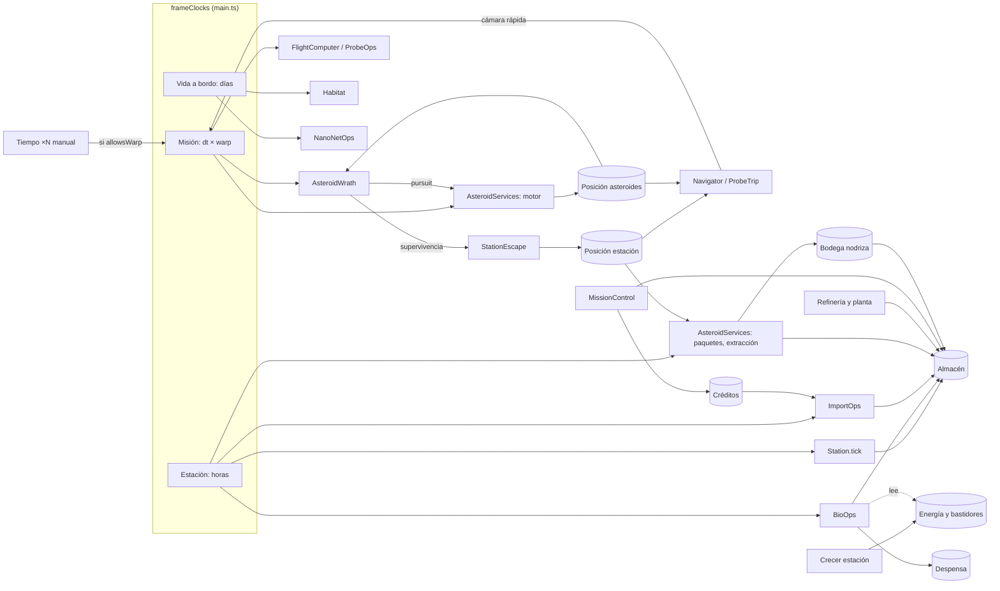

# Entrelazamiento: estado compartido y quién lo escribe

Qué estado del juego tocan a la vez dos o más procesos. De aquí salen los casos de convivencia
(área **CV** de [casos.md](casos.md)): cada fila con más de un escritor es un sitio donde un proceso
puede pisar a otro mientras el jugador hace otra cosa. Los nombres son los del código; el cableado
vive en `src/main.ts` y en los ficheros de pegamento de `src/*.ts` (`wrath-mode.ts`,
`subjugation-levels.ts`, `subjugation.ts`, `probe-travel.ts`).

Al añadir un proceso que escribe en algo de esta tabla, se añade su fila (o su escritor) y, como
mínimo, un caso CV con el proceso que ya estaba.

## Relojes

El bucle principal mueve tres relojes por fotograma. Desde la rama `qa-casos` los calcula una sola
función pura, `frameClocks` (`src/modules/navigation/domain/travel-time.ts`), que `main.ts` llama una
vez por fotograma y prueban los casos CV-01, CV-02 y CV-08.

| Reloj | Cuánto avanza por fotograma | Quién lo lee |
|---|---|---|
| **Misión** (s de juego) | `dt × warp`. `warp` = 1 si la ira amenaza a la nave que viaja (`AsteroidWrath.threatened`: el viaje queda retenido, `held`, HC-03); si no, la cámara rápida del viaje (`Navigator.lapse` o `ProbeTrip.lapse`) si hay viaje; si no, el ×10/×50 manual (tecla X) cuando `WrathMode.allowsWarp` y la expedición lo permiten, por el `warpFactor` de la nano_net | `Expedition.update` (vuelo a 120 Hz), `AsteroidWrath.update` (ira, proyectiles), `AsteroidServices` (motor gravitatorio, persecución, vuelo de paquetes), `ProbeOps.update` (batería), `NanoNetOps.powerShip` |
| **Vida a bordo** (días) | En viaje: `max(dt / 40, misión / 86 400)`: un día cada 40 s reales, o el viaje si comprime más que ×2160. Fuera de viaje: `dt × warp / 40` (corre con el ×N manual, HC-01) | `Habitat.tick` (tripulación, huerto, animales, gallinas, carne cultivada, buzón), `NanoNetOps.tick` (averías) |
| **Estación** (horas) | Siempre `24 × días de a bordo` (fuera de viaje, `dt × warp × 0,6`, lo mismo) | `Station.tick` (máquinas), `BioOps.tick`, `ImportOps.tick` (buzón y lanzadores), `AsteroidServices` (paquetes de nivel 2 y 3, confianza, extracción de nivel 4; antes del arreglo de B-01 usaban el de misión) |

Topes de tiempo por llamada que hay que conocer al cruzar relojes:

| Dónde | Tope | Efecto |
|---|---|---|
| `main.ts`, `dt` del fotograma | 0,1 s reales | Por debajo de 10 fps el juego entero va más lento que el reloj de pared |
| `AsteroidWrath.update` | 600 pasos por llamada | Hasta 60 s de juego en pasos de 0,1 s; una llamada más larga se reparte en 600 subpasos más gruesos (arreglo de B-02) |
| `AsteroidServices.update` | 120 s de juego | Igual, a partir de ×1200 |
| `TRAVEL_TIME.maxPhysicsLapse` | ×60 | Los tramos con física (módulo, sonda) no comprimen más |

## Mapa de estado compartido

| Estado | Escriben | Leen | Reloj de los escritores | Casos |
|---|---|---|---|---|
| Almacén de la estación (`MaterialStock`, con capacidad por módulos y reservas con prioridad: HC-02, HC-04) | Refinería y planta (`Station.refine`, toman al poner en cola), fabricación (`fabricate`), repostaje (`transfer`, devuelve si la nave se fue), entregas de máquinas (`Station.tick`), biorreactores (`BioOps.tick`: toman y dan cada tick, abono con amoníaco, hielo de CO₂), despensa (`shipToLarder`), buzón de importación (`ImportOps.tick`), remolcador (xenón), bodega de la nodriza al atracar (`LevelsUi`), bodega del módulo (botón «Descargar»), recompensas de misiones (`MissionControl`, kits) | Planos, retos (lo que queda en el almacén), indicador de autosustento. Lo nuevo entra solo si cabe (`fits`): extracción de nivel 4, buzón, lotes de la refinería, bodegas; lo que vuelve (`add`) entra siempre. El abono con amoníaco solo toma lo que pasa de la reserva de propelente (`availableTo`) | Estación (máquinas, bio, buzón); al instante (retos resueltos, botones) | CV-05, CV-09, CV-10, CV-15 |
| Bodega de la nodriza (`CargoHold`, 20 t) | Paquetes de nivel 2 (`AsteroidServices`) | `LevelsUi` la vacía en el almacén al atracar | Misión (vuelo del paquete) y estación (cuándo sale) | CV-03 |
| Bodega del módulo (`Expedition.cargo`) | Fases 2 y 3 de la subyugación | Pantalla de la estación (descargar) | Al instante | — |
| Despensa de la nodriza (`Habitat`) | Carga de salida, huevos, cosecha, cocina (recetas), `BioOps.shipToLarder` | Cocina, animales | Vida a bordo; al instante | — (VID) |
| Posición de los asteroides | `AsteroidServices` (persecución, viaje de nivel 4, vuelta a casa) | Ira (origen de proyectiles, alcance), mapa, navegación (destinos), importación (distancias), nano_net (el núcleo se queda en su sitio: pregunta abierta de subyugacion.md) | Misión | CV-06, CV-12, CV-13 |
| Blancos de la ira (`WrathTarget.active`) | Acople (`docking.docked`), sonda fuera (`ProbeOps.out`), traje fuera (`Eva.outside`) | `AsteroidWrath` (a quién dispara y a quién persigue) | Al instante | CV-06, CV-12, CV-13, CV-14 |
| Posición de la estación | `StationEscape` en modo supervivencia (`WrathMode.moveStation`), que también mueve la nodriza atracada | Aparcamiento de nivel 4, destino «Estación» del mapa, zona de exclusión, distancias del buzón | Misión | CV-09 |
| Créditos (`Wallet`) | `MissionControl` (paga misiones), `ImportOps` (cobra al resolver la cadena del pedido) | Pestaña Importar | Al instante | CV-15 |
| Energía de la estación (`StationOutfit.drawKw`) | `fabricate` (reserva lo que está en obra), `completeEquipment`, `fitComponent` (alas, radiadores) | Bloqueos de planos, retos de crecer y de ajustar biorreactores | Al instante | CV-11 |
| Bastidores y puertos (`StationOutfit`, puertos IDSS) | Reservas al poner en cola; `Docking` y viajes con atraque | Planos, navegación | Al instante | CV-11 (bastidores) |
| «Un viaje comprimido a la vez» | `Navigator` (nodriza, módulo) y `ProbeTrip` (sonda) | `navBusy` y `ProbeTravel.busy` en `main.ts` | Misión | CV-14 |
| Estado de la sonda (`ProbeOps`) | Lanzamiento, aparcamiento, pérdida (escombros, pulso, batería), reposición | Viaje de la sonda, fase 1, ira, nivel 4 (`anchoredOn`) | Misión | CV-12, CV-14 |
| Confianza y nivel (`RapportBook`) | Duelos (`Expedition`), servicio tranquilo (`AsteroidServices.serve`) | Ofertas de nivel, núcleo de la nano_net (`LevelsUi`) | Al instante; servicio en reloj de estación | CV-03 |
| Casco del módulo (`Ship.hullIntegrity`) | Ira (`damage`), sacudidas de la expedición, contacto, reparación de la nano_net (`powerShip`), bahía | HUD, bahía | Misión | — (IRA, NNT) |
| Buzón de radio (`Mailbox`) | Misiones, averías de la nano_net, pedidos, historia | Radio | Vida a bordo | — (MIS) |

## Diagrama

## Reglas para un proceso nuevo

1. Si produce algo «por día» o «por hora», recibe las horas de la estación o los días de a bordo de
   `frameClocks`, nunca `dt × warp` (lección de B-01).
2. Si mueve algo en el espacio, usa el reloj de misión, y su `update` debe aguantar los topes de arriba.
3. Si toma del almacén, decide si toma al poner en cola (refinería) o por tick (biología), y lo escribe
   aquí; si otro proceso más importante usa lo mismo, toma con `availableTo(id, prioridad)` por encima de sus
   reservas (`STOCK_PRIORITY`, HC-04). Si trae algo nuevo, mira `fits` y lo guarda en su origen si no cabe (HC-02).
4. Si su `active()` depende de otro proceso (acople, sonda fuera, traje fuera), hay un caso CV con ese
   proceso cambiando a mitad.
